# Diagrams

Rendered from the Mermaid blocks in the project specifications. Each diagram is available as editable source (`.mmd`), vector (`.svg`) and high-resolution raster (`.png`, 2× scale).

## v1 — Refined Software Requirements Specification ([v1.md](../v1.md))

| # | Diagram | Source section | Files |
|---|---|---|---|
| 1 | High-level architecture | §1 Product scope and architecture | [mmd](diagrams/v1/01-high-level-architecture.mmd) · [svg](diagrams/v1/01-high-level-architecture.svg) · [png](diagrams/v1/01-high-level-architecture.png) |
| 2 | Core relationships (ERD) | §4.5 Core relationships | [mmd](diagrams/v1/02-core-relationships-erd.mmd) · [svg](diagrams/v1/02-core-relationships-erd.svg) · [png](diagrams/v1/02-core-relationships-erd.png) |
| 3 | Payment states | §4.6 Important state models | [mmd](diagrams/v1/03-payment-states.mmd) · [svg](diagrams/v1/03-payment-states.svg) · [png](diagrams/v1/03-payment-states.png) |
| 4 | Order states | §4.6 Important state models | [mmd](diagrams/v1/04-order-states.mmd) · [svg](diagrams/v1/04-order-states.svg) · [png](diagrams/v1/04-order-states.png) |
| 5 | Ticket states | §4.6 Important state models | [mmd](diagrams/v1/05-ticket-states.mmd) · [svg](diagrams/v1/05-ticket-states.svg) · [png](diagrams/v1/05-ticket-states.png) |
| 6 | Payment-to-ticket issuance sequence | §6 Payment-to-ticket issuance workflow | [mmd](diagrams/v1/06-payment-to-ticket-sequence.mmd) · [svg](diagrams/v1/06-payment-to-ticket-sequence.svg) · [png](diagrams/v1/06-payment-to-ticket-sequence.png) |
| 7 | Event states | §4.6 Important state models | [mmd](diagrams/v1/07-event-states.mmd) · [svg](diagrams/v1/07-event-states.svg) · [png](diagrams/v1/07-event-states.png) |

### 1. High-level architecture


### 2. Core relationships (ERD)


### 3–5 and 7. State models


| Payment | Order | Ticket |
|---|---|---|
|  |  |  |

### 6. Payment-to-ticket issuance sequence

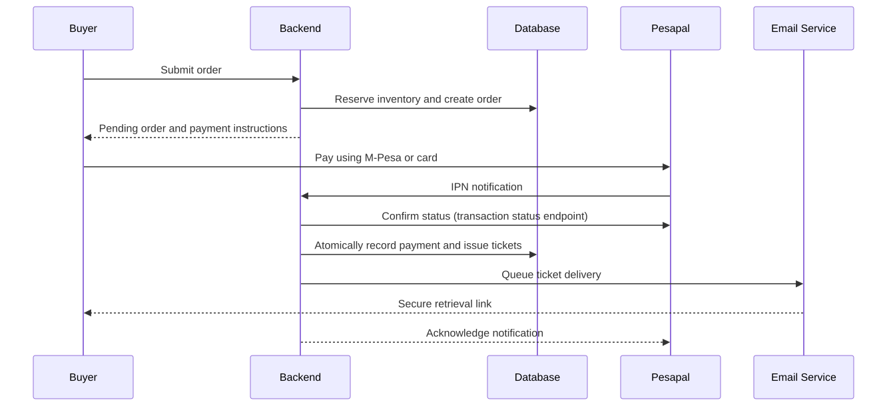

## v2 — Requirements Review ([v2.md](../v2.md))

| # | Diagram | Source section | Files |
|---|---|---|---|
| 1 | Ticket purchasing flow | §2 Recommended ticket purchasing flow | [mmd](diagrams/v2/01-ticket-purchasing-flow.mmd) · [svg](diagrams/v2/01-ticket-purchasing-flow.svg) · [png](diagrams/v2/01-ticket-purchasing-flow.png) |
| 2 | Guard account delegation | §6 Roles and permissions | [mmd](diagrams/v2/02-guard-delegation-flow.mmd) · [svg](diagrams/v2/02-guard-delegation-flow.svg) · [png](diagrams/v2/02-guard-delegation-flow.png) |
| 3 | Database structure (ERD) | §10 Recommended database structure | [mmd](diagrams/v2/03-database-structure-erd.mmd) · [svg](diagrams/v2/03-database-structure-erd.svg) · [png](diagrams/v2/03-database-structure-erd.png) |

### 1. Ticket purchasing flow


### 2. Guard account delegation


### 3. Database structure (ERD)


## Tech Stack — Architecture Blueprint ([techstack.md](../techstack.md))

| # | Diagram | Source section | Files |
|---|---|---|---|
| 1 | System architecture | §2 System architecture | [mmd](diagrams/techstack/01-system-architecture.mmd) · [svg](diagrams/techstack/01-system-architecture.svg) · [png](diagrams/techstack/01-system-architecture.png) |
| 2 | Ticket purchase flow | §5A Ticket purchase | [mmd](diagrams/techstack/02-ticket-purchase-flow.mmd) · [svg](diagrams/techstack/02-ticket-purchase-flow.svg) · [png](diagrams/techstack/02-ticket-purchase-flow.png) |
| 3 | Gate QR scanning flow | §5B QR scanning at the gate | [mmd](diagrams/techstack/03-gate-qr-scanning-flow.mmd) · [svg](diagrams/techstack/03-gate-qr-scanning-flow.svg) · [png](diagrams/techstack/03-gate-qr-scanning-flow.png) |
| 4 | Google sign-in flow | §3 Authentication and role design | [mmd](diagrams/techstack/04-google-sign-in.mmd) · [svg](diagrams/techstack/04-google-sign-in.svg) · [png](diagrams/techstack/04-google-sign-in.png) |

### 1. System architecture


### 2. Ticket purchase flow


### 3. Gate QR scanning flow


### 4. Google sign-in flow

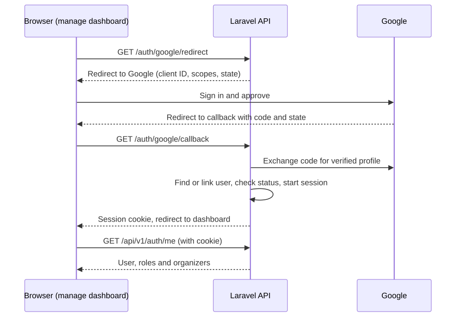

## Implementation Plan ([implementation-plan.md](../implementation-plan.md))

| # | Diagram | Source section | Files |
|---|---|---|---|
| 1 | Delivery timeline (12 weeks) | §1.3 Timeline | [mmd](diagrams/implementation-plan/01-delivery-timeline.mmd) · [svg](diagrams/implementation-plan/01-delivery-timeline.svg) · [png](diagrams/implementation-plan/01-delivery-timeline.png) |

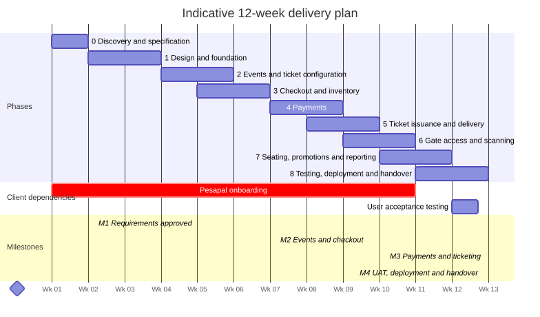

## SOW ([sow.md](../sow.md))

The Statement of Work contains no Mermaid diagrams.

## Regenerating

Edit the `.mmd` file, then re-render with [mermaid-cli](https://github.com/mermaid-js/mermaid-cli):

```sh
npx -p @mermaid-js/mermaid-cli mmdc -i diagrams/v1/01-high-level-architecture.mmd -o diagrams/v1/01-high-level-architecture.svg -b white
npx -p @mermaid-js/mermaid-cli mmdc -i diagrams/v1/01-high-level-architecture.mmd -o diagrams/v1/01-high-level-architecture.png -b white -s 2
```

The `.mmd` files are copies of the blocks in `v1.md`, `v2.md`, `techstack.md` and `implementation-plan.md`. If you change a diagram in one place, update the other too.
