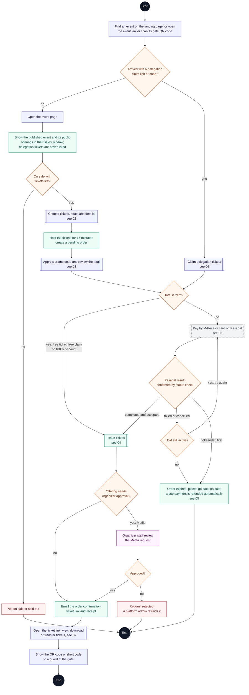

# Buyer journey: overview

**Type:** Activity diagram (Mermaid flowchart)  
**Based on:** [v1.md FR-06 to FR-09](../../../v1.md#fr-06--purchasing-and-orders), [limitation.md §5–§8](../../../limitation.md#5-buying-tickets), [doc/state-machines.md](../../state-machines.md)  
**Files:** [SVG](01-buyer-journey-overview.svg) · [PNG](01-buyer-journey-overview.png) · [Mermaid source](01-buyer-journey-overview.mmd)

How a buyer gets a ticket, from finding the event to showing the ticket at the gate. Buyers find events on the landing page, which lists every on-sale event and its public tickets, or through the event's own link or gate QR code. Each double-edged box is drawn in detail in its own diagram.

## How to read it

Mermaid has no activity diagram type, so this is drawn as a flowchart that follows UML activity conventions.

| Element | Meaning |
|---|---|
| Black circle or pill | Start or end; a label says where the flow continues |
| Diamond with text | Decision |
| Small empty diamond | Merge: alternative paths join again |
| Black bar | Fork or join: the paths between two bars run in parallel |
| Double-edged box | A sub-activity drawn in its own diagram |
| Blue box | Buyer action |
| Green box | Platform action (website or API) |
| Grey dashed box | Pesapal or the email service |
| Purple box | Organizer staff or platform admin action |
| Red box | The journey stops here |

## The buyer journey

1. [Buyer journey overview](01-buyer-journey-overview.md)
2. [Choose tickets and place a hold](02-choose-tickets-and-hold.md)
3. [Promo code, review and payment](03-promo-review-and-payment.md)
4. [Payment confirmation and ticket issuance](04-payment-confirmation-and-issuance.md)
5. [Hold expiry and late payment](05-hold-expiry-and-late-payment.md)
6. [Delegation claim](06-delegation-claim.md)
7. [Ticket retrieval and transfer](07-ticket-retrieval-and-transfer.md)
