# Buyer journey: choose tickets and place a hold

**Type:** Activity diagram (Mermaid flowchart)  
**Based on:** [v1.md FR-06, FR-07](../../../v1.md#fr-06--purchasing-and-orders), [limitation.md §5](../../../limitation.md#5-buying-tickets), [state-machines.md §2, §5, §6](../../state-machines.md#2-order)  
**Files:** [SVG](02-choose-tickets-and-hold.svg) · [PNG](02-choose-tickets-and-hold.png) · [Mermaid source](02-choose-tickets-and-hold.mmd)

The buyer chooses tickets, seats and details, and the platform holds the tickets for 15 minutes.

```mermaid
%%{init: {"flowchart": {"wrappingWidth": 320}}}%%
flowchart TD
    classDef startNode fill:#111827,stroke:#111827,color:#ffffff
    classDef endNode fill:#111827,stroke:#111827,color:#ffffff
    classDef buyer fill:#eef2ff,stroke:#4f46e5,color:#1e1b4b
    classDef system fill:#ecfdf5,stroke:#059669,color:#064e3b
    classDef decision fill:#fff7ed,stroke:#ea580c,color:#7c2d12

    start(("Start")):::startNode
    a1["Press Buy on a ticket option on the landing page,<br/>or open the event page from its link or gate QR code"]:::buyer
    s1["Show the public ticket options: each category's<br/>current wave, upcoming waves greyed out,<br/>sold-out options marked; delegation tickets<br/>are never listed"]:::system
    a2["Choose offerings and quantities"]:::buyer
    d1{"Within min and max<br/>per order and group size?"}:::decision
    d2{"Reserved seating?"}:::decision
    a3["Pick available seats"]:::buyer
    m1{" "}:::decision
    a4["Enter purchaser name and email"]:::buyer
    d3{"Collection mode?"}:::decision
    a5["Enter each ticket holder's name"]:::buyer
    m2{" "}:::decision
    d4{"Identity field<br/>set by the event?"}:::decision
    a6["Enter each holder's phone number"]:::buyer
    a7["Enter each holder's ID number;<br/>only the last 4 digits are kept"]:::buyer
    m3{" "}:::decision
    d5{"Organizer questions?"}:::decision
    a8["Answer pick-list, checkbox<br/>and date questions"]:::buyer
    m4{" "}:::decision
    d6{"CAPTCHA required?"}:::decision
    a9["Complete the CAPTCHA"]:::buyer
    m5{" "}:::decision
    a10["Submit the order"]:::buyer
    s2["Validate: event published, organizer active,<br/>offering on sale, quantity rules, details match<br/>the event with no extra fields, CAPTCHA passed"]:::system
    d7{"Valid?"}:::decision
    s3["In one transaction, hold offering capacity<br/>and seats with atomic conditional updates"]:::system
    d8{"Enough tickets and<br/>seats still free?"}:::decision
    s4["Create the pending order and reservations,<br/>expiring in 15 minutes; issue the checkout token"]:::system
    a11["See the order review<br/>with a countdown"]:::buyer
    done(["End: continue<br/>to payment, see 03"]):::endNode

    start --> a1 --> s1 --> a2 --> d1
    d1 -->|"no: show the limits"| a2
    d1 -->|"yes"| d2
    d2 -->|"yes"| a3 --> m1
    d2 -->|"no"| m1
    m1 --> a4 --> d3
    d3 -->|"purchaser only"| m2
    d3 -->|"per ticket, always when the<br/>event has an identity field"| a5 --> m2
    m2 --> d4
    d4 -->|"none"| m3
    d4 -->|"phone"| a6 --> m3
    d4 -->|"ID number"| a7 --> m3
    m3 --> d5
    d5 -->|"yes"| a8 --> m4
    d5 -->|"no"| m4
    m4 --> d6
    d6 -->|"yes"| a9 --> m5
    d6 -->|"no"| m5
    m5 --> a10 --> s2 --> d7
    d7 -->|"no: show what to fix"| a2
    d7 -->|"yes"| s3 --> d8
    d8 -->|"no: sold out or seat taken"| a2
    d8 -->|"yes"| s4 --> a11 --> done
```

## How to read it

Mermaid has no activity diagram type, so this is drawn as a flowchart that follows UML activity conventions.

| Element | Meaning |
|---|---|
| Black circle or pill | Start or end; a label says where the flow continues |
| Diamond with text | Decision |
| Small empty diamond | Merge: alternative paths join again |
| Black bar | Fork or join: the paths between two bars run in parallel |
| Double-edged box | A sub-activity drawn in its own diagram |
| Blue box | Buyer action |
| Green box | Platform action (website or API) |
| Grey dashed box | Pesapal or the email service |
| Purple box | Organizer staff or platform admin action |
| Red box | The journey stops here |

## Notes

- A category sold in waves offers only its current wave's ticket options; its upcoming waves are shown greyed out with their dates and prices ([v1.md FR-04](../../../v1.md#fr-04--ticket-types-and-categories)).
- Seats are chosen on the page but held only when the order is created, in the same transaction as the offering hold.
- When the event has an identity field (phone or ID number), details are collected for every ticket. Only the last 4 digits of an ID number are kept.
- The backend refuses any submission that contains a field the event didn't ask for.
- Holds use atomic conditional updates: a hold succeeds only if `capacity - sold_count - reserved_count` covers the quantity.

## Activity diagrams

1. [Buyer journey overview](01-buyer-journey-overview.md)
2. [Choose tickets and place a hold](02-choose-tickets-and-hold.md)
3. [Promo code, review and payment](03-promo-review-and-payment.md)
4. [Payment confirmation and ticket issuance](04-payment-confirmation-and-issuance.md)
5. [Hold expiry and late payment](05-hold-expiry-and-late-payment.md)
6. [Delegation claim](06-delegation-claim.md)
7. [Ticket retrieval and transfer](07-ticket-retrieval-and-transfer.md)
8. [Organizer: set up ticket waves](08-set-up-ticket-waves.md)
