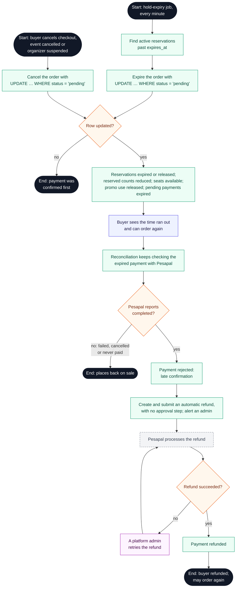

# Buyer journey: hold expiry and late payment

**Type:** Activity diagram (Mermaid flowchart)  
**Based on:** [state-machines.md §2, §3, §6](../../state-machines.md#6-inventory-reservation), [limitation.md 5.4, 7.7](../../../limitation.md#7-payments)  
**Files:** [SVG](05-hold-expiry-and-late-payment.svg) · [PNG](05-hold-expiry-and-late-payment.png) · [Mermaid source](05-hold-expiry-and-late-payment.mmd)

What happens when a hold runs out or the order is cancelled before payment, and when Pesapal confirms a payment after that.

## How to read it

Mermaid has no activity diagram type, so this is drawn as a flowchart that follows UML activity conventions.

| Element | Meaning |
|---|---|
| Black circle or pill | Start or end; a label says where the flow continues |
| Diamond with text | Decision |
| Small empty diamond | Merge: alternative paths join again |
| Black bar | Fork or join: the paths between two bars run in parallel |
| Double-edged box | A sub-activity drawn in its own diagram |
| Blue box | Buyer action |
| Green box | Platform action (website or API) |
| Grey dashed box | Pesapal or the email service |
| Purple box | Organizer staff or platform admin action |
| Red box | The journey stops here |

## Notes

- A late payment never creates a new hold. It is refunded automatically, and the buyer can order again.
- The expiry job is safe to run twice: its conditional update changes a row only once.

## Activity diagrams

1. [Buyer journey overview](01-buyer-journey-overview.md)
2. [Choose tickets and place a hold](02-choose-tickets-and-hold.md)
3. [Promo code, review and payment](03-promo-review-and-payment.md)
4. [Payment confirmation and ticket issuance](04-payment-confirmation-and-issuance.md)
5. [Hold expiry and late payment](05-hold-expiry-and-late-payment.md)
6. [Delegation claim](06-delegation-claim.md)
7. [Ticket retrieval and transfer](07-ticket-retrieval-and-transfer.md)
8. [Organizer: set up ticket waves](08-set-up-ticket-waves.md)
