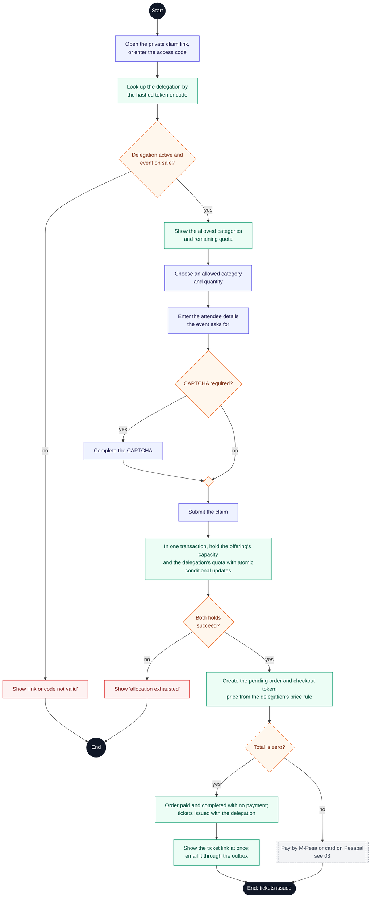

# Buyer journey: delegation claim

**Type:** Activity diagram (Mermaid flowchart)  
**Based on:** [doc/sponsored.md](../../sponsored.md), [v1.md FR-05](../../../v1.md#fr-05--delegations-and-inventory), [hurdles.md H3](../../../hurdles.md#h3-no-path-for-free-tickets-or-delegation-claims--decided)  
**Files:** [SVG](06-delegation-claim.svg) · [PNG](06-delegation-claim.png) · [Mermaid source](06-delegation-claim.mmd)

A sponsor's guest claims tickets through the delegation's private link or access code.

## How to read it

Mermaid has no activity diagram type, so this is drawn as a flowchart that follows UML activity conventions.

| Element | Meaning |
|---|---|
| Black circle or pill | Start or end; a label says where the flow continues |
| Diamond with text | Decision |
| Small empty diamond | Merge: alternative paths join again |
| Black bar | Fork or join: the paths between two bars run in parallel |
| Double-edged box | A sub-activity drawn in its own diagram |
| Blue box | Buyer action |
| Green box | Platform action (website or API) |
| Grey dashed box | Pesapal or the email service |
| Purple box | Organizer staff or platform admin action |
| Red box | The journey stops here |

## Notes

- A delegation ticket uses its offering's capacity and the delegation's quota, both held in one transaction, so it's never counted twice.
- A free claim skips Pesapal entirely and issues tickets straight away. A claim with a price goes through the normal payment flow.

## The buyer journey

1. [Buyer journey overview](01-buyer-journey-overview.md)
2. [Choose tickets and place a hold](02-choose-tickets-and-hold.md)
3. [Promo code, review and payment](03-promo-review-and-payment.md)
4. [Payment confirmation and ticket issuance](04-payment-confirmation-and-issuance.md)
5. [Hold expiry and late payment](05-hold-expiry-and-late-payment.md)
6. [Delegation claim](06-delegation-claim.md)
7. [Ticket retrieval and transfer](07-ticket-retrieval-and-transfer.md)
