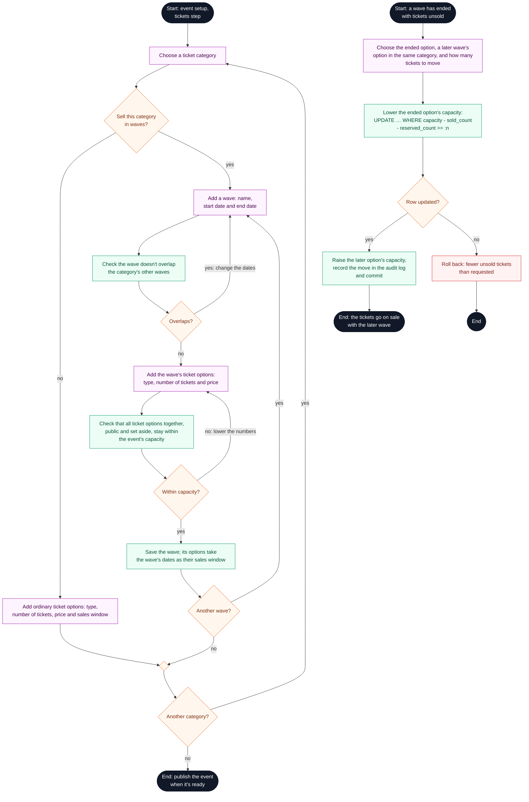

# Organizer: set up ticket waves

**Type:** Activity diagram (Mermaid flowchart)  
**Based on:** [v1.md FR-04](../../../v1.md#fr-04--ticket-types-and-categories), [limitation.md 4.12–4.14](../../../limitation.md#4-tickets-prices-and-capacity), [state-machines.md §6](../../state-machines.md#6-inventory-reservation)  
**Files:** [SVG](08-set-up-ticket-waves.svg) · [PNG](08-set-up-ticket-waves.png) · [Mermaid source](08-set-up-ticket-waves.mmd)

How organizer staff set up a category's ticket waves while building an event, and how they move a wave's unsold tickets to a later wave.

## How to read it

Mermaid has no activity diagram type, so this is drawn as a flowchart that follows UML activity conventions.

| Element | Meaning |
|---|---|
| Black circle or pill | Start or end; a label says where the flow continues |
| Diamond with text | Decision |
| Small empty diamond | Merge: alternative paths join again |
| Black bar | Fork or join: the paths between two bars run in parallel |
| Double-edged box | A sub-activity drawn in its own diagram |
| Blue box | Buyer action |
| Green box | Platform action (website or API) |
| Grey dashed box | Pesapal or the email service |
| Purple box | Organizer staff or platform admin action |
| Red box | The journey stops here |

## Notes

- Waves open on their start dates only. There is no automatic advance when a wave sells out, and no automatic rollover when it ends (decision #23).
- The move takes tickets only if the conditional update finds enough unsold ones, so it can never take tickets that are sold or held, even while buyers are checking out.
- The same move action returns a delegation's unclaimed tickets to public sale ([v1.md FR-05](../../../v1.md#fr-05--delegations-and-inventory)).
- A category's waves setting can change only while nothing in that category has been sold or held.

## Activity diagrams

1. [Buyer journey overview](01-buyer-journey-overview.md)
2. [Choose tickets and place a hold](02-choose-tickets-and-hold.md)
3. [Promo code, review and payment](03-promo-review-and-payment.md)
4. [Payment confirmation and ticket issuance](04-payment-confirmation-and-issuance.md)
5. [Hold expiry and late payment](05-hold-expiry-and-late-payment.md)
6. [Delegation claim](06-delegation-claim.md)
7. [Ticket retrieval and transfer](07-ticket-retrieval-and-transfer.md)
8. [Organizer: set up ticket waves](08-set-up-ticket-waves.md)
