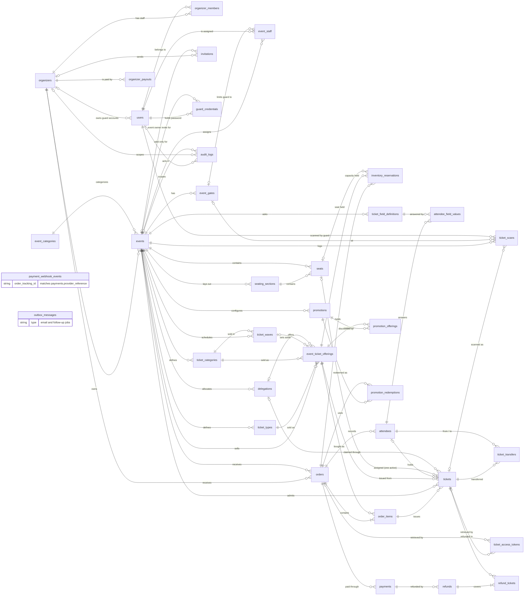

# Database ERD: overview

**Type:** Entity relationship diagram  
**Based on:** [v1.md §4.1–§4.4](../../../v1.md#4-database-design)  
**Files:** [SVG](00-overview.svg) · [PNG](00-overview.png) · [Mermaid source](00-overview.mmd)

Every table in the logical schema and the foreign keys between them. The column-level diagrams for each part of the schema are [01 identity and tenancy](01-identity-and-tenancy.md), [02 ticket configuration and inventory](02-ticket-configuration-and-inventory.md), [03 orders, attendees and tickets](03-orders-attendees-and-tickets.md) and [04 payments, promotions and operations](04-payments-promotions-and-operations.md). [v1.md §4.5](../../../v1.md#45-core-relationships) links here.

## How to read it

- Table and column names are exactly those in [v1.md §4](../../../v1.md#4-database-design). Only the columns v1.md lists are shown; timestamps and any other columns P1.3 adds are not.
- **Types are logical.** `key` is a primary or foreign key (UUID for records referenced from outside the system, chosen in P1.3). `money` is a `bigint` amount in minor units, with its currency in a separate `char(3)` column. Status columns are strings backed by the PHP enums in [state-machines.md](../../state-machines.md).
- **Keys:** `PK` primary key, `FK` foreign key, `UK` unique. Composite or scoped uniqueness, such as a seat number within its event, is in the column comment.
- **Cardinality:** `||--o{` one to zero or more; `||--|{` one to one or more; `|o--o{` optional foreign key (nullable).
- Tables from another part of the schema appear as stubs that show only `id`.

## Notes

- To stay readable, the overview leaves out the "who did it" links to `users` (`verified_by`, `invited_by`, `issued_by`, `requested_by`, `approved_by`, `recorded_by`). The domain diagrams show them.
- `payment_webhook_events` and `outbox_messages` have no foreign keys. A webhook event is matched to its payment by `order_tracking_id`, which is the payment's `provider_reference`.

P1.3 writes the migrations from v1.md §4 and updates these diagrams to match the final schema (prompts.md P1.3).
