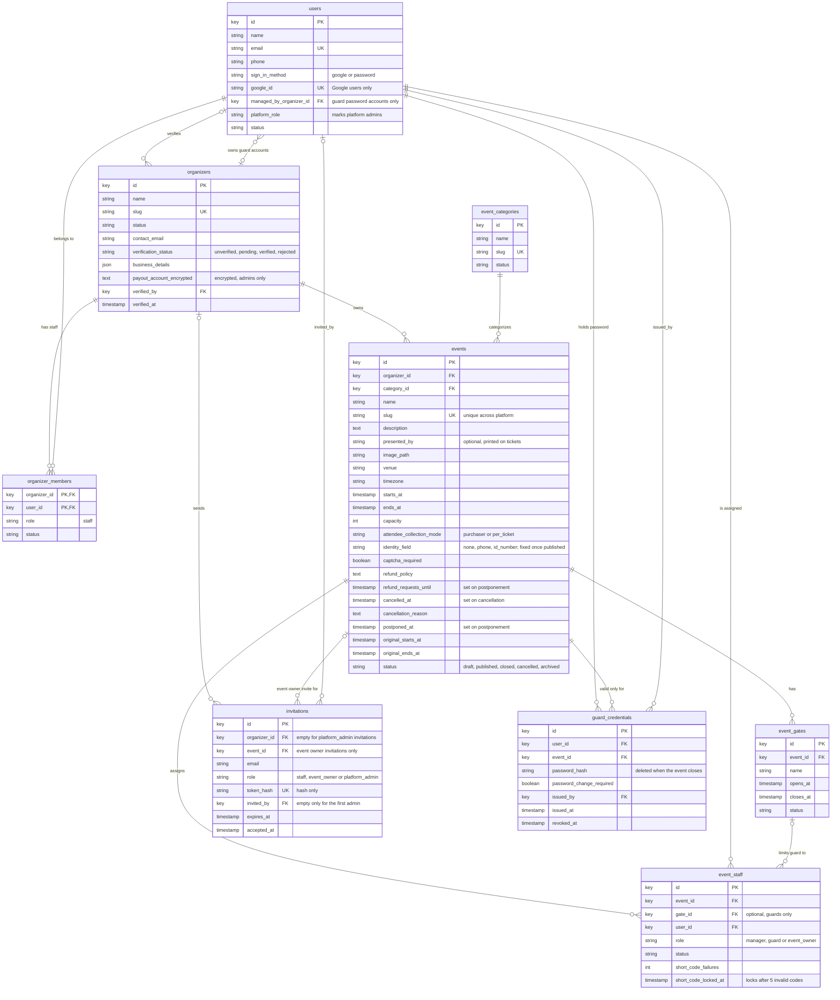

# Database ERD: identity and tenancy

**Type:** Entity relationship diagram  
**Based on:** [v1.md §4.1 Identity and tenancy](../../../v1.md#41-identity-and-tenancy)  
**Files:** [SVG](01-identity-and-tenancy.svg) · [PNG](01-identity-and-tenancy.png) · [Mermaid source](01-identity-and-tenancy.mmd)

Users, organizers and their staff, events and their categories, gates, event assignments for guards and event owners, invitations and one-event guard passwords.

## How to read it

- Table and column names are exactly those in [v1.md §4](../../../v1.md#4-database-design). Only the columns v1.md lists are shown; timestamps and any other columns P1.3 adds are not.
- **Types are logical.** `key` is a primary or foreign key (UUID for records referenced from outside the system, chosen in P1.3). `money` is a `bigint` amount in minor units, with its currency in a separate `char(3)` column. Status columns are strings backed by the PHP enums in [state-machines.md](../../state-machines.md).
- **Keys:** `PK` primary key, `FK` foreign key, `UK` unique. Composite or scoped uniqueness, such as a seat number within its event, is in the column comment.
- **Cardinality:** `||--o{` one to zero or more; `||--|{` one to one or more; `|o--o{` optional foreign key (nullable).
- Tables from another part of the schema appear as stubs that show only `id`.

## Assumptions to confirm in P1.3

- v1.md lists no `id` for `organizer_members`, so `(organizer_id, user_id)` is shown as its key.
- `events.category_id` is shown as required.

P1.3 writes the migrations from v1.md §4 and updates these diagrams to match the final schema (prompts.md P1.3).
