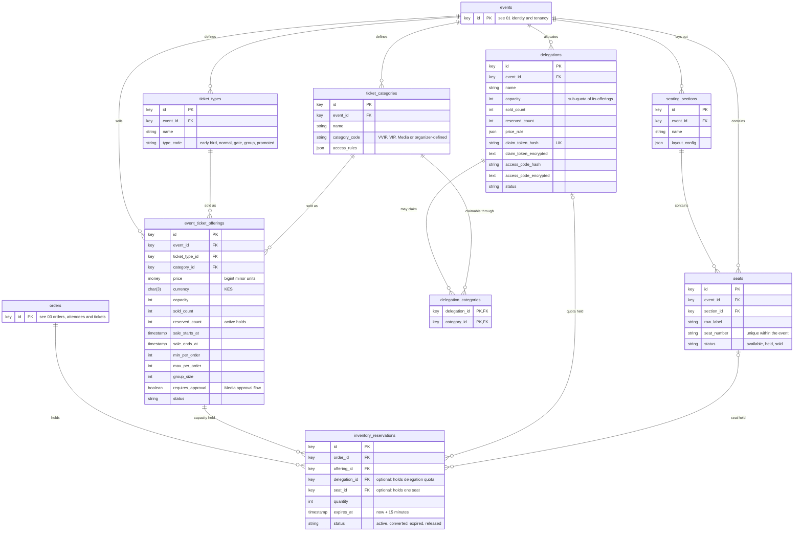

# Database ERD: ticket configuration and inventory

**Type:** Entity relationship diagram  
**Based on:** [v1.md §4.2 Ticket configuration and inventory](../../../v1.md#42-ticket-configuration-and-inventory)  
**Files:** [SVG](02-ticket-configuration-and-inventory.svg) · [PNG](02-ticket-configuration-and-inventory.png) · [Mermaid source](02-ticket-configuration-and-inventory.mmd)

Ticket types and categories, the offerings that combine them with a price and capacity, delegations and their sub-quotas, seating, and the inventory reservations that hold capacity during checkout.

## How to read it

- Table and column names are exactly those in [v1.md §4](../../../v1.md#4-database-design). Only the columns v1.md lists are shown; timestamps and any other columns P1.3 adds are not.
- **Types are logical.** `key` is a primary or foreign key (UUID for records referenced from outside the system, chosen in P1.3). `money` is a `bigint` amount in minor units, with its currency in a separate `char(3)` column. Status columns are strings backed by the PHP enums in [state-machines.md](../../state-machines.md).
- **Keys:** `PK` primary key, `FK` foreign key, `UK` unique. Composite or scoped uniqueness, such as event slug per organizer, is in the column comment.
- **Cardinality:** `||--o{` one to zero or more; `||--|{` one to one or more; `|o--o{` optional foreign key (nullable).
- Tables from another part of the schema appear as stubs that show only `id`.

## Notes

- A delegation's quota is a sub-quota of its offerings' capacity, so a delegation ticket moves the counters on both rows in one transaction ([state-machines.md §6](../../state-machines.md#6-inventory-reservation)).
- `seats.section_id` is shown as required; confirm in P1.3.

P1.3 writes the migrations from v1.md §4. When it does, update these diagrams to match the final schema (prompts.md P1.3 asks for an ERD of the final schema).
