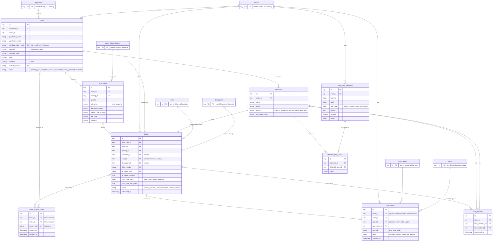

# Database ERD: orders, attendees and tickets

**Type:** Entity relationship diagram  
**Based on:** [v1.md §4.3 Orders, attendees and tickets](../../../v1.md#43-orders-attendees-and-tickets)  
**Files:** [SVG](03-orders-attendees-and-tickets.svg) · [PNG](03-orders-attendees-and-tickets.png) · [Mermaid source](03-orders-attendees-and-tickets.mmd)

Orders and their items, attendee details and answers, tickets with their hashed and encrypted credentials, retrieval tokens, scans and transfers.

## How to read it

- Table and column names are exactly those in [v1.md §4](../../../v1.md#4-database-design). Only the columns v1.md lists are shown; timestamps and any other columns P1.3 adds are not.
- **Types are logical.** `key` is a primary or foreign key (UUID for records referenced from outside the system, chosen in P1.3). `money` is a `bigint` amount in minor units, with its currency in a separate `char(3)` column. Status columns are strings backed by the PHP enums in [state-machines.md](../../state-machines.md).
- **Keys:** `PK` primary key, `FK` foreign key, `UK` unique. Composite or scoped uniqueness, such as event slug per organizer, is in the column comment.
- **Cardinality:** `||--o{` one to zero or more; `||--|{` one to one or more; `|o--o{` optional foreign key (nullable).
- Tables from another part of the schema appear as stubs that show only `id`.

## Notes

- A seat can belong to several tickets over time: it returns to sale when its ticket is refunded or revoked ([state-machines.md §5](../../state-machines.md#5-seat)). A partial unique index allows one active ticket per seat. The v1.md §4.5 diagram shows this as one-to-one, which is wrong.
- An order item has no tickets while its order is pending, so `order_items ||--o{ tickets` is zero or more. The v1.md §4.5 diagram says one or more.
- `ticket_access_tokens` has both `ticket_id` and `order_id`. v1.md says "`ticket_id` or `order_id`", so exactly one is set.

## Assumptions to confirm in P1.3

- `ticket_scans.ticket_id` is optional, because an attempt with an unknown code matches no ticket and every attempt is recorded.

P1.3 writes the migrations from v1.md §4. When it does, update these diagrams to match the final schema (prompts.md P1.3 asks for an ERD of the final schema).
