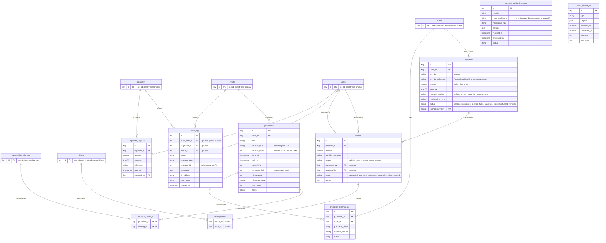

# Database ERD: payments, promotions and operations

**Type:** Entity relationship diagram  
**Based on:** [v1.md §4.4 Payments and promotions](../../../v1.md#44-payments-and-promotions)  
**Files:** [SVG](04-payments-promotions-and-operations.svg) · [PNG](04-payments-promotions-and-operations.png) · [Mermaid source](04-payments-promotions-and-operations.mmd)

Payments and their refunds, Pesapal notifications, promotions and their redemptions, the audit log, manual payouts and the transactional outbox.

## How to read it

- Table and column names are exactly those in [v1.md §4](../../../v1.md#4-database-design). Only the columns v1.md lists are shown; timestamps and any other columns P1.3 adds are not.
- **Types are logical.** `key` is a primary or foreign key (UUID for records referenced from outside the system, chosen in P1.3). `money` is a `bigint` amount in minor units, with its currency in a separate `char(3)` column. Status columns are strings backed by the PHP enums in [state-machines.md](../../state-machines.md).
- **Keys:** `PK` primary key, `FK` foreign key, `UK` unique. Composite or scoped uniqueness, such as event slug per organizer, is in the column comment.
- **Cardinality:** `||--o{` one to zero or more; `||--|{` one to one or more; `|o--o{` optional foreign key (nullable).
- Tables from another part of the schema appear as stubs that show only `id`.

## Notes

- `payments.payment_method` records M-Pesa or card only, never the paying account Pesapal reports (v1.md FR-08).
- `payment_webhook_events` has no unique key: Pesapal notifications carry no event ID, so idempotency comes from the payment and order checks (v1.md §4.4).

## Assumptions to confirm in P1.3

- `refunds.requested_by` is optional: postponement requests come from guest buyers with no user account, and system refunds have no requester.
- `audit_logs.actor_user_id`, `organizer_id` and `event_id` are optional, for system actions and platform-level actions.

P1.3 writes the migrations from v1.md §4. When it does, update these diagrams to match the final schema (prompts.md P1.3 asks for an ERD of the final schema).
