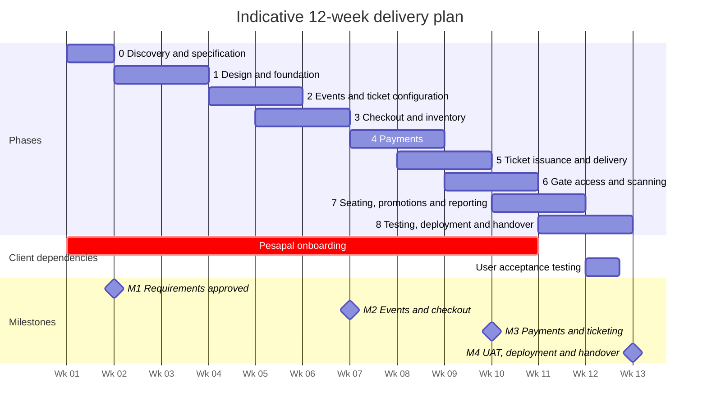

# Delivery timeline (12 weeks)

**Type:** Gantt chart  
**Source:** [implementation-plan.md › 1.3 Timeline](../../../implementation-plan.md#13-timeline)  
**Files:** [SVG](01-delivery-timeline.svg) · [PNG](01-delivery-timeline.png) · [Mermaid source](01-delivery-timeline.mmd)

This is a copy of the Mermaid block in [implementation-plan.md](../../../implementation-plan.md#13-timeline). When it changes, update the source document, this file and `01-delivery-timeline.mmd` together, then re-render ([how](../../README.md#regenerating)).
