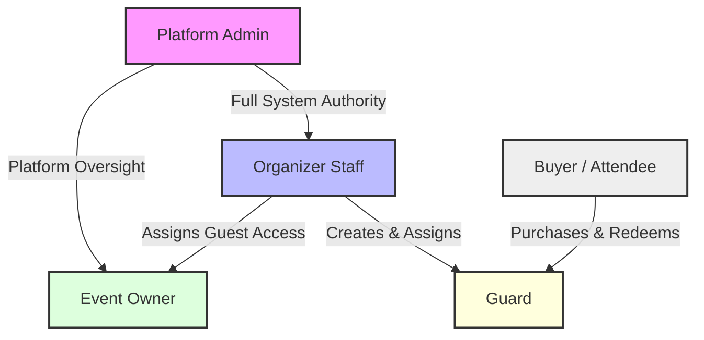

# Role relationships

**Type:** Flowchart  
**Source:** [doc/roleandprivileage.md › 2. The Five System Roles](../../../doc/roleandprivileage.md#2-the-five-system-roles)  
**Files:** [SVG](01-role-relationships.svg) · [PNG](01-role-relationships.png) · [Mermaid source](01-role-relationships.mmd)

This is a copy of the Mermaid block in [doc/roleandprivileage.md](../../../doc/roleandprivileage.md#2-the-five-system-roles). When it changes, update the source document, this file and `01-role-relationships.mmd` together, then re-render ([how](../../README.md#regenerating)).
