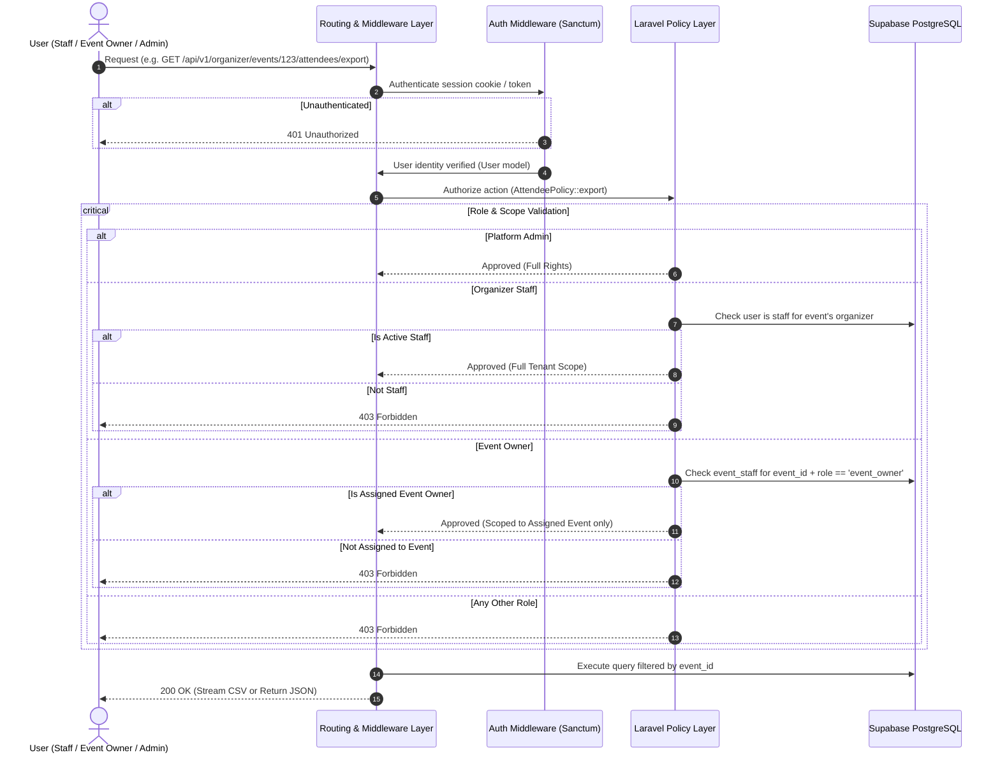

# Authorization pipeline

**Type:** Sequence diagram  
**Source:** [doc/roleandprivileage.md › 4.1 Enforcement Pipeline Flow](../../../doc/roleandprivileage.md#41-enforcement-pipeline-flow)  
**Files:** [SVG](02-authorization-pipeline.svg) · [PNG](02-authorization-pipeline.png) · [Mermaid source](02-authorization-pipeline.mmd)

This is a copy of the Mermaid block in [doc/roleandprivileage.md](../../../doc/roleandprivileage.md#41-enforcement-pipeline-flow). When it changes, update the source document, this file and `02-authorization-pipeline.mmd` together, then re-render ([how](../../README.md#regenerating)).
