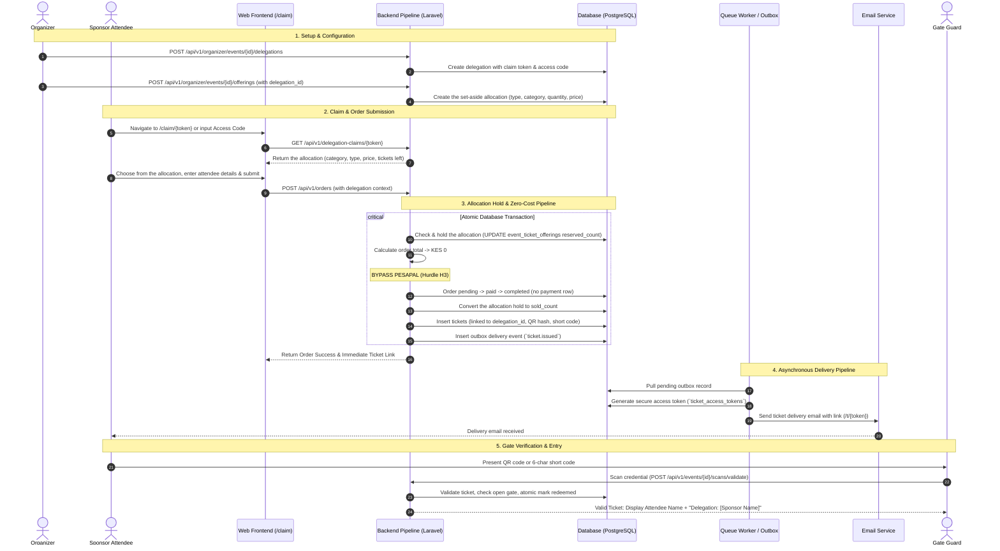

# Delegation claim pipeline

**Type:** Sequence diagram  
**Source:** [doc/sponsored.md › 4. End-to-End Pipeline Architecture](../../../doc/sponsored.md#4-end-to-end-pipeline-architecture)  
**Files:** [SVG](01-delegation-claim-pipeline.svg) · [PNG](01-delegation-claim-pipeline.png) · [Mermaid source](01-delegation-claim-pipeline.mmd)

> The buyer's side of a claim, with every branch, is in [activity 06](../activity/06-delegation-claim.md).

This is a copy of the Mermaid block in [doc/sponsored.md](../../../doc/sponsored.md#4-end-to-end-pipeline-architecture). When it changes, update the source document, this file and `01-delegation-claim-pipeline.mmd` together, then re-render ([how](../../README.md#regenerating)).
