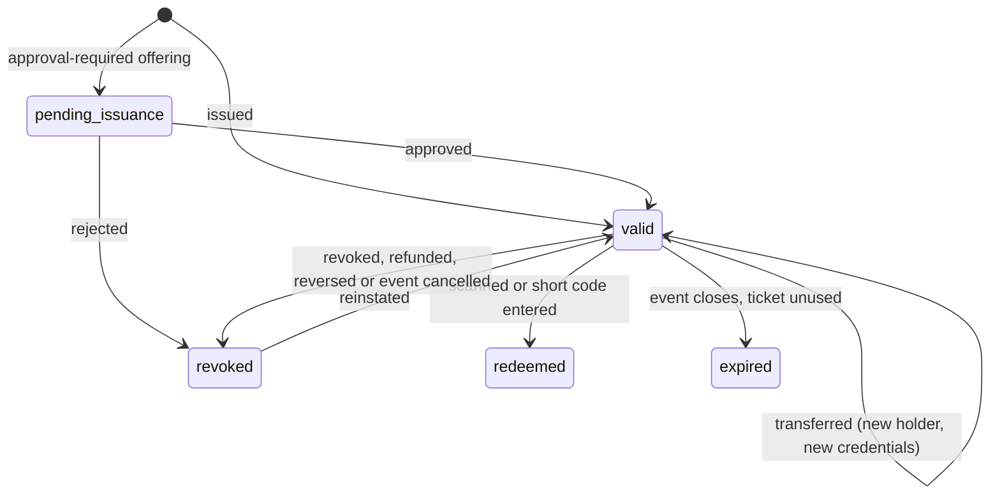

# Ticket state machine

**Type:** State diagram  
**Source:** [doc/state-machines.md › 4. Ticket](../../../doc/state-machines.md#4-ticket)  
**Files:** [SVG](05-ticket-states.svg) · [PNG](05-ticket-states.png) · [Mermaid source](05-ticket-states.mmd)

This is a copy of the Mermaid block in [doc/state-machines.md](../../../doc/state-machines.md#4-ticket). When it changes, update the source document, this file and `05-ticket-states.mmd` together, then re-render ([how](../../README.md#regenerating)).
