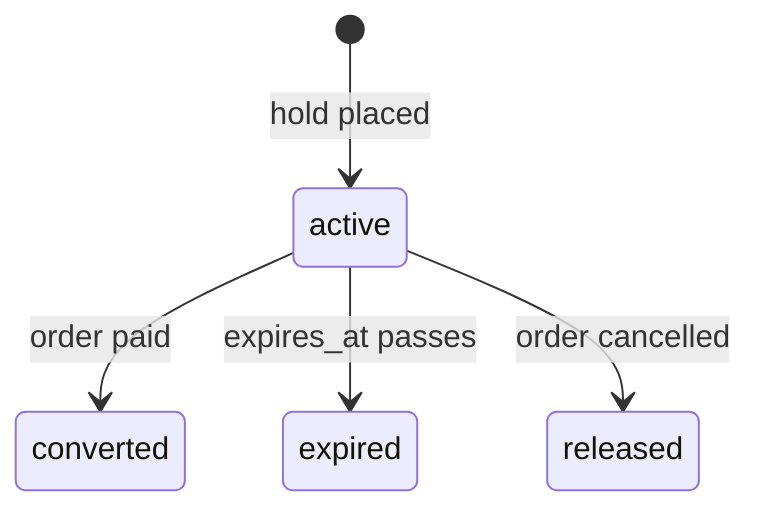

# Inventory reservation state machine

**Type:** State diagram  
**Source:** [doc/state-machines.md › 6. Inventory reservation](../../../doc/state-machines.md#6-inventory-reservation)  
**Files:** [SVG](07-inventory-reservation-states.svg) · [PNG](07-inventory-reservation-states.png) · [Mermaid source](07-inventory-reservation-states.mmd)

This is a copy of the Mermaid block in [doc/state-machines.md](../../../doc/state-machines.md#6-inventory-reservation). When it changes, update the source document, this file and `07-inventory-reservation-states.mmd` together, then re-render ([how](../../README.md#regenerating)).
