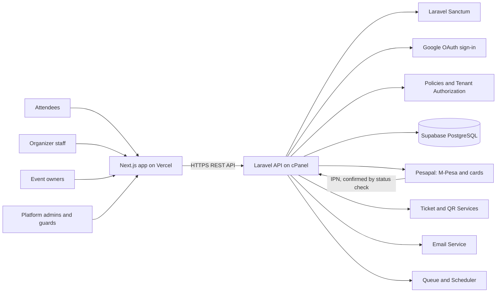

# System architecture

**Type:** Flowchart  
**Source:** [techstack.md › 2. System architecture](../../../techstack.md#2-system-architecture)  
**Files:** [SVG](01-system-architecture.svg) · [PNG](01-system-architecture.png) · [Mermaid source](01-system-architecture.mmd)

This is a copy of the Mermaid block in [techstack.md](../../../techstack.md#2-system-architecture). When it changes, update the source document, this file and `01-system-architecture.mmd` together, then re-render ([how](../../README.md#regenerating)).
