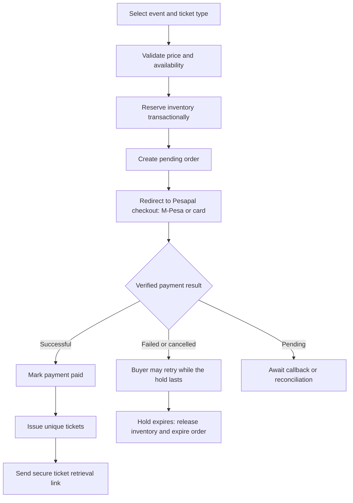

# Ticket purchase flow

**Type:** Flowchart  
**Source:** [techstack.md › A. Ticket purchase](../../../techstack.md#a-ticket-purchase)  
**Files:** [SVG](02-ticket-purchase-flow.svg) · [PNG](02-ticket-purchase-flow.png) · [Mermaid source](02-ticket-purchase-flow.mmd)

> The complete buyer journey is in the [activity diagrams](../activity/01-buyer-journey-overview.md).

This is a copy of the Mermaid block in [techstack.md](../../../techstack.md#a-ticket-purchase). When it changes, update the source document, this file and `02-ticket-purchase-flow.mmd` together, then re-render ([how](../../README.md#regenerating)).
