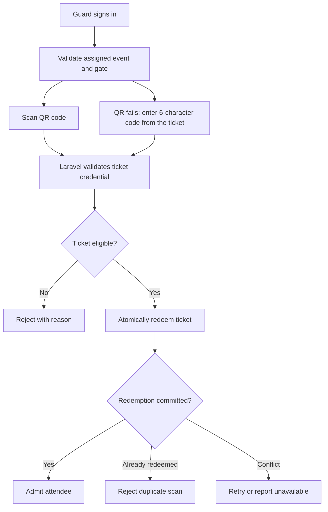

# Gate QR scanning flow

**Type:** Flowchart  
**Source:** [techstack.md › B. QR scanning at the gate](../../../techstack.md#b-qr-scanning-at-the-gate)  
**Files:** [SVG](03-gate-qr-scanning-flow.svg) · [PNG](03-gate-qr-scanning-flow.png) · [Mermaid source](03-gate-qr-scanning-flow.mmd)

This is a copy of the Mermaid block in [techstack.md](../../../techstack.md#b-qr-scanning-at-the-gate). When it changes, update the source document, this file and `03-gate-qr-scanning-flow.mmd` together, then re-render ([how](../../README.md#regenerating)).
