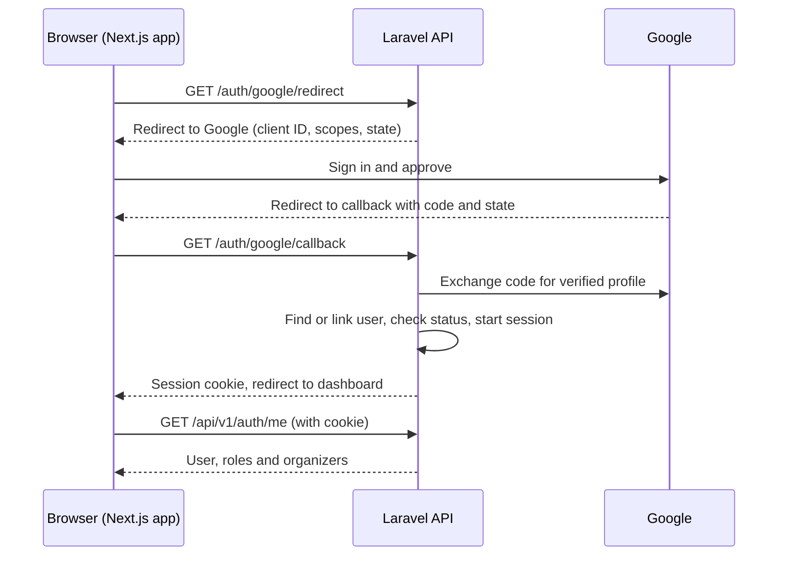

# Google sign-in flow

**Type:** Sequence diagram  
**Source:** [techstack.md › Google sign-in flow](../../../techstack.md#google-sign-in-flow)  
**Files:** [SVG](04-google-sign-in.svg) · [PNG](04-google-sign-in.png) · [Mermaid source](04-google-sign-in.mmd)

This is a copy of the Mermaid block in [techstack.md](../../../techstack.md#google-sign-in-flow). When it changes, update the source document, this file and `04-google-sign-in.mmd` together, then re-render ([how](../../README.md#regenerating)).
