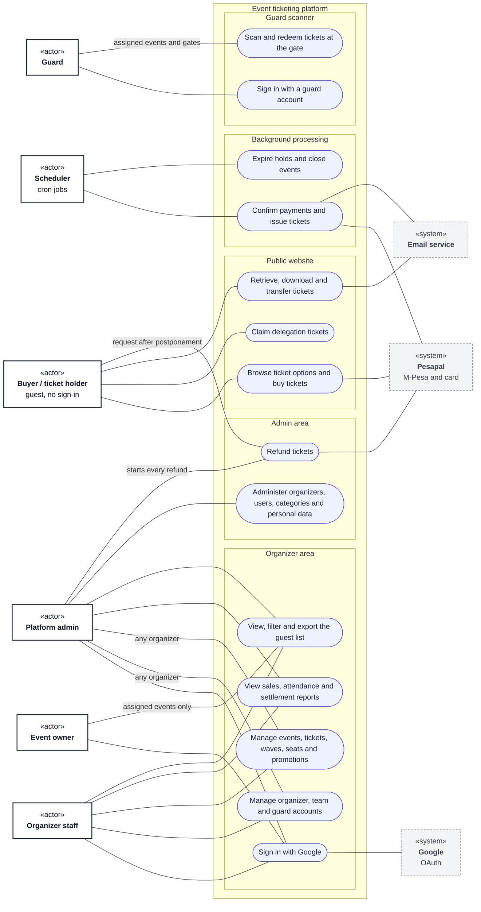

# Use cases: overview

**Type:** Use case diagram (Mermaid flowchart)  
**Based on:** [v1.md §3 Permissions matrix](../../../v1.md#3-permissions-matrix), [v1.md §2](../../../v1.md#2-functional-requirements), [doc/roleandprivileage.md](../../roleandprivileage.md)  
**Files:** [SVG](00-overview.svg) · [PNG](00-overview.png) · [Mermaid source](00-overview.mmd)

Every actor and the main things each one does. Diagrams 01–06 break each actor down.

## How to read it

Mermaid has no use case diagram type, so this is drawn as a flowchart that follows UML use case conventions. Roles and permissions come from [v1.md §3](../../../v1.md#3-permissions-matrix).

| Element | Meaning |
|---|---|
| Box marked «actor» | A role that uses the system |
| Dashed box marked «system» | An external system |
| Oval | A use case |
| Large box | The system boundary; inner boxes group related use cases |
| Solid line | The actor takes part in the use case |
| Dashed arrow «include» | The base use case always includes the target |
| Dashed arrow «extend» | The source use case adds to the target, under the stated condition |

## Notes

- Platform admins can act on any organizer, but they don't scan tickets: only guard accounts scan.
- Platform admins also carry out personal data deletion requests ([v1.md FR-15](../../../v1.md#fr-15--personal-data-deletion)).

## Use case diagrams

0. [Overview](00-overview.md)
1. [Buyer and ticket holder](01-buyer-and-ticket-holder.md)
2. [Organizer staff](02-organizer-staff.md)
3. [Event owner](03-event-owner.md)
4. [Guard](04-guard.md)
5. [Platform admin](05-platform-admin.md)
6. [Automated processes](06-automated-processes.md)
