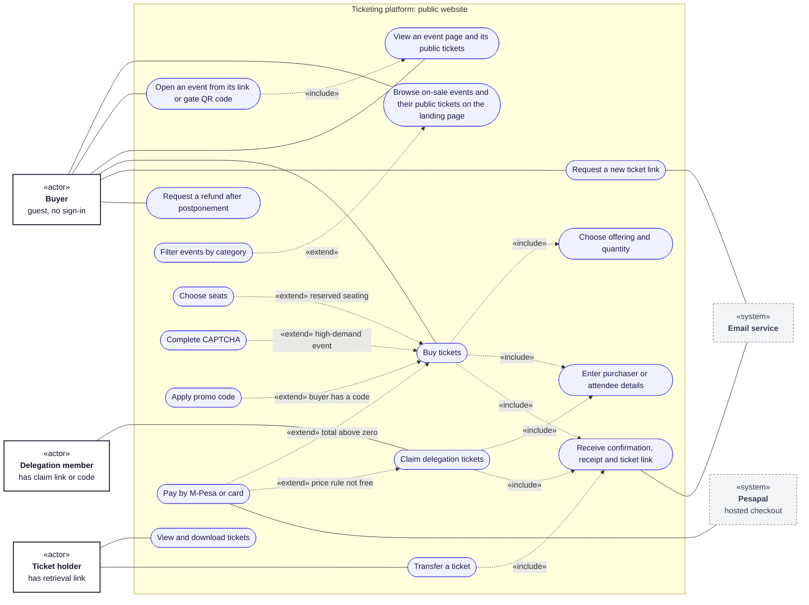

# Use cases: buyer and ticket holder

**Type:** Use case diagram (Mermaid flowchart)  
**Based on:** [v1.md FR-06 to FR-09](../../../v1.md#fr-06--purchasing-and-orders), [limitation.md §5–§8](../../../limitation.md#5-buying-tickets), [doc/sponsored.md](../../sponsored.md)  
**Files:** [SVG](01-buyer-and-ticket-holder.svg) · [PNG](01-buyer-and-ticket-holder.png) · [Mermaid source](01-buyer-and-ticket-holder.mmd)

What buyers, delegation members and ticket holders do on the public website. None of them sign in.

## How to read it

Mermaid has no use case diagram type, so this is drawn as a flowchart that follows UML use case conventions. Roles and permissions come from [v1.md §3](../../../v1.md#3-permissions-matrix).

| Element | Meaning |
|---|---|
| Box marked «actor» | A role that uses the system |
| Dashed box marked «system» | An external system |
| Oval | A use case |
| Large box | The system boundary; inner boxes group related use cases |
| Solid line | The actor takes part in the use case |
| Dashed arrow «include» | The base use case always includes the target |
| Dashed arrow «extend» | The source use case adds to the target, under the stated condition |

## Notes

- The landing page lists every published event that is on sale, with its public tickets. Delegation (sponsored) tickets are never listed: they are reached only through the delegation's private claim link or access code ([doc/sponsored.md](../../sponsored.md)).
- Each event has its own link, and a gate QR code that opens it, so buyers can buy At the Gate tickets on their own phones ([hurdles.md H4](../../../hurdles.md#h4-at-the-gate-tickets-have-no-way-to-be-sold--decided)). There are no cash sales.
- Buyers reach an order only through its checkout token, and their tickets only through the retrieval link ([hurdles.md H11](../../../hurdles.md#h11-guest-buyers-have-no-defined-way-to-view-their-order--decided)).
- A ticket can be transferred until the event starts, except at events that ask for ID numbers.
- A refund request is possible only after a postponement, until `refund_requests_until`. A platform admin approves or declines it.
- The step-by-step journey is in the [activity diagrams](../activity/01-buyer-journey-overview.md).
