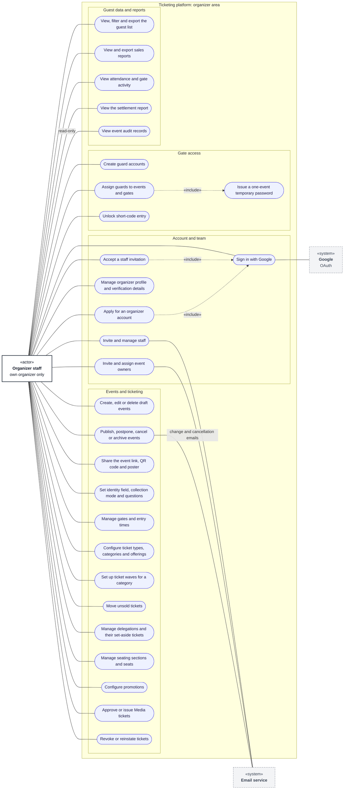

# Use cases: organizer staff

**Type:** Use case diagram (Mermaid flowchart)  
**Based on:** [v1.md §3](../../../v1.md#3-permissions-matrix), [v1.md FR-02, FR-03](../../../v1.md#fr-02--multi-organizer-tenancy), [doc/roleandprivileage.md §2.2](../../roleandprivileage.md#22-organizer-staff)  
**Files:** [SVG](02-organizer-staff.svg) · [PNG](02-organizer-staff.png) · [Mermaid source](02-organizer-staff.mmd)

Organizer staff have full control of their own organizer: team, events, ticketing, guard accounts and reports.

## How to read it

Mermaid has no use case diagram type, so this is drawn as a flowchart that follows UML use case conventions. Roles and permissions come from [v1.md §3](../../../v1.md#3-permissions-matrix).

| Element | Meaning |
|---|---|
| Box marked «actor» | A role that uses the system |
| Dashed box marked «system» | An external system |
| Oval | A use case |
| Large box | The system boundary; inner boxes group related use cases |
| Solid line | The actor takes part in the use case |
| Dashed arrow «include» | The base use case always includes the target |
| Dashed arrow «extend» | The source use case adds to the target, under the stated condition |

## Notes

- Staff can't start refunds or scan tickets (v1.md §3). A staff member who works a gate uses a guard account.
- Every organizer must keep at least one active staff member.
- **Ticket waves:** for each category, staff choose whether it sells in waves. Each wave has its own dates and its own ticket options (type, number of tickets, price), and a category's waves never overlap. Staff move a wave's unsold tickets by hand ([v1.md FR-04](../../../v1.md#fr-04--ticket-types-and-categories), [activity 08](../activity/08-set-up-ticket-waves.md)).
- **Event link, QR code and poster:** staff copy the event's link and download its QR code as PNG or SVG, or as a printable A4 poster for the gate ([v1.md FR-14](../../../v1.md#fr-14--landing-page-and-event-links)).
- **Delegations:** each delegation's tickets are set aside as its own offerings; staff can return unclaimed ones to public sale with the same move action.
- Platform admins can do all of this for any organizer ([05 platform admin](05-platform-admin.md)).
