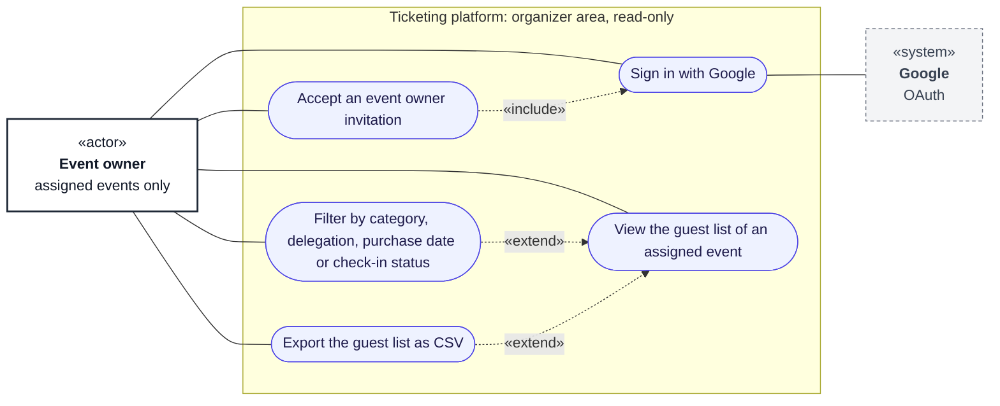

# Use cases: event owner

**Type:** Use case diagram (Mermaid flowchart)  
**Based on:** [v1.md §3](../../../v1.md#3-permissions-matrix), [v1.md FR-13](../../../v1.md#fr-13--reporting-and-auditability), [doc/roleandprivileage.md §2.3](../../roleandprivileage.md#23-event-owner)  
**Files:** [SVG](03-event-owner.svg) · [PNG](03-event-owner.png) · [Mermaid source](03-event-owner.mmd)

Event owners can only view, filter and export the guest list of the events they are assigned to.

## How to read it

Mermaid has no use case diagram type, so this is drawn as a flowchart that follows UML use case conventions. Roles and permissions come from [v1.md §3](../../../v1.md#3-permissions-matrix).

| Element | Meaning |
|---|---|
| Box marked «actor» | A role that uses the system |
| Dashed box marked «system» | An external system |
| Oval | A use case |
| Large box | The system boundary; inner boxes group related use cases |
| Solid line | The actor takes part in the use case |
| Dashed arrow «include» | The base use case always includes the target |
| Dashed arrow «extend» | The source use case adds to the target, under the stated condition |

## Notes

- The guest list shows each ticket holder's name, ticket category, delegation and check-in status only: no contact details, ID numbers, sales, payment or settlement figures.
- Event owners never change anything, and never trigger a state transition ([state-machines.md](../../state-machines.md#conventions)).
