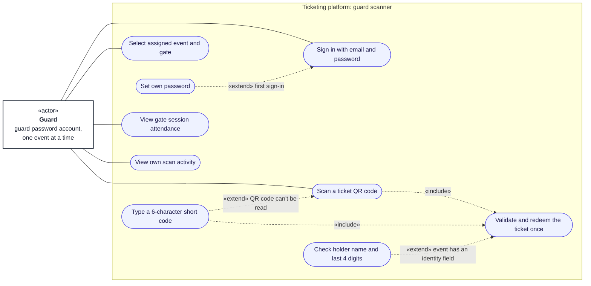

# Use cases: guard

**Type:** Use case diagram (Mermaid flowchart)  
**Based on:** [v1.md FR-01, FR-10](../../../v1.md#fr-10--online-gate-access-control), [limitation.md §9](../../../limitation.md#9-gate-entry)  
**Files:** [SVG](04-guard.svg) · [PNG](04-guard.png) · [Mermaid source](04-guard.mmd)

Guards sign in with an email and password account their organizer created, valid for one event, and scan tickets at their assigned gates.

## How to read it

Mermaid has no use case diagram type, so this is drawn as a flowchart that follows UML use case conventions. Roles and permissions come from [v1.md §3](../../../v1.md#3-permissions-matrix).

| Element | Meaning |
|---|---|
| Box marked «actor» | A role that uses the system |
| Dashed box marked «system» | An external system |
| Oval | A use case |
| Large box | The system boundary; inner boxes group related use cases |
| Solid line | The actor takes part in the use case |
| Dashed arrow «include» | The base use case always includes the target |
| Dashed arrow «extend» | The source use case adds to the target, under the stated condition |

## Notes

- Only guard password accounts scan. Each scan, valid or not, is recorded with the guard who made it.
- Short-code entry locks after 5 invalid codes in a row, until organizer staff unlock it; QR scanning keeps working.
- Each ticket admits once. If the scanner can't reach the platform, it shows "Unable to verify, do not admit".
- The guard's password is deleted when the event closes, and the assignment ends.
