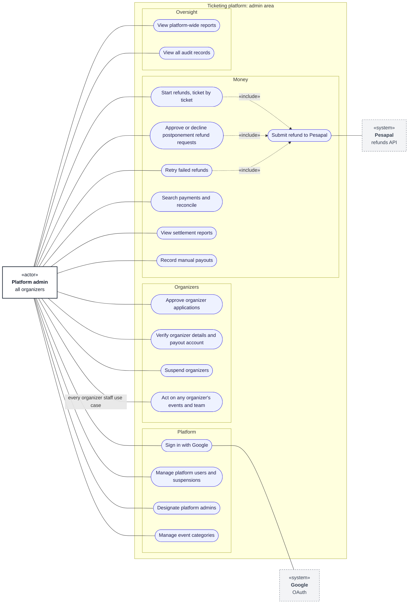

# Use cases: platform admin

**Type:** Use case diagram (Mermaid flowchart)  
**Based on:** [v1.md §3](../../../v1.md#3-permissions-matrix), [v1.md FR-08, FR-13](../../../v1.md#fr-08--payments), [doc/roleandprivileage.md §2.1](../../roleandprivileage.md#21-platform-admin)  
**Files:** [SVG](05-platform-admin.svg) · [PNG](05-platform-admin.png) · [Mermaid source](05-platform-admin.mmd)

Platform admins run the platform: users, organizers, categories, refunds, settlements and oversight.

## How to read it

Mermaid has no use case diagram type, so this is drawn as a flowchart that follows UML use case conventions. Roles and permissions come from [v1.md §3](../../../v1.md#3-permissions-matrix).

| Element | Meaning |
|---|---|
| Box marked «actor» | A role that uses the system |
| Dashed box marked «system» | An external system |
| Oval | A use case |
| Large box | The system boundary; inner boxes group related use cases |
| Solid line | The actor takes part in the use case |
| Dashed arrow «include» | The base use case always includes the target |
| Dashed arrow «extend» | The source use case adds to the target, under the stated condition |

## Notes

- Admins can do everything organizer staff can, for any organizer ([02 organizer staff](02-organizer-staff.md)), but they don't scan tickets.
- Only admins start refunds, ticket by ticket. The automatic refunds of late or mismatched payments are system actions ([06 automated processes](06-automated-processes.md)).
- Platform admins are designated by an existing admin or a system command, never through sign-in.
