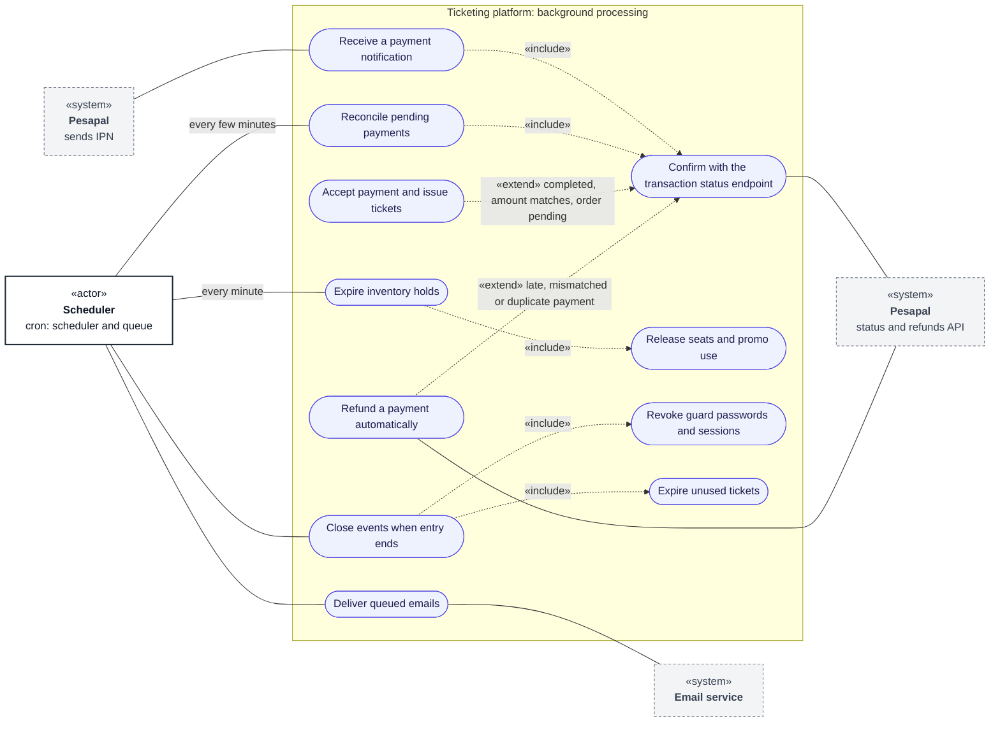

# Use cases: automated processes

**Type:** Use case diagram (Mermaid flowchart)  
**Based on:** [doc/state-machines.md](../../state-machines.md), [v1.md §6](../../../v1.md#6-payment-to-ticket-issuance-workflow), [techstack.md](../../../techstack.md)  
**Files:** [SVG](06-automated-processes.svg) · [PNG](06-automated-processes.png) · [Mermaid source](06-automated-processes.mmd)

What the platform does without a person: payment confirmation, hold expiry, event closing and email delivery.

## How to read it

Mermaid has no use case diagram type, so this is drawn as a flowchart that follows UML use case conventions. Roles and permissions come from [v1.md §3](../../../v1.md#3-permissions-matrix).

| Element | Meaning |
|---|---|
| Box marked «actor» | A role that uses the system |
| Dashed box marked «system» | An external system |
| Oval | A use case |
| Large box | The system boundary; inner boxes group related use cases |
| Solid line | The actor takes part in the use case |
| Dashed arrow «include» | The base use case always includes the target |
| Dashed arrow «extend» | The source use case adds to the target, under the stated condition |

## Notes

- The scheduler and queue run from cron on cPanel.
- Pesapal's transaction status endpoint is the only source of a payment's result. An IPN only triggers the check.
- Late, mismatched and duplicate payments are refunded automatically, with no approval step ([state-machines.md §3](../../state-machines.md#3-payment)).
