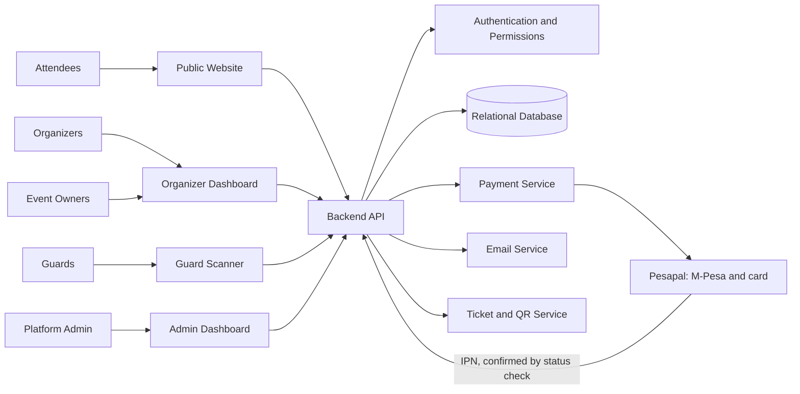

# High-level architecture

**Type:** Flowchart  
**Source:** [v1.md › Recommended high-level architecture](../../../v1.md#recommended-high-level-architecture)  
**Files:** [SVG](01-high-level-architecture.svg) · [PNG](01-high-level-architecture.png) · [Mermaid source](01-high-level-architecture.mmd)

This is a copy of the Mermaid block in [v1.md](../../../v1.md#recommended-high-level-architecture). When it changes, update the source document, this file and `01-high-level-architecture.mmd` together, then re-render ([how](../../README.md#regenerating)).
