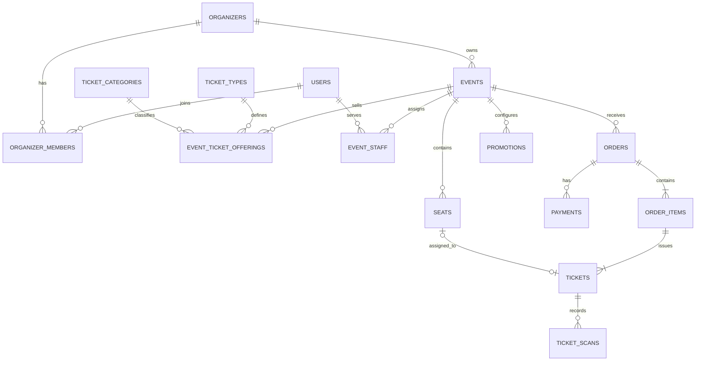

# Core relationships (ERD)

**Type:** Entity relationship diagram  
**Source:** [v1.md › 4.5 Core relationships](../../../v1.md#45-core-relationships)  
**Files:** [SVG](02-core-relationships-erd.svg) · [PNG](02-core-relationships-erd.png) · [Mermaid source](02-core-relationships-erd.mmd)

> **Out of date.** This is the short diagram in v1.md §4.5. It shows 16 of the 36 tables in v1.md §4 and gets some cardinalities wrong (see [hurdles.md §6](../../../hurdles.md#6-document-upkeep)). Use the [complete ERD](../erd/00-overview.md) instead.

This is a copy of the Mermaid block in [v1.md](../../../v1.md#45-core-relationships). When it changes, update the source document, this file and `02-core-relationships-erd.mmd` together, then re-render ([how](../../README.md#regenerating)).
