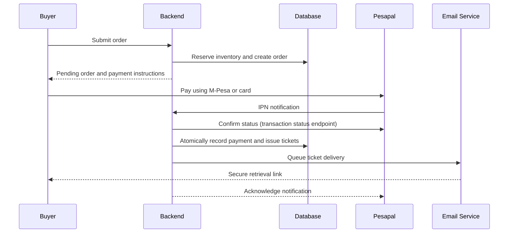

# Payment-to-ticket issuance sequence

**Type:** Sequence diagram  
**Source:** [v1.md › 6. Payment-to-ticket issuance workflow](../../../v1.md#6-payment-to-ticket-issuance-workflow)  
**Files:** [SVG](06-payment-to-ticket-sequence.svg) · [PNG](06-payment-to-ticket-sequence.png) · [Mermaid source](06-payment-to-ticket-sequence.mmd)

> The branches this sequence leaves out (duplicates, rejections, expiry, zero totals) are in [activity 04](../activity/04-payment-confirmation-and-issuance.md) and [activity 05](../activity/05-hold-expiry-and-late-payment.md).

This is a copy of the Mermaid block in [v1.md](../../../v1.md#6-payment-to-ticket-issuance-workflow). When it changes, update the source document, this file and `06-payment-to-ticket-sequence.mmd` together, then re-render ([how](../../README.md#regenerating)).
