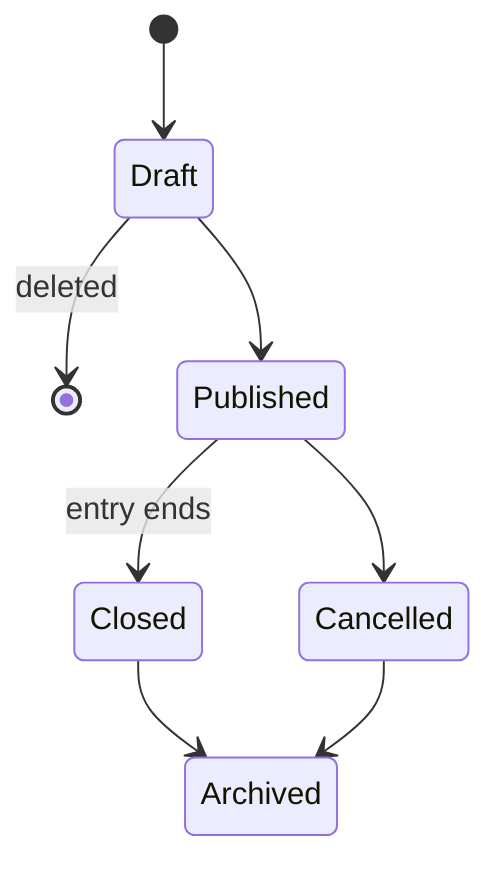

# Event states

**Type:** State diagram  
**Source:** [v1.md › 4.6 Important state models](../../../v1.md#46-important-state-models)  
**Files:** [SVG](07-event-states.svg) · [PNG](07-event-states.png) · [Mermaid source](07-event-states.mmd)

> **Short version.** The authoritative machine, with every transition, trigger and actor, is [state-machines/01-event-states](../state-machines/01-event-states.md) (doc/state-machines.md §1).

This is a copy of the Mermaid block in [v1.md](../../../v1.md#46-important-state-models). When it changes, update the source document, this file and `07-event-states.mmd` together, then re-render ([how](../../README.md#regenerating)).
