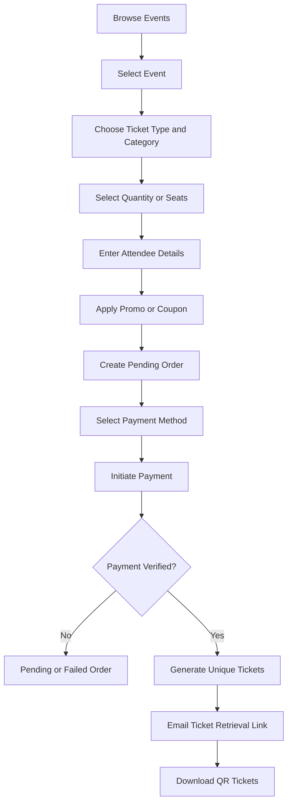

# Ticket purchasing flow

**Type:** Flowchart  
**Source:** [v2.md › 2. Recommended ticket purchasing flow](../../../v2.md#2-recommended-ticket-purchasing-flow)  
**Files:** [SVG](01-ticket-purchasing-flow.svg) · [PNG](01-ticket-purchasing-flow.png) · [Mermaid source](01-ticket-purchasing-flow.mmd)

> **Replaced.** v2.md is kept for reference only. [v1.md](../../../v1.md) replaces it, and the names and decisions in this diagram are out of date.
>
> The complete buyer journey is in the [activity diagrams](../activity/01-buyer-journey-overview.md).

This is a copy of the Mermaid block in [v2.md](../../../v2.md#2-recommended-ticket-purchasing-flow). When it changes, update the source document, this file and `01-ticket-purchasing-flow.mmd` together, then re-render ([how](../../README.md#regenerating)).
