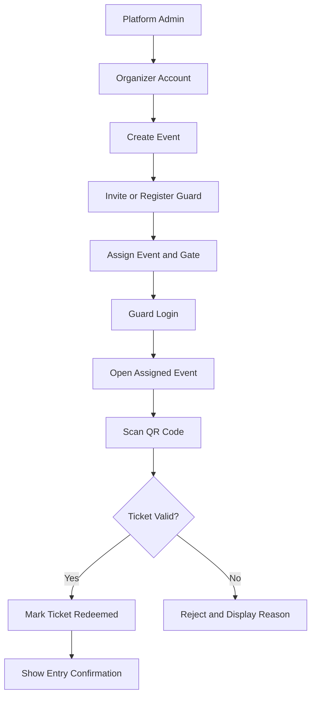

# Guard account delegation

**Type:** Flowchart  
**Source:** [v2.md › How guard account delegation should work](../../../v2.md#how-guard-account-delegation-should-work)  
**Files:** [SVG](02-guard-delegation-flow.svg) · [PNG](02-guard-delegation-flow.png) · [Mermaid source](02-guard-delegation-flow.mmd)

> **Replaced.** v2.md is kept for reference only. [v1.md](../../../v1.md) replaces it, and the names and decisions in this diagram are out of date.

This is a copy of the Mermaid block in [v2.md](../../../v2.md#how-guard-account-delegation-should-work). When it changes, update the source document, this file and `02-guard-delegation-flow.mmd` together, then re-render ([how](../../README.md#regenerating)).
