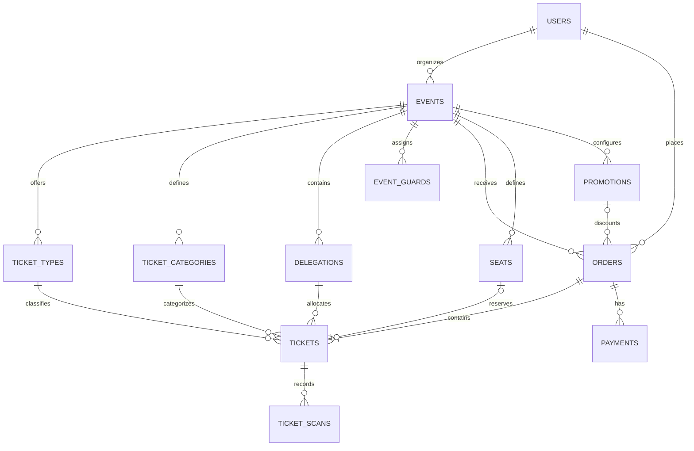

# Database structure (ERD)

**Type:** Entity relationship diagram  
**Source:** [v2.md › 10. Recommended database structure](../../../v2.md#10-recommended-database-structure)  
**Files:** [SVG](03-database-structure-erd.svg) · [PNG](03-database-structure-erd.png) · [Mermaid source](03-database-structure-erd.mmd)

> **Replaced.** v2.md is kept for reference only. [v1.md](../../../v1.md) replaces it, and the names and decisions in this diagram are out of date.
>
> The current schema is in the [complete ERD](../erd/00-overview.md).

This is a copy of the Mermaid block in [v2.md](../../../v2.md#10-recommended-database-structure). When it changes, update the source document, this file and `03-database-structure-erd.mmd` together, then re-render ([how](../../README.md#regenerating)).
