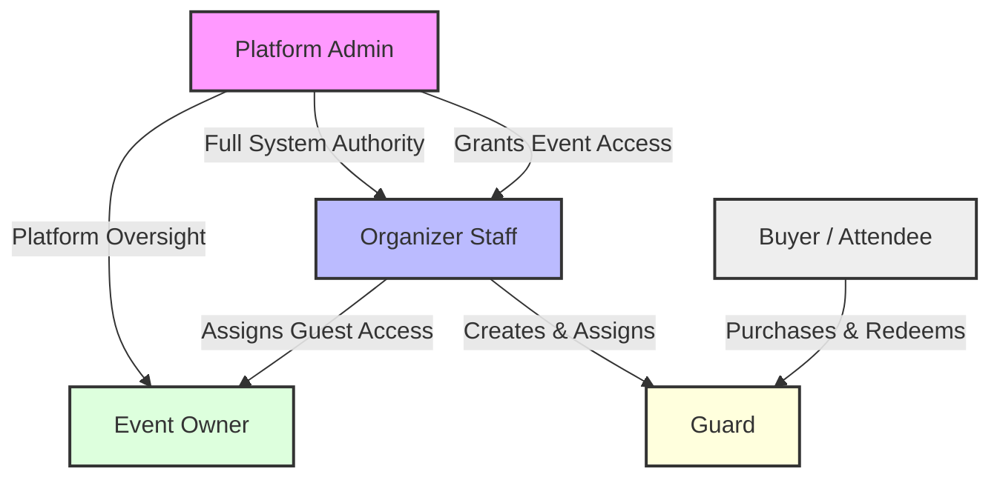
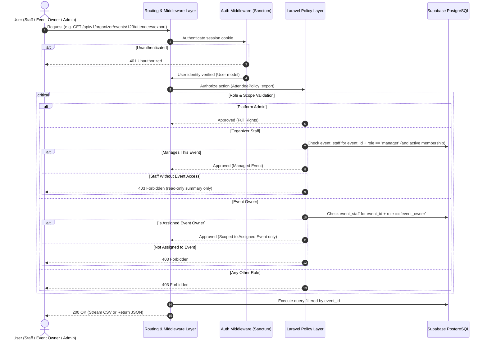

# Roles, Privileges & Authorization Overview

**Multi-Organizer Event Ticketing Platform · Version 1.5 · 16 October 2026**  
**References:** [limitation.md](../limitation.md) (§1, §2, §11), [v1.md](../v1.md) (§FR-01, §FR-02, §FR-04, §FR-13, §FR-14, §FR-15, §3, §4.1), [techstack.md](../techstack.md) (§3), [implementation-plan.md](../implementation-plan.md) (Phase 1, Phase 2, §11 #29–#33). If this document disagrees with v1.md, v1.md wins.

---

## 1. Core Operating Principles

The ticketing platform operates as a shared system supporting multiple event organizers simultaneously while ensuring total privacy and data separation. The access and security framework is built around five core operational principles:

1. **Platform Administration & Oversight:** System Administrators hold overall operational authority, managing event organizer accounts, supervising platform activity, resolving cross-organizer issues, executing refunds, and reviewing overall business reporting.
2. **Organizer Self-Management:** Organizer staff manage their own organization profile, team and gate control accounts, and create events. They fully manage only the events they created or that a Platform Admin gave them access to: pricing, ticket inventories, assignments, sales and settlement statements. For their organization's other events they see a read-only summary.
3. **Restricted Event Host Access:** External event owners or promoters are granted access strictly to monitor guest activity for their assigned events. They can view, filter, and export attendee lists, but cannot modify event details, ticket prices, or financial settings.
4. **Tenant Privacy & Data Isolation:** Strict boundaries ensure that no event organizer or team member can view, access, or modify another organizer's events, sales figures, guest lists, or financial payouts. Inside an organizer, a staff member sees another event's sales, orders and guest data only once a Platform Admin gives them access, and only Platform Admins see the list of every user.
5. **Fail-Safe Security Default:** Access rights are continuously verified on every system action based on the logged-in user’s current role and verified organization permissions. Any unauthorized request is automatically blocked by default.

---

## 2. Summary of System Roles



### 2.1 Platform Admin
* **Description:** Executive platform managers who oversee all platform operations, organizer onboarding, compliance, and overall business performance.
* **Scope:** Full, platform-wide administrative oversight.
* **Log In Method:** Google Sign-In with a Google-verified email address, after accepting a platform admin invitation sent to that address.
* **Key Capabilities:**
  * Approve, verify, or suspend event organizer accounts.
  * View platform-wide sales summary reports, financial transactions, and system activity logs.
  * Authorize ticket cancellations, event cancellations, and customer refunds.
  * Record manual financial settlements and payout records for event organizers.
  * Enter, change and view each organizer's payout account. Only admins can, and every change is audited.
  * See the list of every user on the platform (only admins can).
  * Grant or remove an organizer staff member's access to an individual event (`POST` and `DELETE /api/v1/admin/events/{id}/managers`). Only admins can; both are audited.
  * Invite new Platform Admins by email, and remove another admin's rights (never the last admin's). Any admin can do both, and both are audited.
  * The very first admin is created once, on a fresh installation, with a setup command (`php artisan platform:bootstrap-admin {email}`) that creates that admin's invitation and refuses to run once any admin exists.
* **Restrictions:** Admins do not scan tickets at event gates during operational entry (gate checking is handled strictly by Guard accounts).

### 2.2 Organizer Staff
* **Description:** Operational managers for an event management company or organizer entity.
* **Scope:** Their own organization's profile, staff and guard accounts, plus the events they manage: the ones they created, and any a Platform Admin gave them access to (an `event_staff` row with role `manager`). A read-only summary of their organization's other events.
* **Log In Method:** Google Sign-In.
* **Key Capabilities:**
  * Manage organization contact profile and public branding. They see only whether a verified payout account is on file: a Platform Admin enters or changes it.
  * Invite and remove team members, and create or disable guard accounts.
  * See their own organization's staff (names, emails and status) and guard accounts.
  * Create events, and become a manager of each event they create.
  * For the events they manage: update, publish, cancel or archive them; configure ticket categories and pricing; issue complimentary, VIP, sponsor or promotional tickets; assign Event Owners and guards; and view sales reports, attendance figures and settlement statements.
  * For their organization's other events: see a read-only summary of the details and ticket setup.
* **Restrictions:** Cannot initiate customer refunds (handled by Platform Admins) and cannot scan tickets directly using standard staff logins (must use an assigned guard account to work a gate). Cannot give themselves or anyone else access to an event (only Platform Admins can). Cannot see or change the organization's payout account. Cannot see the sales, sold counts, orders, payments, guest data, reports, audit records, delegations, promotions or assignments of events they don't manage, or any user outside their organization.

### 2.3 Event Owner
* **Description:** External event hosts, client representatives, or guest artists who require real-time visibility into attendance for specific assigned events.
* **Scope:** Strictly limited to guest data for their explicitly assigned event(s).
* **Log In Method:** Google Sign-In (via email invitation from the event's managing staff or a Platform Admin).
* **Key Capabilities:**
  * **View Guest Information:** See each ticket holder's name, ticket category, delegation, check-in status and entry time for assigned events.
  * **Filter Guest Data:** Search by name, and filter by ticket category, delegation, purchase date or check-in status.
  * **Export Guest Data:** Download guest rosters as spreadsheet (CSV) files.
  * **See the Event's Managers:** The names and email addresses of the staff who manage their assigned events, so they know whom to contact.
* **Restrictions:** Read-only guest access. Cannot edit event settings, ticket quantities, pricing, guard assignments, or view revenue figures and bank details. Cannot see any other users: not other event owners, guards, or the organization's other staff.

### 2.4 Guard
* **Description:** On-site venue personnel working entry turnstiles, gates, or doors to scan tickets or handle entry checks.
* **Scope:** Restricted solely to scanning functions for assigned gates during an active event.
* **Log In Method:** Guard authentication is an isolated, temporary, single-event credential system: an email and password account created by Organizer Staff (or a Platform Admin), signed in through Laravel Sanctum SPA cookie sessions, never Google OAuth.
* **Key Capabilities:**
  * Scan ticket QR codes at designated gates.
  * Manually enter short verification codes for entry fallback.
  * View real-time gate entry counts for active shifts.
* **Restrictions:** No access to administrative tools, sales figures, financial data, or guest lists. A scan result shows only what the guard needs to check entry: the attendee's name (where collected), ticket category, seat or delegation, and the last 4 digits of their phone or ID number when the event collects one. Guard credentials work for one event only and automatically deactivate (password hash wiped and sessions terminated) when the event concludes.

### 2.5 Buyer / Attendee
* **Description:** Customers purchasing ticket offerings or claiming event passes online.
* **Scope:** Limited exclusively to their own ticket purchases and order receipts.
* **Log In Method:** Guest checkout (no account password creation needed).
* **Key Capabilities & Access:** Access passes via secure digital ticket links (`/t/{access_token}`) delivered to their email, plus a checkout token during checkout. Ticket holders can view their pass, present entry codes, or transfer eligible passes to friends prior to event start (unless the event collects national ID numbers).

---

## 3. Key Operations & Permissions Matrix

### Access Level Definitions:
* **Full:** Complete management authority within scope.
* **Scoped:** Permitted for specific assigned events or gates.
* **Limited:** Restricted strictly to viewing or exporting guest data.
* **Managed events:** The events a staff member created, or that a Platform Admin gave them access to.
* **No:** Access not allowed (`403 Forbidden`).

| Operational Area | Capability | Platform Admin | Organizer Staff | Event Owner | Guard | Buyer / Guest |
| :--- | :--- | :---: | :---: | :---: | :---: | :---: |
| **Platform Management** | View platform audit logs | Full | No | No | No | No |
| | View all users | Full | No | No | No | No |
| | Grant or remove staff access to an event | Full | No | No | No | No |
| | View event audit records | Full | Limited (Managed events, read-only) | No | No | No |
| | Verify organizers & categories | Full | No | No | No | No |
| | Invite or remove Platform Admins | Full | No | No | No | No |
| | Approve or suspend organizers | Full | No | No | No | No |
| | View platform financial totals | Full | No | No | No | No |
| **Account & Staffing** | Edit organization profile | Full | Full (Own org) | No | No | No |
| | Enter, change or view the payout account | Full | No (sees only whether one is on file) | No | No | No |
| | Invite & manage Organizer Staff | Full | Full (Own org) | No | No | No |
| | View Organizer Staff list | Full | Full (Own org) | Limited (Managers of assigned events) | No | No |
| | Assign Event Owners to events | Full | Scoped (Managed events) | No | No | No |
| **Event Management** | Create events | Full | Full (Own org) | No | No | No |
| | View other events' summary (read-only) | Full | Limited (Own org, no sales or guest data) | No | No | No |
| | Edit and publish events | Full | Scoped (Managed events) | No | No | No |
| | Cancel or archive events | Full | Scoped (Managed events) | No | No | No |
| | Configure ticket types & pricing | Full | Scoped (Managed events) | No | No | No |
| | Configure reserved seating layouts | Full | Scoped (Managed events) | No | No | No |
| | Manage partner & sponsor allocations | Full | Scoped (Managed events) | No | No | No |
| | Issue complimentary / VIP tickets | Full | Scoped (Managed events) | No | No | No |
| **Guest Data** | View attendee rosters | Full | Scoped (Managed events) | Limited (Names, status & entry time, assigned event) | No | Own Order Only |
| | Filter attendee lists | Full | Scoped (Managed events) | Limited (Names, status & entry time, assigned event) | No | No |
| | Export guest lists (CSV) | Full | Scoped (Managed events) | Limited (Names, status & entry time, assigned event) | No | No |
| **Customer Orders** | Revoke or cancel tickets | Full | Scoped (Managed events) | No | No | No |
| | Authorize and execute refunds | Full | No | No | No | Request after a postponement |
| | Transfer ticket to another person | No | No | No | No | Own tickets, before the event starts |
| **Scanning & Entry** | Create guard entry credentials | Full | Full (Own org) | No | No | No |
| | Assign guards to specific gates | Full | Scoped (Managed events) | No | No | No |
| | Scan tickets & check in guests | No | No | No | Scoped (Assigned gates) | No |
| | Manual entry code verification | No | No | No | Scoped (Assigned gates) | No |
| | View real-time gate entry counts | Full | Scoped (Managed events) | No | Scoped (Assigned gate) | No |
| **Financials** | View settlement statements | Full | Scoped (Managed events) | No | No | View own receipt |
| | Record manual payout details | Full | No | No | No | No |

---

## 4. Operational Workflows & How Access Works

### 4.1 Step-by-Step Access Verification Flow

1. **User Request:** A staff member, event owner, or guard performs an action in the system (e.g., viewing an attendee roster or clicking to export guest data).
2. **Identity Verification:** The system confirms the user is logged in with valid active credentials (a Sanctum SPA cookie session, for Google users and guard password accounts alike).
3. **Role & Ownership Check:** The system checks the user's assigned role and verifies whether they belong to the organization hosting that specific event or are explicitly assigned to it.
4. **Permission Decision:**
   * **Platform Admin:** Request approved automatically across all operational resources.
   * **Organizer Staff:** Organizer-level requests (profile, team, guard accounts, creating events) are approved if they are active staff of the organization. A request about a specific event is approved only if they manage that event; other staff of the organization get its read-only summary and nothing else.
   * **Event Owner:** Request approved only if the user is assigned directly to that specific event and the request is read-only guest management.
   * **Guard:** Request approved only for scanning and gate check functions at their assigned gate.
5. **Execution or Block:** Authorized requests display the relevant data or complete the task. Unauthorized requests are immediately blocked with an access denied message (`401 Unauthorized` or `403 Forbidden`).

### 4.2 Enforcement Sequence Diagram



### 4.3 Laravel Policy Implementation Patterns

#### Event Management Policy (`EventPolicy.php`)
```php
namespace App\Policies;

use App\Models\Event;
use App\Models\User;
use Illuminate\Auth\Access\HandlesAuthorization;

class EventPolicy
{
    use HandlesAuthorization;

    /**
     * Platform Admin has full rights over all resources.
     */
    public function before(User $user, $ability): ?bool
    {
        if ($user->isPlatformAdmin()) {
            return true;
        }

        return null;
    }

    /**
     * Any active staff member of the event's organizer sees the
     * read-only summary (no sales, orders, guest data or assignments).
     */
    public function viewSummary(User $user, Event $event): bool
    {
        return $user->organizerMemberships()
            ->where('organizer_id', $event->organizer_id)
            ->where('role', 'staff')
            ->where('status', 'active')
            ->exists();
    }

    /**
     * Only staff who manage this event can update it: its creator, or
     * staff a Platform Admin gave access to. Event Owners CANNOT update events.
     */
    public function update(User $user, Event $event): bool
    {
        return $this->viewSummary($user, $event)
            && $user->staffAssignments()
                ->where('event_id', $event->id)
                ->where('role', 'manager')
                ->where('status', 'active')
                ->exists();
    }

    /**
     * Delete/archive events - the event's managers only.
     */
    public function delete(User $user, Event $event): bool
    {
        return $this->update($user, $event);
    }
}
```

#### Attendee & Guest Data Policy (`AttendeePolicy.php`)
```php
namespace App\Policies;

use App\Models\Event;
use App\Models\User;
use Illuminate\Auth\Access\HandlesAuthorization;

class AttendeePolicy
{
    use HandlesAuthorization;

    public function before(User $user, $ability): ?bool
    {
        if ($user->isPlatformAdmin()) {
            return true;
        }

        return null;
    }

    /**
     * Determine whether the user can view, filter, or export guest data.
     * Allowed for:
     * 1. Organizer Staff who manage this event.
     * 2. Event Owners explicitly assigned to this specific event.
     */
    public function viewGuestData(User $user, Event $event): bool
    {
        // 1. Check if user manages this event (EventPolicy::update checks
        //    both organizer membership and the manager assignment)
        if ((new EventPolicy())->update($user, $event)) {
            return true;
        }

        // 2. Check if user is an assigned Event Owner for this specific event
        return $user->staffAssignments()
            ->where('event_id', $event->id)
            ->where('role', 'event_owner')
            ->where('status', 'active')
            ->exists();
    }

    /**
     * Export guest data as CSV.
     */
    public function exportGuestData(User $user, Event $event): bool
    {
        return $this->viewGuestData($user, $event);
    }
}
```

---

## 5. Key Operational Safeguards & Security Rules

### 5.1 Strict Boundaries for Event Owners

#### 5.1.1 Event-Specific Access Authorization
* **Explicit Assignment Required:** Event Owners gain access to event data strictly through explicit assignment by the staff who manage the event or by Platform Admins.
* **Strict Event Isolation:** Access is confined solely to explicitly assigned events. Event Owners cannot view or discover other events hosted by the same organizer.

#### 5.1.2 Permitted Guest Information
* **Visible Fields:** Event Owners can view each ticket holder's full name, ticket category, delegation, check-in status (checked in or not yet) and entry time (when the ticket was scanned in). Nothing else: no ticket type, contact details, ID numbers, prices or order amounts.
* **Roster Operations:** Permitted actions are limited strictly to searching, filtering, and exporting attendee rosters as CSV files.

#### 5.1.3 Prohibited Operational and Administrative Access
* **Financial Data Shielding:** Revenue figures, payout summaries, ticket prices, and settlement details are completely hidden from Event Owners.
* **Operational Restrictions:** Event Owners cannot modify ticket capacities, adjust pricing, create discount codes, manage guard credentials, or trigger ticket cancellations and refunds.

#### 5.1.4 Read-Only Enforcement
* **UI and API Blocking:** Administrative options are hidden in the interface, and write API attempts are rejected with explicit permission errors (`403 Forbidden`).
* **Scanning Restrictions:** Event Owner credentials cannot be used to perform ticket entry checks or operate gate turnstiles.

#### 5.1.5 Assignment Management and Revocation
* **Dynamic Revocation:** Access permissions terminate immediately when an Event Owner is removed from an event or when the assigned event is archived.
* **Organizer Scope Control:** Disabling or suspending an organizer account automatically revokes access for all linked Event Owners.

#### 5.1.6 Auditability and Data Protection
* **Audit Trail Logging:** All view, filter, and export requests initiated by Event Owners are logged with timestamps and user IDs for compliance monitoring.
* **Privacy Compliance:** Personal guest details are rendered strictly for necessary event coordination, upholding platform tenant isolation policies.

#### Expected Outcome
Event Owners gain necessary real-time attendee visibility to coordinate event hospitality while maintaining comprehensive isolation from financial, administrative, and cross-event data.

### 5.2 Event Access for Organizer Staff and Who Sees Whom

1. **Managed events only:** A staff member manages an event only through an active `event_staff` row with role `manager`. Creating an event creates that row for its creator; any other row is created or removed only by a Platform Admin, and both are audited. Removing a staff member from the organizer ends all their event access.
2. **Read-only summary:** For their organization's other events, staff see the event's details and ticket setup (name, category, venue, dates, status, ticket types, categories, waves, prices and capacity). They see no sold counts, orders, payments, guest data, reports, audit records, delegations, promotions, or guard and event owner assignments, and every write request returns `403 Forbidden`.
3. **Events nobody manages:** If an event has no active manager, only Platform Admins can change it until they grant someone access.
4. **Who sees whom:**
   * Platform Admins see every user.
   * Organizer Staff see their own organization's staff (name, email and status) and guard accounts, plus the managers, event owners and guards of the events they manage. They never see users of another organization.
   * Event Owners see only the names and email addresses of the staff who manage their assigned events.
   * Guards see no other users.

### 5.3 Multi-Tenant Isolation & Guard Safeguards

1. **Guard Password Account Containment:**
   * Password accounts belong strictly to the creating organizer (`managed_by_organizer_id`) and work for **one event only**.
   * A guard account can never be assigned as Organizer Staff, Event Owner, or Platform Admin.
   * Temporary passwords are shown once upon creation and must be changed on first login before scanning endpoints unlock.
   * **Automatic Lifecycle Wipe:** When the event closes, is cancelled, or is archived, the guard password hash is wiped, active sessions are invalidated, and the guard is signed out immediately.
   * Lockout limits: 5 consecutive failed passwords lock the account; 5 invalid short codes lock code-entry fallback.
2. **Instant Session Revocation & Suspension Cascading:**
   * Suspending an organizer account instantly terminates sessions for all linked Organizer Staff and assigned Event Owners/Guards.
   * Suspending a user immediately deletes all matching rows in the `sessions` table.
3. **Fail-Closed Default & No Role Escalation:**
   * The backend validates ownership and role assignments from the database on every authenticated request.
   * Event Owners have zero ability to invite users, change roles, or grant permissions.
   * Organizer Staff can't give themselves or anyone else access to an event; only Platform Admins grant or remove event access, apart from the access an event's creator gets automatically.
   * Platform admin rights come only from accepting a platform admin invitation sent by an existing admin, or, for the very first admin, from the one-time setup command. The last admin can't be removed.
4. **Payout Account Protection:**
   * Only Platform Admins enter, change or read an organizer's payout account (`PUT /api/v1/admin/organizers/{id}/payout-account`), stored encrypted. Every change is audited.
   * Organizer endpoints return only whether a verified payout account is on file, never its details, so a compromised staff login can't redirect an organizer's payouts.
   * Until a Platform Admin has entered it, the organizer's events with paid tickets stay in draft: staff can prepare them but can't publish them, or add paid tickets to an event already published. Free events aren't affected.

---

## 6. Database Schema Supporting RBAC

```sql
-- Users Table
CREATE TABLE users (
    id UUID PRIMARY KEY DEFAULT gen_random_uuid(),
    name VARCHAR(255) NOT NULL,
    email VARCHAR(255) NOT NULL,
    phone VARCHAR(50),
    sign_in_method VARCHAR(20) NOT NULL DEFAULT 'google', -- 'google', 'password'
    google_id VARCHAR(255) UNIQUE,
    managed_by_organizer_id UUID REFERENCES organizers(id) ON DELETE CASCADE,
    platform_role VARCHAR(20) DEFAULT NULL, -- 'admin' or NULL
    status VARCHAR(20) NOT NULL DEFAULT 'active', -- 'active', 'suspended'
    created_at TIMESTAMP WITH TIME ZONE DEFAULT NOW(),
    updated_at TIMESTAMP WITH TIME ZONE DEFAULT NOW(),
    CONSTRAINT uq_user_email_method UNIQUE (email, sign_in_method)
);

-- Organizers (Tenants)
CREATE TABLE organizers (
    id UUID PRIMARY KEY DEFAULT gen_random_uuid(),
    name VARCHAR(255) NOT NULL,
    slug VARCHAR(255) UNIQUE NOT NULL,
    contact_email VARCHAR(255) NOT NULL,
    status VARCHAR(20) NOT NULL DEFAULT 'pending', -- 'pending', 'active', 'suspended'
    created_at TIMESTAMP WITH TIME ZONE DEFAULT NOW(),
    updated_at TIMESTAMP WITH TIME ZONE DEFAULT NOW()
);

-- Organizer Memberships (Tenant Staff: organizer-level rights; event rights come from event_staff managers)
CREATE TABLE organizer_members (
    id UUID PRIMARY KEY DEFAULT gen_random_uuid(),
    organizer_id UUID NOT NULL REFERENCES organizers(id) ON DELETE CASCADE,
    user_id UUID NOT NULL REFERENCES users(id) ON DELETE CASCADE,
    role VARCHAR(20) NOT NULL DEFAULT 'staff', -- 'staff'
    status VARCHAR(20) NOT NULL DEFAULT 'active', -- 'active', 'suspended'
    created_at TIMESTAMP WITH TIME ZONE DEFAULT NOW(),
    updated_at TIMESTAMP WITH TIME ZONE DEFAULT NOW(),
    CONSTRAINT uq_organizer_user UNIQUE (organizer_id, user_id)
);

-- Event Staff & Assignments (Managers, Guards and Event Owners)
CREATE TABLE event_staff (
    id UUID PRIMARY KEY DEFAULT gen_random_uuid(),
    event_id UUID NOT NULL REFERENCES events(id) ON DELETE CASCADE,
    gate_id UUID REFERENCES event_gates(id) ON DELETE SET NULL, -- Guards only; NULL for managers and Event Owners
    user_id UUID NOT NULL REFERENCES users(id) ON DELETE CASCADE,
    role VARCHAR(20) NOT NULL, -- 'manager' (organizer staff with event access), 'guard', 'event_owner'
    status VARCHAR(20) NOT NULL DEFAULT 'active',
    created_at TIMESTAMP WITH TIME ZONE DEFAULT NOW(),
    CONSTRAINT uq_event_user_role UNIQUE (event_id, user_id, role)
);

-- Guard Credentials (Single-Event Passwords)
CREATE TABLE guard_credentials (
    id UUID PRIMARY KEY DEFAULT gen_random_uuid(),
    user_id UUID NOT NULL REFERENCES users(id) ON DELETE CASCADE,
    event_id UUID NOT NULL REFERENCES events(id) ON DELETE CASCADE,
    password_hash VARCHAR(255) NOT NULL,
    password_change_required BOOLEAN NOT NULL DEFAULT true,
    issued_by UUID NOT NULL REFERENCES users(id),
    issued_at TIMESTAMP WITH TIME ZONE DEFAULT NOW(),
    revoked_at TIMESTAMP WITH TIME ZONE DEFAULT NULL
);

-- System Audit Logs
CREATE TABLE audit_logs (
    id UUID PRIMARY KEY DEFAULT gen_random_uuid(),
    actor_user_id UUID REFERENCES users(id) ON DELETE SET NULL,
    organizer_id UUID REFERENCES organizers(id) ON DELETE SET NULL,
    event_id UUID REFERENCES events(id) ON DELETE SET NULL,
    action VARCHAR(100) NOT NULL,
    resource_type VARCHAR(100) NOT NULL,
    resource_id VARCHAR(255) NOT NULL,
    metadata JSONB DEFAULT '{}',
    ip_address VARCHAR(45),
    user_agent TEXT,
    created_at TIMESTAMP WITH TIME ZONE DEFAULT NOW()
);
```
