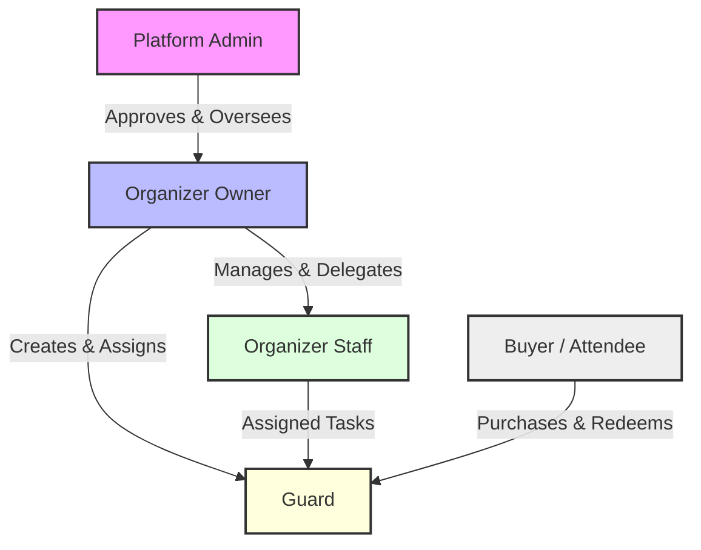
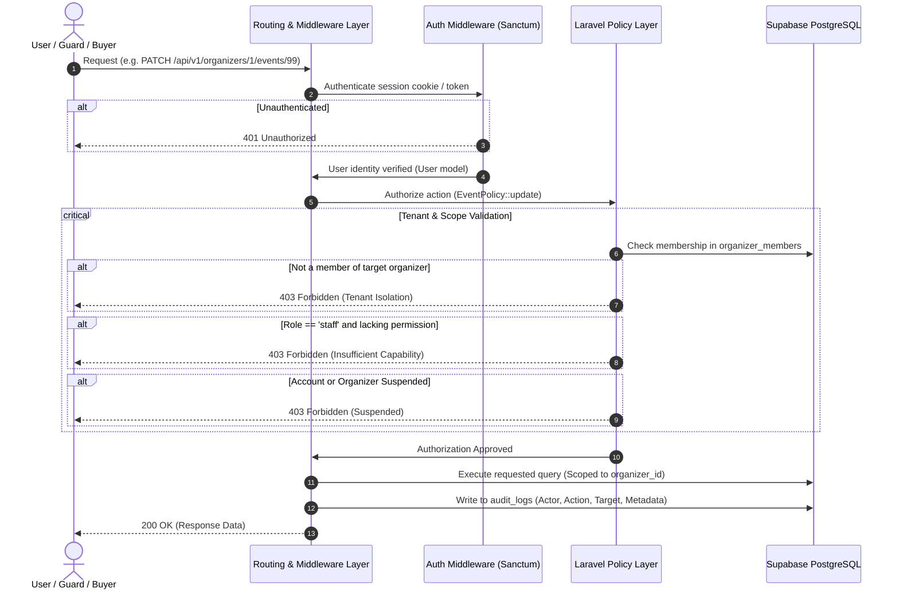

# Roles, Privileges & Authorization Architecture

**Multi-Organizer Event Ticketing Platform · Version 1.0 · October 2026**  
**References:** [audit ticket business rules.md](../audit%20ticket%20business%20rules.md) (§1, §2), [v1.md](../v1.md) (§FR-01, §FR-02, §3, §4.1), [techstack.md](../techstack.md) (§3), [implementation-plan.md](../implementation-plan.md) (Phase 1, Phase 2).

---

## 1. Architectural Principles

The platform is a multi-tenant event ticketing system where multiple organizers coexist on shared infrastructure while maintaining absolute isolation. The authorization and security framework is designed around five core principles:

1. **Multi-Tenant Isolation:** An organizer or staff member must never be able to access, view, or alter another organizer’s events, sales, financial settlement reports, attendee details, or staff assignments through parameter tampering, URL guessing, or IDOR (Insecure Direct Object Reference).
2. **Principle of Least Privilege:** Users receive only the minimum permissions required for their specific role and assigned resources.
3. **Dual-Layer Authorization (Role + Resource Scope):** Having a role (e.g., `organizer_owner`) determines *what* operations are permitted; resource scoping determines *which* specific tenant or event can be operated on.
4. **Zero Trust in Client Context:** The backend never trusts client-supplied identifiers (`organizer_id`, `event_id`, `gate_id`, or `role`) in request bodies. Ownership is always verified against authenticated session state in the database.
5. **Fail-Closed Design:** Any unauthenticated request, unrecognized route, missing policy, or unverified credential defaults to immediate rejection (`401 Unauthorized` or `403 Forbidden`).

---

## 2. The Five System Roles



### 2.1 Platform Admin
* **Description:** System-wide administrator who oversees platform operations.
* **Scope:** Platform-wide oversight.
* **Authentication:** Google OAuth only (verified email).
* **Appointment:** Appointed strictly by an existing Platform Admin or via secure server CLI command (`php artisan admin:grant {email}`). No user can register or self-promote to Admin.
* **Key Capabilities:**
  * Review, approve, reject, or suspend organizer accounts.
  * Oversee platform-wide financial settlement and aggregate reports.
  * Audit sensitive operational actions across tenants.
  * Intervene in disputes, emergency event suspensions, or compliance inquiries.
* **Safeguards:** When a platform admin views or modifies an organizer's data, an immutable record is logged in `audit_logs` specifying the admin ID, target tenant, timestamp, and justification.

### 2.2 Organizer Owner
* **Description:** Tenant root owner with full operational and financial control over their organization.
* **Scope:** Scoped strictly to their own Organizer account and all child entities (events, offerings, sales, staff, guards).
* **Authentication:** Google OAuth only.
* **Rules:**
  * Every organizer account must always have at least **one active owner**.
  * Owners can invite and appoint additional owners or staff members.
  * Owners configure payment settlement payout details, legal profile, and branding.

### 2.3 Organizer Staff
* **Description:** Team members invited to assist with event planning, ticket configuration, or gate supervision.
* **Scope:** Scoped to their employer’s organizer account, limited by an explicit list of granted capabilities.
* **Authentication:** Google OAuth only (invited via single-use email invitation).
* **Strict Constraints ([audit ticket business rules.md §1](../audit%20ticket%20business%20rules.md)):**
  * Staff **cannot** invite team members, assign roles, or modify permissions.
  * Staff **cannot** edit the organizer’s legal profile or banking/payout details.
  * Staff **cannot** delete an organizer account.
  * Staff capabilities are stored in `organizer_members.permissions` as an allowlist of permission slugs.

### 2.4 Guard
* **Description:** Field staff stationed at venue gates to scan QR codes or enter short codes for ticket verification.
* **Scope:** Scoped strictly to assigned events and designated gates.
* **Authentication:** Supports two secure paths:
  1. **Google OAuth Invitation:** Guard accepts email invitation with a verified Google account.
  2. **Temporary Guard Password Account:** Created by an Organizer Owner or authorized Staff member.
* **Strict Rules for Guard Password Accounts ([audit ticket business rules.md §2](../audit%20ticket%20business%20rules.md)):**
  * Password accounts belong strictly to the creating organizer (`managed_by_organizer_id`).
  * Account can **never** become an Organizer, Staff, or Platform Admin.
  * Credentials work for **one event only**.
  * System generates a temporary password shown only once on screen (never emailed or shared in group chats).
  * Mandatory password change on first sign-in before any scan endpoints can be invoked.
  * **Automatic Deletion:** As soon as the event closes (or is cancelled/archived), the guard credential password hash is wiped, active sessions are terminated, and the guard is logged out immediately. Past scan records retain the guard's name for historical auditing.
  * Session lifetime capped at 12 hours max.
  * Lockout after 5 consecutive failed password attempts.
  * Lockout of short-code typing after 5 consecutive invalid codes (QR scanning remains active).

### 2.5 Buyer / Attendee
* **Description:** Public consumer purchasing or claiming tickets.
* **Scope:** Access restricted to their own purchased orders and tickets.
* **Authentication:** **No account or password required** (Guest Checkout).
* **Credential Access:** Orders and tickets are accessed exclusively via cryptographically secure, tokenized retrieval links (`/t/{access_token}`) delivered to the buyer’s email. An order is never accessible by numeric ID alone ([hurdles.md §H11](../hurdles.md)).

---

## 3. Comprehensive Permissions Matrix

**Legend:**
* **Full:** Unrestricted authority within the user's tenant or platform scope.
* **Scoped:** Permitted, but strictly scoped to assigned events/gates.
* **If Granted:** Permitted only if the specific permission slug is present in `organizer_members.permissions`.
* **No:** Prohibited. Attempts return `403 Forbidden` and trigger a security audit entry.

| Functional Area | Capability | Platform Admin | Organizer Owner | Organizer Staff | Guard | Buyer / Guest |
| :--- | :--- | :---: | :---: | :---: | :---: | :---: |
| **Platform Ops** | View system audit logs | Full | No | No | No | No |
| | Create/appoint Platform Admins | Full (CLI/Admin) | No | No | No | No |
| | Approve/Suspend Organizers | Full | No | No | No | No |
| | View platform-wide financial aggregates | Full | No | No | No | No |
| **Tenant Admin** | Edit Organizer profile & payout bank details | Oversight / Audit | Full (Own org) | No | No | No |
| | Invite, promote, or remove Owners & Staff | Oversight / Audit | Full (Own org) | No | No | No |
| | Grant/revoke Staff granular permissions | No | Full (Own org) | No | No | No |
| **Event Ops** | Create, edit, and publish events | Oversight / Audit | Full (Own org) | If Granted (`events:write`) | No | No |
| | Cancel or archive events | Oversight / Audit | Full (Own org) | If Granted (`events:delete`) | No | No |
| | Configure ticket offerings, prices, and capacity | Oversight / Audit | Full (Own org) | If Granted (`tickets:manage`) | No | No |
| | Configure reserved seating sections & seats | Oversight / Audit | Full (Own org) | If Granted (`seating:manage`) | No | No |
| | Create & manage delegations (sponsors/groups) | Oversight / Audit | Full (Own org) | If Granted (`delegations:manage`) | No | No |
| | Issue sponsor/media tickets directly | Oversight / Audit | Full (Own org) | If Granted (`tickets:issue`) | No | No |
| **Orders & Sales** | View orders and customer information | Platform-wide | Full (Own events) | If Granted (`orders:read`) | No | Own Order Only |
| | Export attendee lists (CSV) | Platform-wide | Full (Own events) | If Granted (`attendees:export`) | No | No |
| | Revoke or cancel individual tickets | Oversight / Audit | Full (Own events) | If Granted (`tickets:revoke`) | No | No |
| | Request/approve customer refunds | Approval / Policy | Request (Own events) | If Granted (`refunds:request`) | No | Request via policy |
| **Gate & Scanning** | Create guard password accounts & issue credentials | Oversight / Audit | Full (Own org) | If Granted (`guards:manage`) | No | No |
| | Assign guards to specific events and gates | Oversight / Audit | Full (Own events) | If Granted (`guards:manage`) | No | No |
| | Scan QR codes and redeem tickets | Support Override | Optional | Optional | Scoped (Assigned gates) | No |
| | Enter short code for manual entry fallback | Support Override | Optional | Optional | Scoped (Assigned gates) | No |
| | View real-time gate attendance counts | Full (Platform) | Full (Own events) | If Granted (`reports:attendance`) | Scoped (Assigned gate) | No |
| **Financials** | View settlement reports & payout calculations | Full (Platform) | Full (Own events) | If Granted (`reports:financial`) | No | View own receipt |

---

## 4. Granular Staff Permissions Registry (`permissions` JSONB)

When an Organizer Owner invites a staff member, they grant specific permission keys stored in `organizer_members.permissions`:

```json
[
  "events:read",
  "events:write",
  "tickets:manage",
  "delegations:manage",
  "orders:read",
  "attendees:export",
  "guards:manage",
  "reports:attendance"
]
```

### Complete Capability Registry

| Permission Slug | Description | Allowed Actions |
| :--- | :--- | :--- |
| `events:read` | View event configuration | Browse drafts, published events, gate schedules, and offerings. |
| `events:write` | Modify event configuration | Edit event metadata, dates, venue, and attendee questions. Cannot publish without `events:publish`. |
| `events:publish` | Publish or close events | Transition event from `draft` $\rightarrow$ `published`, or manually trigger closure. |
| `events:delete` | Cancel or archive events | Cancel scheduled events or move past events to archive. |
| `tickets:manage` | Manage ticket tiers & prices | Add/edit ticket types, categories, prices, and offering quotas. |
| `tickets:issue` | Direct manual ticket issuance | Manually issue complimentary, sponsor, or media passes. |
| `tickets:revoke` | Invalidate tickets | Revoke tickets with an audit reason, barring admission at gates. |
| `seating:manage` | Configure seating layouts | Setup seating sections, rows, and seat inventory. |
| `delegations:manage` | Manage sponsor allocations | Create delegations, generate claim links, and track sponsor quotas. |
| `orders:read` | View attendee & order lists | View customer names, emails, and ticket assignment details. |
| `attendees:export` | Download attendee rosters | Export attendee and order lists as CSV spreadsheets. |
| `guards:manage` | Manage gate personnel | Create guard password accounts, issue temporary credentials, assign to gates. |
| `reports:attendance` | View gate analytics | Monitor real-time gate scan volumes, check-in percentages, and gate logs. |
| `reports:financial` | View financial summaries | View ticket gross sales, promotion discounts, and net ticket totals. |
| `refunds:request` | Initiate customer refunds | Submit refund requests to Platform Admins for Pesapal reversal. |

---

## 5. Technical Implementation & Enforcement

### 5.1 Enforcement Pipeline Flow



### 5.2 Laravel Policy Implementation Pattern

All operations on organizer resources use Laravel Policies. A role check alone is never sufficient; the policy explicitly verifies multi-tenant relationship and permission claims.

```php
namespace App\Policies;

use App\Models\User;
use App\Models\Event;
use Illuminate\Auth\Access\HandlesAuthorization;

class EventPolicy
{
    use HandlesAuthorization;

    /**
     * Intercept all checks for platform administrators.
     */
    public function before(User $user, $ability)
    {
        if ($user->isPlatformAdmin()) {
            // Platform admin access is permitted but recorded in audit log
            return true;
        }
    }

    /**
     * Determine whether the user can update the event.
     */
    public function update(User $user, Event $event): bool
    {
        // 1. Verify user belongs to the event's owning organizer
        $membership = $user->organizerMemberships()
            ->where('organizer_id', $event->organizer_id)
            ->where('status', 'active')
            ->first();

        if (!$membership) {
            return false; // Multi-tenant boundary violation
        }

        // 2. Owners have unrestricted access within their organizer
        if ($membership->role === 'owner') {
            return true;
        }

        // 3. Staff must have the specific granular capability
        if ($membership->role === 'staff') {
            return in_array('events:write', $membership->permissions ?? [], true);
        }

        return false;
    }
}
```

### 5.3 Guard Account Enforcement Policy

Guards operate under strict runtime constraints:

```php
namespace App\Policies;

use App\Models\User;
use App\Models\EventGate;

class GateScanPolicy
{
    public function scan(User $user, EventGate $gate): bool
    {
        // 1. Must hold guard credentials
        if ($user->sign_in_method === 'password') {
            $credential = $user->activeGuardCredential;
            if (!$credential || $credential->revoked_at !== null) {
                return false;
            }
            if ($credential->password_change_required) {
                return false; // Must complete password change first
            }
        }

        // 2. Event must be open
        $event = $gate->event;
        if ($event->status !== 'published' || now()->isAfter($gate->closes_at)) {
            return false;
        }

        // 3. Verify guard is explicitly assigned to this event (and gate if set)
        return $user->guardAssignments()
            ->where('event_id', $event->id)
            ->where(function ($query) use ($gate) {
                $query->whereNull('gate_id')
                      ->orWhere('gate_id', $gate->id);
            })
            ->where('status', 'active')
            ->exists();
    }
}
```

---

## 6. Database Schema Supporting RBAC

```sql
-- Users Table
CREATE TABLE users (
    id UUID PRIMARY KEY DEFAULT gen_random_uuid(),
    name VARCHAR(255) NOT NULL,
    email VARCHAR(255) UNIQUE NOT NULL,
    phone VARCHAR(50),
    sign_in_method VARCHAR(20) NOT NULL DEFAULT 'google', -- 'google', 'password'
    google_id VARCHAR(255) UNIQUE,
    managed_by_organizer_id UUID REFERENCES organizers(id) ON DELETE CASCADE,
    platform_role VARCHAR(20) DEFAULT NULL, -- 'admin' or NULL
    status VARCHAR(20) NOT NULL DEFAULT 'active', -- 'active', 'suspended'
    created_at TIMESTAMP WITH TIME ZONE DEFAULT NOW(),
    updated_at TIMESTAMP WITH TIME ZONE DEFAULT NOW()
);

-- Organizers (Tenants)
CREATE TABLE organizers (
    id UUID PRIMARY KEY DEFAULT gen_random_uuid(),
    name VARCHAR(255) NOT NULL,
    slug VARCHAR(255) UNIQUE NOT NULL,
    contact_email VARCHAR(255) NOT NULL,
    status VARCHAR(20) NOT NULL DEFAULT 'pending', -- 'pending', 'active', 'suspended'
    created_at TIMESTAMP WITH TIME ZONE DEFAULT NOW(),
    updated_at TIMESTAMP WITH TIME ZONE DEFAULT NOW()
);

-- Organizer Memberships (Tenant Staff & Owners)
CREATE TABLE organizer_members (
    id UUID PRIMARY KEY DEFAULT gen_random_uuid(),
    organizer_id UUID NOT NULL REFERENCES organizers(id) ON DELETE CASCADE,
    user_id UUID NOT NULL REFERENCES users(id) ON DELETE CASCADE,
    role VARCHAR(20) NOT NULL, -- 'owner', 'staff'
    permissions JSONB NOT NULL DEFAULT '[]', -- Array of granted permission strings
    status VARCHAR(20) NOT NULL DEFAULT 'active', -- 'active', 'suspended'
    created_at TIMESTAMP WITH TIME ZONE DEFAULT NOW(),
    updated_at TIMESTAMP WITH TIME ZONE DEFAULT NOW(),
    CONSTRAINT uq_organizer_user UNIQUE (organizer_id, user_id)
);

-- Guard Credentials (Single-Event Passwords)
CREATE TABLE guard_credentials (
    id UUID PRIMARY KEY DEFAULT gen_random_uuid(),
    user_id UUID NOT NULL REFERENCES users(id) ON DELETE CASCADE,
    event_id UUID NOT NULL REFERENCES events(id) ON DELETE CASCADE,
    password_hash VARCHAR(255) NOT NULL,
    password_change_required BOOLEAN NOT NULL DEFAULT true,
    issued_by UUID NOT NULL REFERENCES users(id),
    issued_at TIMESTAMP WITH TIME ZONE DEFAULT NOW(),
    revoked_at TIMESTAMP WITH TIME ZONE DEFAULT NULL
);

-- Event Staff Assignments (Event & Gate Scoping)
CREATE TABLE event_staff (
    id UUID PRIMARY KEY DEFAULT gen_random_uuid(),
    event_id UUID NOT NULL REFERENCES events(id) ON DELETE CASCADE,
    gate_id UUID REFERENCES event_gates(id) ON DELETE SET NULL,
    user_id UUID NOT NULL REFERENCES users(id) ON DELETE CASCADE,
    role VARCHAR(20) NOT NULL DEFAULT 'guard',
    status VARCHAR(20) NOT NULL DEFAULT 'active',
    created_at TIMESTAMP WITH TIME ZONE DEFAULT NOW(),
    CONSTRAINT uq_event_gate_user UNIQUE (event_id, gate_id, user_id)
);

-- System Audit Logs
CREATE TABLE audit_logs (
    id UUID PRIMARY KEY DEFAULT gen_random_uuid(),
    actor_id UUID REFERENCES users(id) ON DELETE SET NULL,
    organizer_id UUID REFERENCES organizers(id) ON DELETE SET NULL,
    event_id UUID REFERENCES events(id) ON DELETE SET NULL,
    action VARCHAR(100) NOT NULL,
    resource_type VARCHAR(100) NOT NULL,
    resource_id VARCHAR(255) NOT NULL,
    metadata JSONB DEFAULT '{}',
    ip_address VARCHAR(45),
    user_agent TEXT,
    created_at TIMESTAMP WITH TIME ZONE DEFAULT NOW()
);
```

---

## 7. Security & Isolation Safeguards

1. **Automated Route Authorization Coverage Test:**
   * A PHPUnit test suite crawls every registered route in the `/api/v1` namespace. If any endpoint lacks a registered policy check or authentication middleware, the build fails automatically.
2. **Suspension Cascading:**
   * Suspending an organizer account instantly terminates all active user sessions for its owners and staff, revokes guard passwords, blocks checkout on its events, and logs the administrative intervention.
3. **No Role Escalation:**
   * Organizer staff members cannot edit memberships or alter `organizer_members.permissions`.
   * Guard password accounts have database check constraints preventing assignment into `organizer_members` or assignment of `platform_role`.
4. **Single-Use Invitations:**
   * Invitations for staff or guards are issued with cryptographic hashes expiring after 48 hours. When accepted via Google OAuth, the system verifies that the authenticated Google email strictly matches the invitation email.
