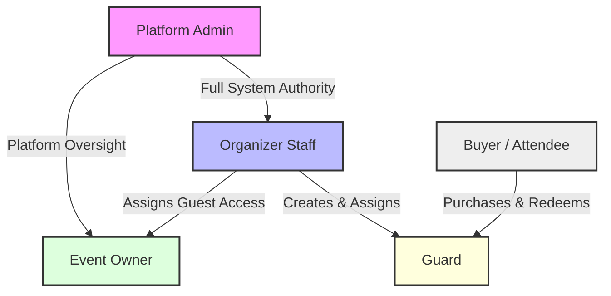
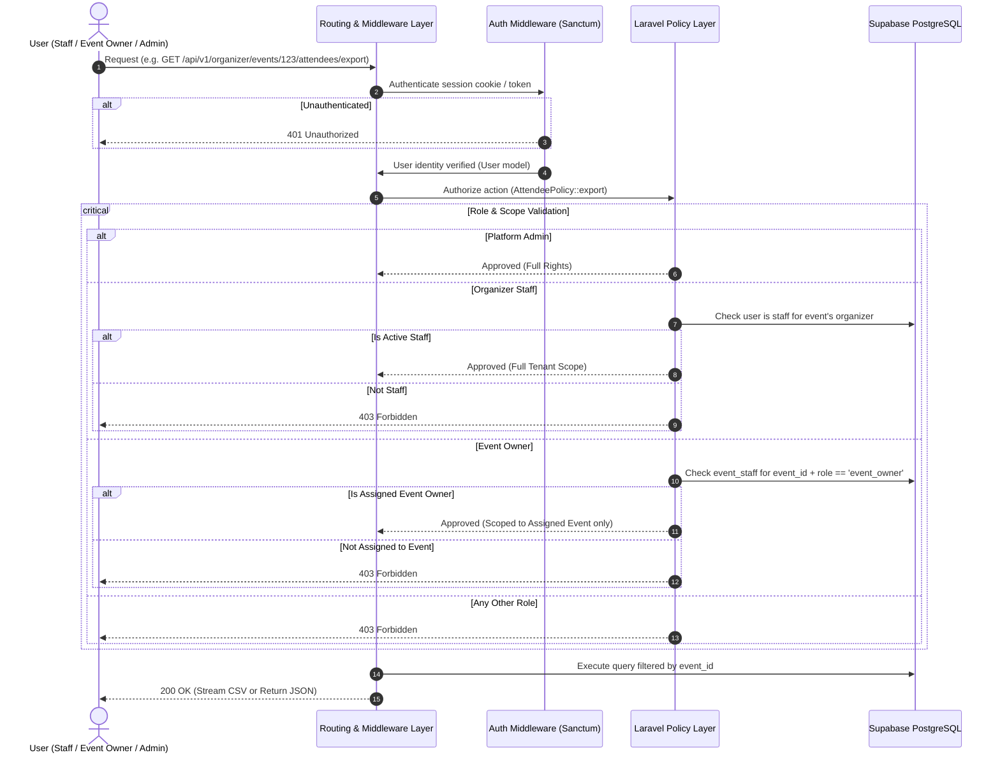

# Roles, Privileges & Authorization Architecture

**Multi-Organizer Event Ticketing Platform · Version 1.3 · 15 October 2026**  
**References:** [limitation.md](../limitation.md) (§1, §2, §11), [v1.md](../v1.md) (§FR-01, §FR-02, §FR-04, §FR-14, §FR-15, §3, §4.1), [techstack.md](../techstack.md) (§3), [implementation-plan.md](../implementation-plan.md) (Phase 1, Phase 2).

---

## 1. Architectural Principles

The platform is a multi-tenant event ticketing system where multiple organizers coexist on shared infrastructure while maintaining absolute isolation. The authorization and security framework is designed around five core principles:

1. **Platform Admin Full Authority:** System-level Platform Admins have full rights and privileges across the platform, including tenant management, event oversight, dispute intervention, refund execution, and aggregate analytics.
2. **Tenant Operations Managed by Organizer Staff:** Organizer Staff have full operational and administrative authority over their organizer account, including profile settings, event creation, offerings, pricing, inventory, guard accounts, and financial settlement reports.
3. **Dedicated, Scoped Event Owner Role:** An Event Owner role is scoped strictly to specific events, with privileges restricted solely to **viewing**, **filtering**, and **exporting** guest/attendee data. Event Owners cannot modify event details, alter pricing, manage guards, or process transactions.
4. **Multi-Tenant Isolation:** An organizer or staff member must never be able to access, view, or alter another organizer’s events, sales, financial settlement reports, attendee details, or staff assignments through parameter tampering, URL guessing, or IDOR (Insecure Direct Object Reference).
5. **Zero Trust in Client Context & Fail-Closed:** The backend never trusts client-supplied identifiers (`organizer_id`, `event_id`, `gate_id`, or `role`) in request bodies. Ownership is always verified against authenticated session state in the database. Any unauthorized call defaults immediately to `401 Unauthorized` or `403 Forbidden`.

---

## 2. The Five System Roles



### 2.1 Platform Admin
* **Description:** System superuser who holds **full, unrestricted rights and privileges** across the entire platform.
* **Scope:** Platform-wide unrestricted authority.
* **Authentication:** Google OAuth only (verified email).
* **Appointment:** Appointed strictly by an existing Platform Admin or via secure server CLI command (`php artisan admin:grant {email}`).
* **Key Capabilities:**
  * Full administrative control over all organizers, events, ticket offerings, pricing, and delegations.
  * Direct ability to view, filter, and export all customer orders and attendee data platform-wide.
  * Sole authority to start and approve refunds; can cancel events and revoke tickets.
  * Verifies organizers before their first paid event, manages the event category list, sees every settlement report, and records manual payouts.
  * Full access to platform audit logs and security telemetry.
  * Real-time gate diagnostics. Admins don't scan tickets: only guard accounts do.

### 2.2 Organizer Staff
* **Description:** Organization manager holding **full operational and administrative authority** over their organizer account.
* **Scope:** Scoped strictly to their own Organizer account and all associated child entities (events, offerings, sales, delegations, guards, settlement reports).
* **Authentication:** Google OAuth only.
* **Rules:**
  * Every organizer account must have at least **one active organizer staff member**.
  * Organizer staff can invite and manage other organizer staff members and assign event owners.
  * Full control over organizer profile, legal details, branding, and payout banking information.
  * Create, edit, publish, cancel, and archive events (closing is automatic).
  * Configure ticket types, categories, prices, seating layouts, and delegations.
  * Issue complimentary, sponsor, or media tickets directly.
  * Create and manage guard password accounts and gate assignments.
  * Access comprehensive financial reports, ticket sales summaries, and settlement calculations.
  * Cannot start refunds (platform admins only) and cannot scan tickets with their Google sign-in; a staff member who works a gate uses a guard account.

### 2.3 Event Owner
* **Description:** An event-level role assigned to external event hosts, clients, or promoters who need visibility into who is attending their specific event.
* **Scope:** Scoped strictly to the specific event(s) assigned to them.
* **Authentication:** Google OAuth only (invited by Organizer Staff or Platform Admin).
* **Sole Privileges:**
  1. **View Guest Data:** View each ticket holder's name, ticket category, delegation and check-in status for their assigned event(s). No contact details, identity numbers or order amounts.
  2. **Filter Guest Data:** Filter attendees by ticket category, delegation, purchase date, or check-in status.
  3. **Export Guest Data:** Download the same columns as a CSV spreadsheet.
* **Strict Restrictions:**
  * Event Owners **cannot** edit event details, dates, venue, or descriptions.
  * Event Owners **cannot** modify ticket offerings, change prices, or alter inventory allocations.
  * Event Owners **cannot** invite team members, create guard accounts, or assign staff.
  * Event Owners **cannot** initiate refunds, revoke tickets, or access organizer banking and settlement reports.

### 2.4 Guard
* **Description:** Field operational personnel stationed at venue gates to scan QR codes or type 6-character short codes for entry verification.
* **Scope:** Scoped strictly to assigned events and designated gates.
* **Authentication:** Guard password account only: the guard's own email address and a password, created by Organizer Staff or a Platform Admin. Guards never sign in with Google, and only guard accounts can scan.
* **Strict Rules for Guard Password Accounts ([limitation.md §2](../limitation.md)):**
  * Password accounts belong strictly to the creating organizer (`managed_by_organizer_id`).
  * Account can **never** become an Organizer Staff, Event Owner, or Platform Admin.
  * Credentials work for **one event only**.
  * Temporary password shown once on screen; must be changed on first sign-in before scanning endpoints are unlocked.
  * **Automatic Deletion:** When the event closes (or is cancelled/archived), the guard credential password hash is wiped, active sessions are terminated, and the guard is signed out immediately.
  * Max session lifetime of 12 hours. Lockout after 5 consecutive failed passwords; code-entry lockout after 5 invalid short codes.

### 2.5 Buyer / Attendee
* **Description:** Public consumer purchasing or claiming tickets.
* **Scope:** Access restricted to their own purchased orders and tickets.
* **Authentication:** **Guest checkout** (no account or password required).
* **Credential Access:** Orders and tickets are accessed exclusively via cryptographically secure, tokenized retrieval links (`/t/{access_token}`) delivered to the buyer's email, plus a checkout token during checkout. A holder can transfer a ticket from its link until the event starts, unless the event collects ID numbers.

---

## 3. Comprehensive Permissions Matrix

**Legend:**
* **Full:** Unrestricted authority within the role's scope.
* **Scoped:** Permitted, but strictly scoped to assigned events/gates.
* **Limited:** Restricted strictly to viewing, filtering, or exporting guest data.
* **No:** Prohibited (`403 Forbidden`).

| Functional Area | Capability | Platform Admin | Organizer Staff | Event Owner | Guard | Buyer / Guest |
| :--- | :--- | :---: | :---: | :---: | :---: | :---: |
| **Platform Ops** | View system audit logs | Full | No | No | No | No |
| | View audit records for own events | Full | Limited (Own events, read-only) | No | No | No |
| | Verify organizers & manage event categories | Full | No | No | No | No |
| | Create/appoint Platform Admins | Full | No | No | No | No |
| | Approve/Suspend Organizers | Full | No | No | No | No |
| | View platform-wide financial aggregates | Full | No | No | No | No |
| | Delete a person's data on request | Full | No | No | No | No |
| **Tenant Admin** | Edit Organizer profile & payout bank details | Full | Full (Own org) | No | No | No |
| | Invite & manage Organizer Staff | Full | Full (Own org) | No | No | No |
| | Assign Event Owners to events | Full | Full (Own org) | No | No | No |
| **Event Ops** | Create, edit, and publish events | Full | Full (Own org) | No | No | No |
| | Cancel or archive events | Full | Full (Own org) | No | No | No |
| | Configure ticket offerings, prices, and capacity | Full | Full (Own org) | No | No | No |
| | Set up ticket waves and move unsold tickets | Full | Full (Own org) | No | No | No |
| | Configure reserved seating sections & seats | Full | Full (Own org) | No | No | No |
| | Create & manage delegations and their set-aside tickets | Full | Full (Own org) | No | No | No |
| | Share event link, QR code & poster | Full | Full (Own org) | No | No | No |
| | Issue sponsor/media tickets directly | Full | Full (Own org) | No | No | No |
| **Guest Data** | **View attendee & order lists** | **Full** | **Full (Own events)** | **Limited (Names & status, assigned event)** | **No** | **Own Order Only** |
| | **Filter attendee lists (category/status)** | **Full** | **Full (Own events)** | **Limited (Names & status, assigned event)** | **No** | **No** |
| | **Export guest lists (CSV)** | **Full** | **Full (Own events)** | **Limited (Names & status, assigned event)** | **No** | **No** |
| **Orders & Sales** | Revoke or cancel individual tickets | Full | Full (Own events) | No | No | No |
| | Start or approve refunds | Full | No | No | No | Request after a postponement |
| | Transfer a ticket | No | No | No | No | Own tickets, before the event starts |
| **Gate & Scanning** | Create guard password accounts & issue credentials | Full | Full (Own org) | No | No | No |
| | Assign guards to specific events and gates | Full | Full (Own events) | No | No | No |
| | Scan QR codes and redeem tickets | No | No | No | Scoped (Assigned gates) | No |
| | Enter short code for manual entry fallback | No | No | No | Scoped (Assigned gates) | No |
| | View real-time gate attendance counts | Full | Full (Own events) | No | Scoped (Assigned gate) | No |
| **Financials** | View settlement reports & payout calculations | Full | Full (Own organizer) | No | No | View own receipt |
| | Record manual payouts | Full | No | No | No | No |

---

## 4. Technical Implementation & Enforcement

### 4.1 Enforcement Pipeline Flow



### 4.2 Laravel Policy Implementation Pattern

#### Event Management Policy (`EventPolicy.php`)
```php
namespace App\Policies;

use App\Models\User;
use App\Models\Event;
use Illuminate\Auth\Access\HandlesAuthorization;

class EventPolicy
{
    use HandlesAuthorization;

    /**
     * Platform Admin has full rights over all resources.
     */
    public function before(User $user, $ability)
    {
        if ($user->isPlatformAdmin()) {
            return true;
        }
    }

    /**
     * Only Organizer Staff can update event configuration.
     * Event Owners CANNOT update events.
     */
    public function update(User $user, Event $event): bool
    {
        return $user->organizerMemberships()
            ->where('organizer_id', $event->organizer_id)
            ->where('role', 'staff')
            ->where('status', 'active')
            ->exists();
    }

    /**
     * Delete/archive events - Organizer Staff only.
     */
    public function delete(User $user, Event $event): bool
    {
        return $this->update($user, $event);
    }
}
```

#### Attendee & Guest Data Policy (`AttendeePolicy.php`)
```php
namespace App\Policies;

use App\Models\User;
use App\Models\Event;
use Illuminate\Auth\Access\HandlesAuthorization;

class AttendeePolicy
{
    use HandlesAuthorization;

    public function before(User $user, $ability)
    {
        if ($user->isPlatformAdmin()) {
            return true;
        }
    }

    /**
     * Determine whether the user can view, filter, or export guest data.
     * Allowed for:
     * 1. Organizer Staff belonging to the event's organizer.
     * 2. Event Owners explicitly assigned to this specific event.
     */
    public function viewGuestData(User $user, Event $event): bool
    {
        // 1. Check if user is Organizer Staff for this event
        $isStaff = $user->organizerMemberships()
            ->where('organizer_id', $event->organizer_id)
            ->where('role', 'staff')
            ->where('status', 'active')
            ->exists();

        if ($isStaff) {
            return true;
        }

        // 2. Check if user is an assigned Event Owner for this specific event
        return $user->eventStaffAssignments()
            ->where('event_id', $event->id)
            ->where('role', 'event_owner')
            ->where('status', 'active')
            ->exists();
    }

    /**
     * Export guest data as CSV.
     */
    public function exportGuestData(User $user, Event $event): bool
    {
        return $this->viewGuestData($user, $event);
    }
}
```

---

## 5. Database Schema Supporting Updated RBAC

```sql
-- Users Table
CREATE TABLE users (
    id UUID PRIMARY KEY DEFAULT gen_random_uuid(),
    name VARCHAR(255) NOT NULL,
    email VARCHAR(255) NOT NULL,
    phone VARCHAR(50),
    sign_in_method VARCHAR(20) NOT NULL DEFAULT 'google', -- 'google', 'password'
    google_id VARCHAR(255) UNIQUE,
    managed_by_organizer_id UUID REFERENCES organizers(id) ON DELETE CASCADE,
    platform_role VARCHAR(20) DEFAULT NULL, -- 'admin' or NULL
    status VARCHAR(20) NOT NULL DEFAULT 'active', -- 'active', 'suspended'
    created_at TIMESTAMP WITH TIME ZONE DEFAULT NOW(),
    updated_at TIMESTAMP WITH TIME ZONE DEFAULT NOW(),
    CONSTRAINT uq_user_email_method UNIQUE (email, sign_in_method)
);

-- Organizers (Tenants)
CREATE TABLE organizers (
    id UUID PRIMARY KEY DEFAULT gen_random_uuid(),
    name VARCHAR(255) NOT NULL,
    slug VARCHAR(255) UNIQUE NOT NULL,
    contact_email VARCHAR(255) NOT NULL,
    status VARCHAR(20) NOT NULL DEFAULT 'pending', -- 'pending', 'active', 'suspended'
    created_at TIMESTAMP WITH TIME ZONE DEFAULT NOW(),
    updated_at TIMESTAMP WITH TIME ZONE DEFAULT NOW()
);

-- Organizer Memberships (Tenant Staff with full operational rights)
CREATE TABLE organizer_members (
    id UUID PRIMARY KEY DEFAULT gen_random_uuid(),
    organizer_id UUID NOT NULL REFERENCES organizers(id) ON DELETE CASCADE,
    user_id UUID NOT NULL REFERENCES users(id) ON DELETE CASCADE,
    role VARCHAR(20) NOT NULL DEFAULT 'staff', -- 'staff'
    status VARCHAR(20) NOT NULL DEFAULT 'active', -- 'active', 'suspended'
    created_at TIMESTAMP WITH TIME ZONE DEFAULT NOW(),
    updated_at TIMESTAMP WITH TIME ZONE DEFAULT NOW(),
    CONSTRAINT uq_organizer_user UNIQUE (organizer_id, user_id)
);

-- Event Staff & Assignments (Guards and Event Owners)
CREATE TABLE event_staff (
    id UUID PRIMARY KEY DEFAULT gen_random_uuid(),
    event_id UUID NOT NULL REFERENCES events(id) ON DELETE CASCADE,
    gate_id UUID REFERENCES event_gates(id) ON DELETE SET NULL, -- Nullable for Event Owners
    user_id UUID NOT NULL REFERENCES users(id) ON DELETE CASCADE,
    role VARCHAR(20) NOT NULL, -- 'guard', 'event_owner'
    status VARCHAR(20) NOT NULL DEFAULT 'active',
    created_at TIMESTAMP WITH TIME ZONE DEFAULT NOW(),
    CONSTRAINT uq_event_user_role UNIQUE (event_id, user_id, role)
);

-- Guard Credentials (Single-Event Passwords)
CREATE TABLE guard_credentials (
    id UUID PRIMARY KEY DEFAULT gen_random_uuid(),
    user_id UUID NOT NULL REFERENCES users(id) ON DELETE CASCADE,
    event_id UUID NOT NULL REFERENCES events(id) ON DELETE CASCADE,
    password_hash VARCHAR(255) NOT NULL,
    password_change_required BOOLEAN NOT NULL DEFAULT true,
    issued_by UUID NOT NULL REFERENCES users(id),
    issued_at TIMESTAMP WITH TIME ZONE DEFAULT NOW(),
    revoked_at TIMESTAMP WITH TIME ZONE DEFAULT NULL
);

-- System Audit Logs
CREATE TABLE audit_logs (
    id UUID PRIMARY KEY DEFAULT gen_random_uuid(),
    actor_user_id UUID REFERENCES users(id) ON DELETE SET NULL,
    organizer_id UUID REFERENCES organizers(id) ON DELETE SET NULL,
    event_id UUID REFERENCES events(id) ON DELETE SET NULL,
    action VARCHAR(100) NOT NULL,
    resource_type VARCHAR(100) NOT NULL,
    resource_id VARCHAR(255) NOT NULL,
    metadata JSONB DEFAULT '{}',
    ip_address VARCHAR(45),
    user_agent TEXT,
    created_at TIMESTAMP WITH TIME ZONE DEFAULT NOW()
);
```

---

## 6. Security & Isolation Safeguards

1. **Strict Event Owner Enclosure:**
   * API endpoints for event configuration (`PATCH /api/v1/organizer/events/{id}`), ticket offerings, ticket waves, pricing, seat maps, delegations, event sharing (link, QR code and poster), and refunds will immediately reject any user authenticated as an `Event Owner`.
   * Event Owners can only query `GET /api/v1/organizer/events/{id}/attendees` and `GET /api/v1/organizer/events/{id}/attendees/export` (v1.md §5) for the exact `event_id` where an active `event_staff` record with `role = 'event_owner'` exists.
2. **Suspension Cascading:**
   * Suspending an organizer account instantly terminates sessions for all its Organizer Staff and assigned Event Owners/Guards, prevents ticket sales, and revokes active guard passwords.
3. **No Role Escalation:**
   * Event Owners have zero access to invite users, change roles, or grant permissions.
   * Guard password accounts are constrained by database checks preventing assignment to `organizer_members` or `event_staff` as an `event_owner`.
