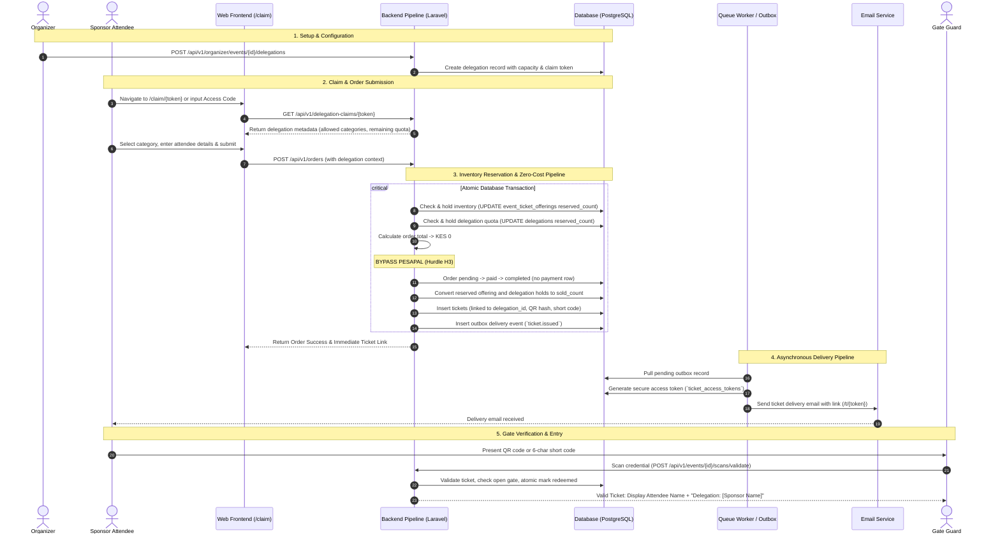

# Sponsored Tickets & Delegations Distribution Specification

**Multi-Organizer Event Ticketing Platform · Version 1.1 · 15 October 2026**  
**References:** [limitation.md](../limitation.md), [hurdles.md](../hurdles.md) (H1, H3, H6, all decided), [doc/state-machines.md](state-machines.md), [v1.md](../v1.md) (§FR-05, §4.5, §6), [implementation-plan.md](../implementation-plan.md) (Phases 2–6).

---

## 1. Overview & Context

In event operations, event organizers frequently allocate blocks of tickets to corporate sponsors, event partners, institutional delegations, media teams, or VIP guest lists. These tickets are typically provided at zero cost to the recipient (or paid for in advance through off-platform corporate sponsorship agreements).

### The Challenge ([hurdles.md §H3](../hurdles.md))
Under the core platform architecture:
1. **Public Availability vs. Private Allocations:** Sponsor tickets must not be available to the general public browsing the event page.
2. **Payment Gateway Incompatibility:** The standard order pipeline requires payment settlement via Pesapal before tickets are issued. However, **Pesapal cannot process zero-shilling (KES 0) transactions**.
3. **Capacity & Overselling Prevention:** Sponsored ticket allocations must be strictly accounted for against the event's total venue capacity and ticket offering pools without double-counting.

This specification defines how the platform models, claims, validates, issues, and redeems sponsored tickets through an automated pipeline.

---

## 2. Core Concepts: Delegations

Sponsored tickets are managed through the **Delegations** subsystem ([v1.md §FR-05](../v1.md)).

* **Definition:** A Delegation is an organizer-configured ticket allocation set aside for a specific group, sponsor, or department.
* **Attributes:**
  * `id`: Unique identifier (UUID).
  * `event_id`: The event the delegation belongs to.
  * `name`: Identifier of the group/sponsor (e.g., *"Safaricom VIP Delegation"*, *"Platinum Sponsor Guest List"*).
  * `capacity`: Total number of tickets allocated. This is a sub-quota of the offerings' capacity, never extra to it.
  * `sold_count` and `reserved_count`: Tickets issued and tickets currently held.
  * Allowed categories: the ticket categories this delegation can claim (the `delegation_categories` table).
  * `price_rule`: Pricing configuration (typically `KES 0` / complimentary, or a fixed sponsor discount).
  * Access code: a 6–8 character code for claiming, stored as `access_code_hash` plus `access_code_encrypted`.
  * Claim token: a high-entropy URL token for private claim links, stored as `claim_token_hash` plus `claim_token_encrypted`, so staff can show the link again.
  * `status`: `active`, `paused`, or `exhausted`.

---

## 3. Distribution Modalities

The system supports two distribution pipelines for sponsored tickets:

| Feature | Mode A: Self-Service Claim (Private Link / Code) | Mode B: Direct Organizer Issuance (Bulk Upload) |
| :--- | :--- | :--- |
| **Use Case** | Sponsor distributes a private link/code to their staff, clients, or executives to register themselves. | Sponsor provides a roster/CSV of names and emails directly to the organizer. |
| **Data Collection** | Attendees input their own details, the event's identity field if it has one, and the event's pick-list questions during checkout. | Organizer imports attendee details in bulk via dashboard. |
| **Capacity Check** | Real-time atomic inventory reservation during order placement. | Batch allocation verified before mass insertion. |
| **Recipient Experience** | Receives order confirmation and ticket retrieval email upon form completion. | Receives personalized ticket link email immediately upon organizer dispatch. |

---

## 4. End-to-End Pipeline Architecture



---

## 5. Detailed Pipeline Stages

### Stage 1: Delegation Setup & Authorization
1. Organizer staff create a delegation in the event's Delegations screen in the organizer area.
2. The platform generates:
   * A private claim URL: `https://www.yourdomain.com/claim/{claim_token}`
   * An optional short claim code (e.g., `ACME2026`).
3. A delegation is a sub-quota of its offerings, so its tickets are never counted twice. Offering capacity alone counts against the event:
   $$\sum \text{Offering Capacity} \le \text{Event Capacity}$$
   A delegation ticket uses its offering's capacity and its delegation's quota in the same transaction.

### Stage 2: Eligibility & Reservation (Backend Pipeline)
When `POST /api/v1/orders` is invoked with a `delegation_token` or `access_code`:
1. **Delegation Guard Validation:**
   * Delegation exists and belongs to the active event.
   * Delegation status is `active`.
   * Requested ticket count $\le$ (`capacity` - `sold_count` - `reserved_count`).
   * Selected category $\in$ `allowed_categories`.
2. **Atomic Quota Reservation:**
   ```sql
   UPDATE delegations
   SET reserved_count = reserved_count + :qty
   WHERE id = :delegation_id
     AND status = 'active'
     AND capacity - sold_count - reserved_count >= :qty;
   ```
   If zero rows update, the claim fails with `Delegation allocation exhausted`.

### Stage 3: Zero-Total Bypass & Issuance (Resolution to Hurdle H3)
1. **Bypass Logic:**
   * Backend checks `final_amount == 0`.
   * Standard redirect to Pesapal hosted checkout is skipped.
   * No payment record is written, because there is nothing to pay; the order records a zero total.
2. **Atomic Issuance Transaction:**
   * Order status transitions immediately: `pending` $\rightarrow$ `paid` $\rightarrow$ `completed` (doc/state-machines.md §2).
   * One record created in `tickets` for each unit:
     * `delegation_id`: Populated with the sponsor delegation ID.
     * `ticket_number`: Unique alphanumeric format (e.g., `TCK-XXXXX`).
     * `qr_token_hash` & `qr_token_encrypted`: Cryptographic random string ([v1.md §4.3](../v1.md)).
     * `short_code_hash` & `short_code_encrypted`: 6-character human-readable alphanumeric code ([hurdles.md §H6](../hurdles.md)).
     * `status`: `'valid'`.
   * Event outbox record committed: `TicketIssuedOutboxMessage`.

### Stage 4: Outbox Asynchronous Delivery Pipeline
1. Laravel Queue worker processes the outbox event.
2. Generates an entry in `ticket_access_tokens` linked to the order/tickets.
3. Renders the ticket email using the platform template, displaying:
   * Event Title, Date, Time (in Event Timezone), and Venue.
   * Ticket Category (e.g., *VIP Sponsor Guest*).
   * Sponsor/Delegation name attribution.
   * Secure link: `/t/{access_token}`.
4. On the web ticket page (`/t/{token}`):
   * Attendee can view the live QR code.
   * Displays the 6-character short code formatted as `XXX YYY`.
   * Downloadable PDF ticket with offline presentation capability.

### Stage 5: Gate Scan & Verification
When a guard scans the ticket at the gate ([limitation.md §9](../limitation.md)):
1. Backend verifies: Guard password account authenticated $\rightarrow$ Assigned to event $\rightarrow$ Within the entry window $\rightarrow$ Ticket valid.
2. Atomically marks ticket:
   ```sql
   UPDATE tickets
   SET status = 'redeemed', redeemed_at = NOW()
   WHERE id = :ticket_id AND event_id = :event_id AND status = 'valid';
   ```
3. Guard scanner displays:
   * **Result:** `Valid`
   * **Attendee Name:** (e.g., *"Jane Doe"*)
   * **Category:** *"VIP"*
   * **Delegation Tag:** *"Sponsor: Safaricom"* (enables gate staff to provide specialized sponsor badges, wristbands, or escorting).

---

## 6. Financial & Settlement Treatment ([hurdles.md §H1](../hurdles.md))

Sponsored tickets distributed via the system have distinct accounting rules:

1. **Escrow Separation:**
   * Because sponsored tickets bypass Pesapal, they produce KES 0 in Pesapal escrow.
   * They do not incur Pesapal payment gateway processing fees.
2. **Reconciliation & Settlement Reporting:**
   * Settlement reports isolate *Public Paid Revenue* from *Sponsored / Complimentary Allocations*.
   * Prevents discrepancies between ticket counts, gate attendance, and Pesapal merchant payouts.
3. **Platform Fee Policy:**
   * If the platform contract includes a per-ticket issuance fee for complimentary/sponsor tickets, this fee is tallied as a settlement deduction against the organizer's net sales balance rather than billed to the guest attendee.

---

## 7. Database Model & Schema Reference

```sql
-- Delegations Table
CREATE TABLE delegations (
    id UUID PRIMARY KEY DEFAULT gen_random_uuid(),
    event_id UUID NOT NULL REFERENCES events(id) ON DELETE CASCADE,
    name VARCHAR(255) NOT NULL,
    description TEXT,
    capacity INTEGER NOT NULL CHECK (capacity > 0),
    sold_count INTEGER NOT NULL DEFAULT 0,
    reserved_count INTEGER NOT NULL DEFAULT 0,
    price_rule VARCHAR(50) NOT NULL DEFAULT 'complimentary', -- 'complimentary', 'discount_fixed', 'discount_percent'
    access_code_hash VARCHAR(255) UNIQUE,
    access_code_encrypted TEXT,
    claim_token_hash VARCHAR(255) UNIQUE NOT NULL,
    claim_token_encrypted TEXT NOT NULL,
    status VARCHAR(20) NOT NULL DEFAULT 'active', -- 'active', 'paused', 'exhausted'
    created_at TIMESTAMP WITH TIME ZONE DEFAULT NOW(),
    updated_at TIMESTAMP WITH TIME ZONE DEFAULT NOW(),
    CHECK (sold_count >= 0 AND reserved_count >= 0 AND sold_count + reserved_count <= capacity)
);

-- Categories a delegation may claim
CREATE TABLE delegation_categories (
    delegation_id UUID NOT NULL REFERENCES delegations(id) ON DELETE CASCADE,
    category_id UUID NOT NULL REFERENCES ticket_categories(id) ON DELETE CASCADE,
    PRIMARY KEY (delegation_id, category_id)
);

-- Ticket Relationship
ALTER TABLE tickets 
ADD COLUMN delegation_id UUID REFERENCES delegations(id) ON DELETE SET NULL;

CREATE INDEX idx_tickets_delegation_id ON tickets(delegation_id);
CREATE INDEX idx_delegations_event ON delegations(event_id);
```

---

## 8. Summary Checklist for Implementation

- [ ] **Phase 1 (Database):** Include `delegations` table and `delegation_id` in `tickets` migration.
- [ ] **Phase 2 (Dashboard):** Implement Delegation CRUD in Organizer Dashboard with link & code generation.
- [ ] **Phase 3 (Checkout):** Add zero-cost checkout bypass when `order.total == 0` via delegation claim.
- [ ] **Phase 5 (Issuance):** Link issued tickets to `delegation_id` and include delegation details in outbox email payload.
- [ ] **Phase 6 (Gate):** Return delegation name in gate scan verification response payload for guard display.
