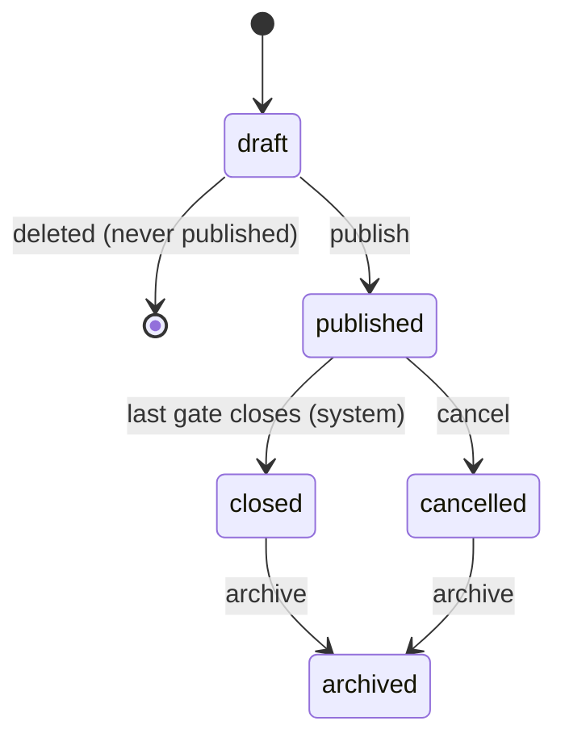
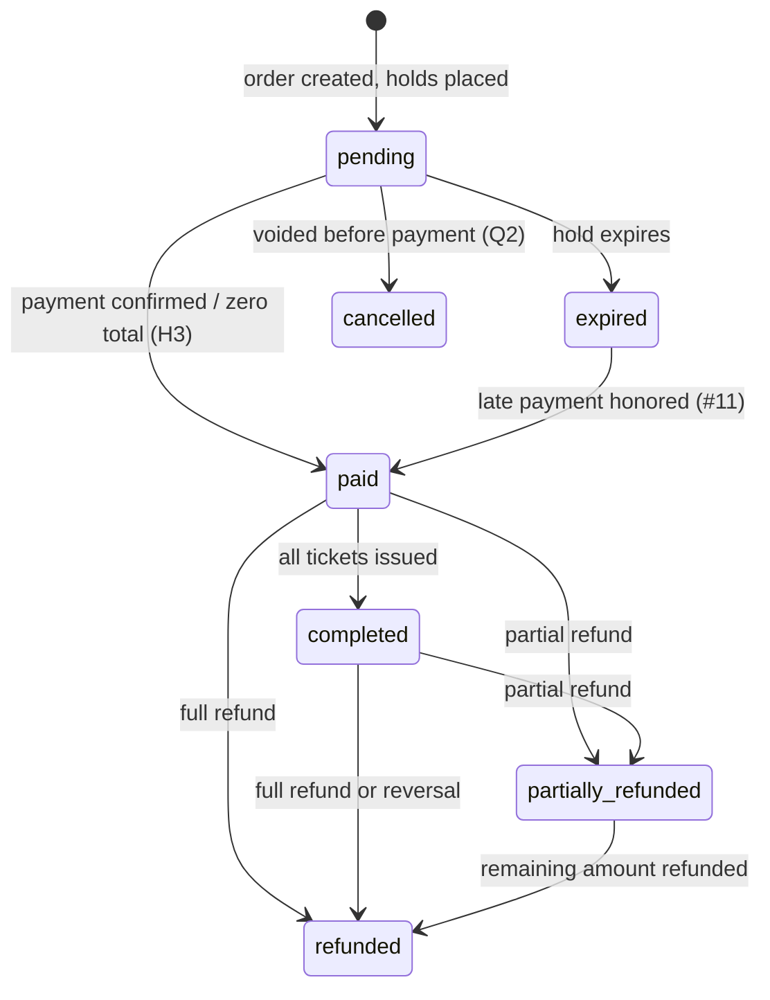
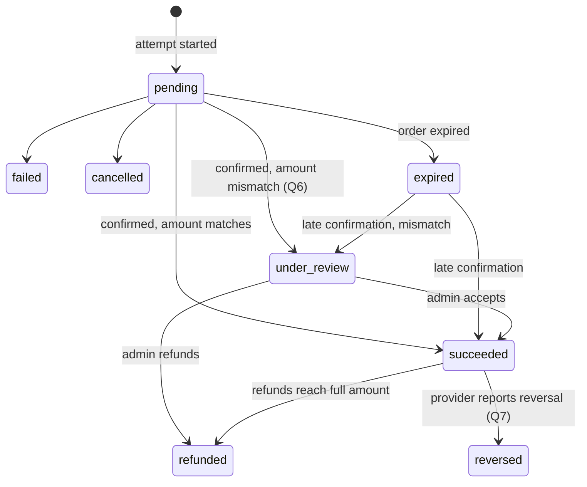
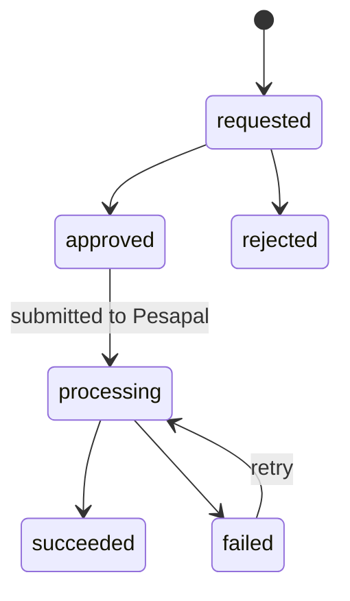
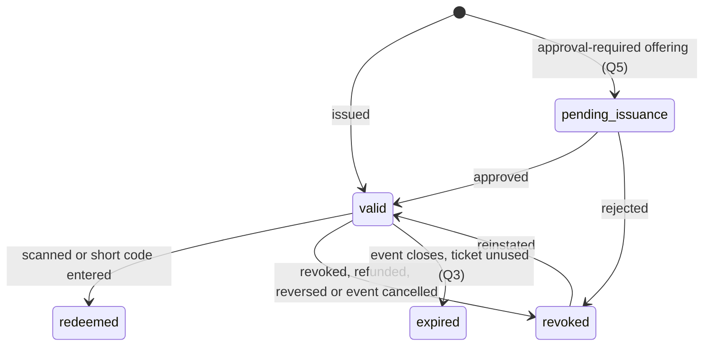
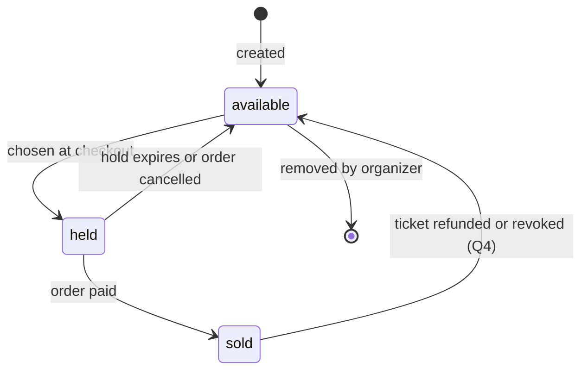
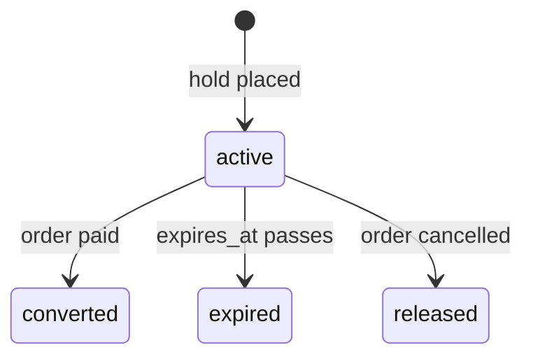

# State Machines

**Multi-Organizer Event Ticketing Platform · Version 0.1 (draft) · 14 October 2026**

**Based on:** [v1.md](../v1.md) §4.6 (version 1.6), [implementation-plan.md](../implementation-plan.md), [limitation.md](../limitation.md), [hurdles.md](../hurdles.md) and [techstack.md](../techstack.md) §5.

This document lists every state, every allowed transition, what triggers it and who may trigger it, for events, orders, payments (with refunds), tickets, seats and inventory reservations. It expands the short state models in v1.md §4.6. P1.3 turns each machine into a PHP enum and a single transition service.

Items marked **Pending** depend on an open hurdle, an open decision-log item or one of the open points in [§8](#8-open-points). Settle those before P1.3 writes the migrations.

---

## Conventions

- **Stored values** are the lowercase names shown here (for example `partially_refunded`), backed by PHP enums.
- **One way in.** Each machine has one service that changes its status. No other code writes the status column, and any transition not listed here is refused.
- **Races.** Transitions that can race (redemption, hold expiry against payment confirmation) use a conditional update, `UPDATE … WHERE status = :from`, or lock the row first. The transition counts only if a row changed.
- **Who:**
  - **Buyer:** a guest on the public website.
  - **Staff:** organizer staff of the event's organizer.
  - **Admin:** a platform admin.
  - **Guard:** a guard assigned to the event, and to the gate if the assignment names one.
  - **System:** a scheduled job or the payment pipeline.
  - Event owners never trigger any transition.
- **Audit.** Every transition triggered by a person is audited. System transitions that affect money or access are audited too: event closing, hold expiry, payment results, refunds, revocations and credential revocation.

---

## 1. Event

| State       | Meaning                                                                                       |
| ----------- | --------------------------------------------------------------------------------------------- |
| `draft`     | Being set up. Not public, not purchasable. Can be deleted.                                     |
| `published` | Public. Purchasable while an offering's sales window is open and the organizer isn't suspended. Scannable while a gate is open. |
| `closed`    | The last gate closing time has passed. Not purchasable, not scannable, still in everyday lists. |
| `cancelled` | Cancelled by the organizer or an admin. Not purchasable, not scannable.                        |
| `archived`  | Hidden from everyday lists. Every order, payment, ticket and scan is kept. Final.              |

| From        | To          | Trigger                         | Who           | Conditions                                                                 | Effects |
| ----------- | ----------- | ------------------------------- | ------------- | -------------------------------------------------------------------------- | ------- |
| `draft`     | *(deleted)* | Delete draft                    | Staff, Admin  | Never published, so it has no orders, tickets or scans                     | Row and its configuration removed; audit entry kept |
| `draft`     | `published` | Publish                         | Staff, Admin  | At least one active offering; valid and consistent time windows; capacity covers all allocations; organizer active. **Pending Q10:** at least one gate | Event appears on public endpoints |
| `published` | `closed`    | Last gate closing time passes   | System (every-minute job) | `now ≥ max(event_gates.closes_at)`. No person can set or undo it | Sales and scans stop. Guard passwords revoked and deleted, guard sessions ended, password-guard assignments ended. Google guards: **Pending H8**. Unused tickets: **Pending Q3** |
| `published` | `cancelled` | Cancel                          | Staff, Admin  | —                                                                          | Sales and scans stop. Guard passwords revoked immediately, as on closing. Pending orders cancelled (**Pending Q2**). Sold tickets and refunds: **Pending H5** |
| `closed`    | `archived`  | Archive                         | Staff, Admin  | —                                                                          | Hidden from everyday lists |
| `cancelled` | `archived`  | Archive                         | Staff, Admin  | **Pending Q11:** no refunds still outstanding                              | Hidden from everyday lists |

**Not allowed:**
- `published → draft` (unpublish).
- `draft → cancelled`: delete the draft instead.
- `closed → published` (reopen).
- `closed → cancelled`.
- Deleting any event that was ever published.

**Not states:**
- A **postponed** event stays `published` with new dates. Changing dates after publishing needs explicit confirmation and is audited (limitation.md 3.5). What buyers are offered: **Pending H5**.
- A **suspended organizer**'s events stay `published` and visible, but can't be bought, and its guards can't sign in (limitation.md 1.8).

---

## 2. Order

| State                | Meaning                                                                                  |
| -------------------- | ---------------------------------------------------------------------------------------- |
| `pending`            | Created with active holds; waiting for payment. The promo code can still change.          |
| `paid`               | Payment confirmed with Pesapal (or the total is zero, **Pending H3**). Holds converted to sold. |
| `completed`          | Every ticket in the order is issued (`valid`). **Pending Q1**                             |
| `expired`            | The hold ran out before a payment was confirmed. Inventory and promo use released.        |
| `cancelled`          | Voided before any payment was confirmed. Inventory and promo use released. **Pending Q2** |
| `partially_refunded` | Some of the amount has been refunded; the matching tickets are revoked. **Pending Q8**    |
| `refunded`           | The whole amount has been refunded, or the payment was reversed. All unredeemed tickets revoked. |

| From                         | To                   | Trigger                                   | Who     | Conditions                                                          | Effects |
| ---------------------------- | -------------------- | ----------------------------------------- | ------- | ------------------------------------------------------------------- | ------- |
| *(new)*                      | `pending`            | Create order                              | Buyer   | Event `published`; organizer active; offering active and in its sales window; quantity, group and delegation rules met; holds placed atomically | Reservations `active`; promo use counted against the hold |
| `pending`                    | `paid`               | Payment confirmed                         | System (payment pipeline) | Order row locked; Pesapal's status check reports completed; amount and currency match | Reservations `converted`; tickets issued; outbox record for the email |
| `pending`                    | `paid`               | Order total is zero                       | System (order service) | **Pending H3**                                    | As above, with no Pesapal payment |
| `paid`                       | `completed`          | All tickets issued                        | System  | Every ticket `valid`. In the normal flow this happens in the same transaction as `paid`; approval-required offerings wait for approval (**Pending Q5**) | — |
| `pending`                    | `expired`            | Hold expires                              | System (hold-expiry job) | Conditional update `WHERE status = 'pending'`; no payment `succeeded` | Reservations `expired`; promo use released; the order's pending payments become `expired` |
| `pending`                    | `cancelled`          | Buyer cancels checkout; event cancelled; organizer suspended | Buyer, System | **Pending Q2**                                  | Reservations `released`; promo use released |
| `expired`                    | `paid`               | Late payment confirmed                    | System  | **Pending decision #11:** inventory (and seats) can be held again atomically | New reservation created and converted in the same transaction |
| `expired`                    | *(stays `expired`)*  | Late payment confirmed, no inventory left | System  | Decision #11                                                        | Payment flagged for refund |
| `paid`, `completed`          | `partially_refunded` | A partial refund succeeds                 | System (refund result) | Refund approved (**Pending decision #12**)               | The refunded tickets are revoked (**Pending Q8**) |
| `paid`, `completed`, `partially_refunded` | `refunded` | Refunds reach the full amount             | System  | Decision #12                                                        | All unredeemed tickets revoked |
| `paid`, `completed`, `partially_refunded` | `refunded` | Pesapal reports the payment reversed      | System  | **Pending Q7**                                                      | All unredeemed tickets revoked; admin alerted |

**Rules:**
- The buyer's return from Pesapal never changes the order. Only the payment pipeline does.
- Payment confirmation and hold expiry race. The payment pipeline locks the order row, and the expiry job updates only `WHERE status = 'pending'`, so exactly one wins. If expiry wins, the payment is a late payment (decision #11).
- A confirmation for an order that is already `paid` or later is acknowledged and changes nothing.
- An order for a `cancelled` event that receives a payment confirmation is refunded, never issued.

---

## 3. Payment

One row per payment attempt. A buyer who retries after a failure starts a new attempt on the same order; the attempt's ID is Pesapal's merchant reference (P4.3).

| State          | Meaning                                                                                     |
| -------------- | ------------------------------------------------------------------------------------------- |
| `pending`      | Sent to Pesapal; waiting for a confirmed result.                                             |
| `succeeded`    | Pesapal's status check confirmed the payment, with the right amount and currency.           |
| `under_review` | Pesapal confirmed a payment whose amount or currency doesn't match the order. Never counts as paid. **Pending Q6** |
| `failed`       | Pesapal reports the payment failed. Final for this attempt; the buyer can start another.     |
| `cancelled`    | Pesapal reports the buyer cancelled the checkout. Final for this attempt.                    |
| `expired`      | The order expired while this attempt was still pending. Reconciliation keeps checking it, because a late confirmation is still possible. |
| `refunded`     | Refunds now total the full amount.                                                           |
| `reversed`     | Pesapal reports that a completed payment was reversed. Final. **Pending Q7**                 |

| From                    | To             | Trigger                                              | Who                     | Conditions                                         | Effects |
| ----------------------- | -------------- | ---------------------------------------------------- | ----------------------- | -------------------------------------------------- | ------- |
| *(new)*                 | `pending`      | Start payment                                        | Buyer                   | Order `pending`, hold active; idempotency key unused (a repeated key returns the same payment) | Order submitted to Pesapal; tracking ID saved as `provider_reference` |
| `pending`               | `succeeded`    | Status check reports completed; amount and currency match | System (IPN handler or reconciliation) | Pesapal's status check is the only source; the IPN body alone is never trusted | Order → `paid` |
| `pending`               | `under_review` | Status check reports completed; amount or currency differs | System             | —                                                  | Order not paid; admin alerted |
| `pending`               | `failed`       | Status check reports failed                          | System                  | Exact Pesapal status mapping confirmed in P4.3     | Buyer may retry while the hold is active |
| `pending`               | `cancelled`    | Pesapal reports the buyer cancelled                  | System                  | Mapping confirmed in P4.3                          | Buyer may retry while the hold is active |
| `pending`               | `expired`      | The order expires                                    | System (hold-expiry job) | —                                                 | — |
| `expired`               | `succeeded`    | Late confirmation from the status check              | System (IPN or reconciliation) | Amount matches                              | Late-payment policy (decision #11) decides the order |
| `expired`               | `under_review` | Late confirmation with a mismatch                    | System                  | —                                                  | Admin alerted |
| `under_review`          | `succeeded`    | Accept the payment                                   | Admin                   | **Pending Q6**                                     | Order → `paid` if its hold is still active, otherwise late-payment policy |
| `under_review`          | `refunded`     | Refund the payment                                   | Admin                   | Through the refund flow below                      | — |
| `succeeded`             | `refunded`     | Refunds reach the full amount                        | System                  | —                                                  | Order → `refunded` |
| `succeeded`             | `reversed`     | Status check reports reversed                        | System                  | —                                                  | Order → `refunded`; tickets revoked; admin alerted |

**Rules:**
- Pesapal's status check is authoritative. If it reports a change that isn't in this table (for example `failed` → completed), log it, flag the payment for review and change nothing automatically.
- A partial refund doesn't change the payment's state; the payment's `refunds` rows record it. The order shows `partially_refunded`.

### 3.1 Refund

| From         | To           | Trigger                                   | Who                                    | Notes |
| ------------ | ------------ | ----------------------------------------- | -------------------------------------- | ----- |
| *(new)*      | `requested`  | Request a refund, with a reason and the tickets it covers | Staff (own events), Admin | **Pending decision #12** and **Q8** |
| `requested`  | `approved`   | Approve                                   | Admin (recommended by decision #12)    | A refund an admin requests can be approved in the same step |
| `requested`  | `rejected`   | Reject, with a reason                     | Admin                                  | Final |
| `approved`   | `processing` | Submit to Pesapal's refund request        | System                                 | Only where Pesapal supports refunds for the payment method |
| `processing` | `succeeded`  | Pesapal confirms the refund, or an admin records a manual refund with its reference | System, Admin | Order and payment states updated; covered tickets revoked |
| `processing` | `failed`     | Pesapal rejects the refund                | System                                 | Admin alerted |
| `failed`     | `processing` | Retry                                     | Admin                                  | — |

Bulk refunds for a cancelled event follow the same machine, one refund per order (**Pending H5**).

---

## 4. Ticket

| State              | Meaning                                                                                        |
| ------------------ | ---------------------------------------------------------------------------------------------- |
| `pending_issuance` | Created for an approval-required offering (such as Media) and waiting for the organizer's approval. No QR code or short code yet; can't be scanned. **Pending Q5** |
| `valid`            | Issued, with a QR token and short code. Admits once at an open gate.                            |
| `redeemed`         | Used for entry. Final: no re-entry (**Pending H7**; limitation.md 9.10 recommends none).        |
| `revoked`          | Cancelled by a person or by a refund, reversal or event cancellation. Refused at the gate.      |
| `expired`          | The event closed without the ticket being used. **Pending Q3**                                  |

| From               | To                 | Trigger                                    | Who                 | Conditions                                                     | Effects |
| ------------------ | ------------------ | ------------------------------------------ | ------------------- | -------------------------------------------------------------- | ------- |
| *(new)*            | `valid`            | Order becomes `paid`                       | System              | Inside the payment transaction; idempotent, so reprocessing creates no extra tickets | QR token and short code generated; email queued through the outbox |
| *(new)*            | `valid`            | Manual issue (Media, complimentary)        | Staff, Admin        | Capacity available; attendee details given                     | Audited |
| *(new)*            | `pending_issuance` | Order for an approval-required offering becomes `paid` | System  | **Pending Q5**                                                 | Inventory counted as sold |
| `pending_issuance` | `valid`            | Approve                                    | Staff, Admin        | —                                                              | Credentials generated; email queued; order → `completed` when every ticket is `valid` |
| `pending_issuance` | `revoked`          | Reject, with a reason                      | Staff, Admin        | —                                                              | Refund through §3.1; capacity returned (**Pending Q4**) |
| `valid`            | `redeemed`         | Scan or short code at the gate             | Guard               | Event `published`; guard assigned to the event (and gate); gate open by server time; ticket belongs to the event. One atomic update `WHERE status = 'valid'` | Scan recorded in `ticket_scans`; `redeemed_at` set |
| `valid`            | `revoked`          | Revoke, with a reason                      | Staff, Admin        | —                                                              | Audited; refused at the gate |
| `valid`            | `revoked`          | Refund covering the ticket, payment reversal, or event cancellation | System | Event cancellation: **Pending H5**                  | Capacity and seat: **Pending Q4** |
| `revoked`          | `valid`            | Reinstate (separate action)                | Staff, Admin        | Order still `paid` or `completed`; ticket not covered by a refund; event `published` | Audited |
| `valid`            | `expired`          | Event closes                               | System (event-close job) | **Pending Q3**                                            | — |

**Rules:**
- A ticket's QR token and short code never change. Reinstating a ticket reuses them.
- Guards can't revoke, reinstate or issue tickets. Event owners can only see ticket status in the guest list.
- A refund doesn't change a `redeemed` ticket.

### 4.1 Scan results (not states)

Every attempt is written to `ticket_scans`, whatever the result. The guard sees four outcomes, and the API returns one of these reasons:

| Guard sees     | `ticket_scans.result` values |
| -------------- | ---------------------------- |
| VALID          | `admitted` |
| ALREADY USED   | `already_redeemed`, with the earlier time and gate |
| INVALID        | `revoked`, `not_issued` (`pending_issuance`), `expired`, `wrong_event`, `wrong_gate`, `gate_not_open`, `gate_closed`, `event_not_open`, `unknown_credential`, `guard_not_assigned`, `short_code_locked`, `rate_limited` |
| UNABLE TO VERIFY | No server response (shown by the scanner only; nothing is recorded) |

---

## 5. Seat

Only for events with reserved seating.

| State       | Meaning                                                                         |
| ----------- | ------------------------------------------------------------------------------- |
| `available` | Can be chosen at checkout.                                                       |
| `held`      | Held by an `active` reservation with this `seat_id`.                             |
| `sold`      | Assigned to a `valid`, `pending_issuance` or `redeemed` ticket.                  |

v1.md FR-12 also lists "released". Here it is the transition back to `available`, not a stored state (**Pending Q9**).

| From        | To          | Trigger                          | Who          | Conditions                                                         | Effects |
| ----------- | ----------- | -------------------------------- | ------------ | ------------------------------------------------------------------ | ------- |
| *(new)*     | `available` | Create seats (single or bulk)    | Staff, Admin | Event uses reserved seating                                         | — |
| `available` | `held`      | Buyer chooses the seat           | Buyer        | Same transaction as the offering hold; conditional update `WHERE status = 'available'` | Reservation with `seat_id` |
| `held`      | `available` | Hold expires or order cancelled  | System       | Same transaction as the reservation release                        | — |
| `held`      | `sold`      | Order becomes `paid`             | System       | Same transaction as the reservation conversion                     | `tickets.seat_id` set |
| `sold`      | `available` | Its ticket is refunded or revoked | System      | **Pending Q4**                                                      | — |
| `available` | *(deleted)* | Remove seat                      | Staff, Admin | Never sold                                                          | — |

**Rule:** the partial unique index (one active ticket per seat per event) is the final guard against double sale. The seat status is a convenience that changes only in the same transaction as its reservation or ticket.

---

## 6. Inventory reservation

A reservation holds capacity on one offering, and on one seat when `seat_id` is set.

| From     | To          | Trigger                    | Who                       | Conditions                                                         | Effects on the offering |
| -------- | ----------- | -------------------------- | ------------------------- | ------------------------------------------------------------------ | ----------------------- |
| *(new)*  | `active`    | Order created              | Buyer (through the order service) | `capacity - sold_count - reserved_count >= qty`, checked and updated in one statement; `expires_at = now + hold duration` (**Pending decision #10**) | `reserved_count += qty` |
| `active` | `converted` | Order becomes `paid`       | System (payment pipeline) | Same transaction as the order change                               | `reserved_count -= qty`, `sold_count += qty`; seat → `sold` |
| `active` | `expired`   | `expires_at` passes        | System (hold-expiry job, every minute) | Conditional update `WHERE status = 'active'`, so it's released only once; safe to run twice | `reserved_count -= qty`; seat → `available`; promo use released |
| `active` | `released`  | Order cancelled            | System                    | Same                                                               | Same as `expired` |

**Rules:**
- **Late payment** (decision #11): a new reservation is created and converted in one transaction, under the same capacity check. If the check fails, the payment is flagged for refund.
- **Invariants**, checked by a reconciliation test:
  - `reserved_count` equals the sum of `quantity` over the offering's `active` reservations.
  - `0 ≤ sold_count + reserved_count ≤ capacity`.
- **Delegations** (**Pending H3** and **Q12**): if a delegation keeps its own counter, it is held, converted and released in the same transactions as the offering.

---

## 7. Rules across machines

1. An order becomes `paid` only through a `succeeded` payment, or a zero total (**Pending H3**).
2. Tickets exist only for `paid` or `completed` orders (or manual issues), and only in `pending_issuance` or `valid` at creation.
3. Event `closed`, `cancelled` or `archived`: no new orders, no new payments, no scans. A payment confirmed afterwards is refunded, never issued.
4. A suspended organizer: no new orders or payments, and its staff, event owners and guards can't sign in. Existing tickets keep their state.
5. Every refund names the tickets it covers, and those tickets are revoked when it succeeds (**Pending Q8**).
6. Money and access transitions run inside database transactions. External calls (Pesapal, email) happen outside them, driven by the outbox.

---

## 8. Open points

These were raised in the P0.1 specification check. Each has a recommendation; the state machines above follow the recommendation until it is confirmed or changed.

| #   | Question | Recommendation |
| --- | -------- | -------------- |
| Q1  | What separates an order's `paid` and `completed` states? | `paid` = payment confirmed; `completed` = every ticket issued. They happen together except for approval-required offerings. |
| Q2  | What cancels an order? | Only before payment: the buyer cancels checkout, the event is cancelled, or the organizer is suspended. After payment, only refunds. |
| Q3  | When does a ticket become `expired`? | Unused `valid` tickets become `expired` when the event closes, so attendance and no-shows are clear. |
| Q4  | Does a refunded or revoked ticket's place go back on sale? | Yes, if it was never redeemed and the event is still `published`: `sold_count` drops by one and its seat becomes `available`. Not for cancelled events. |
| Q5  | How do approval-required (Media) tickets work? | The order is paid (or zero-total, H3) and its tickets wait in `pending_issuance` with inventory counted as sold. Approval issues them; rejection revokes and refunds. |
| Q6  | How is a payment with the wrong amount handled? | Payment `under_review`; the order is not paid. An admin refunds it, or accepts it if the hold is still active. |
| Q7  | What happens when Pesapal reverses a completed payment? | Payment `reversed`, order `refunded` (reason: reversal), unredeemed tickets revoked, admin alerted. |
| Q8  | How do partial refunds work? | Per ticket: each partial refund names the tickets it covers and revokes exactly those. |
| Q9  | Is "released" a seat state, and can organizers block seats? | "Released" is the transition back to `available`. No blocked seats in the first release. |
| Q10 | How does an event with no gates close? | Publishing requires at least one gate, so every published event closes automatically. |
| Q11 | Is archiving manual, and are unpublish and reopen allowed? | Archiving is manual (staff or admin). A cancelled event can be archived only when no refunds are outstanding. No unpublish or reopen. |
| Q12 | Is a delegation's allocation part of an offering's capacity or extra to it? | Part of it: a delegation is a sub-quota of its offerings' capacity, so a ticket is never counted twice. |

Open hurdles and decisions these machines depend on: **H3** (zero-total orders and delegation claims), **H5** (cancelled and postponed events), **H7** (re-entry), **H8** (Google guard assignments at close), and decision-log **#10** (hold duration), **#11** (late payment) and **#12** (refund approval).
