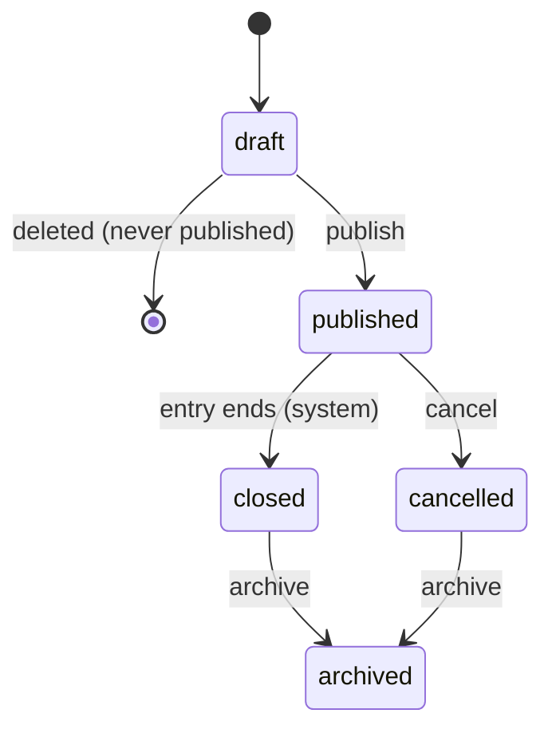
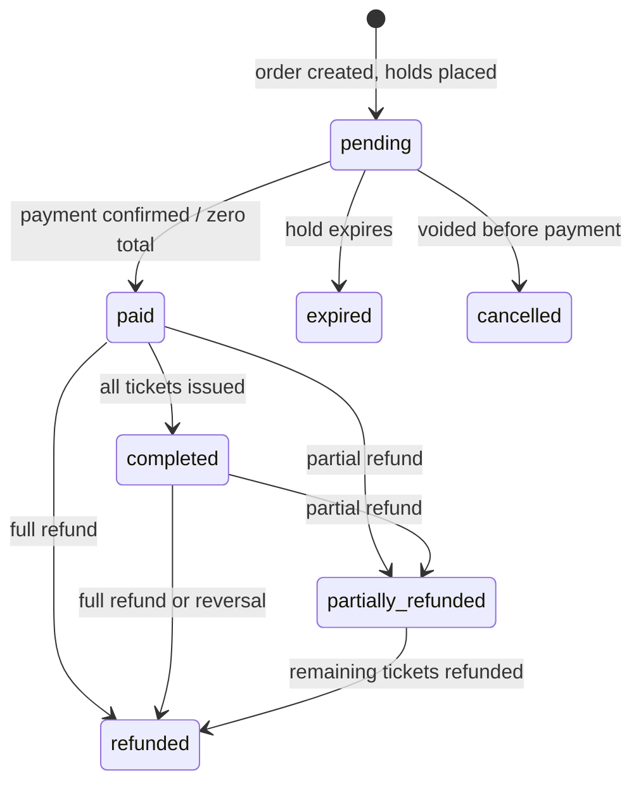
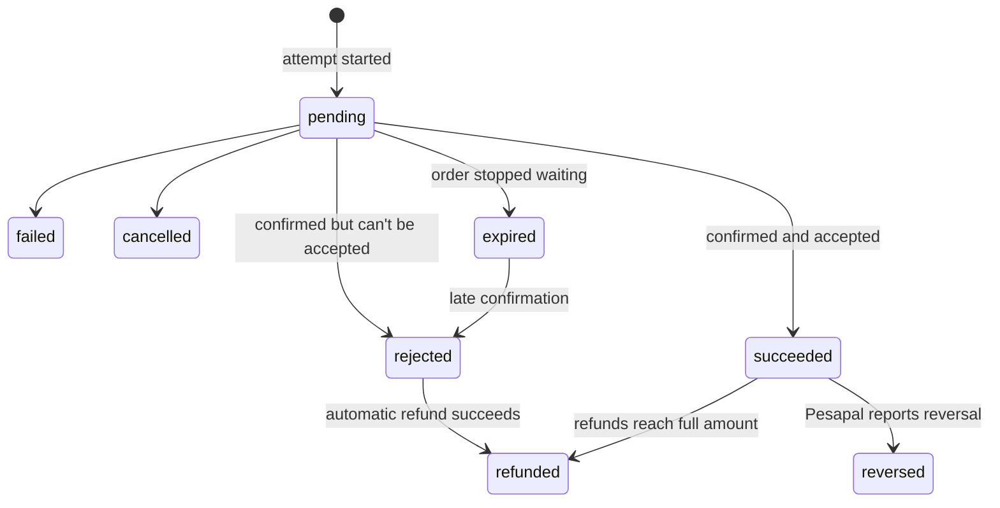
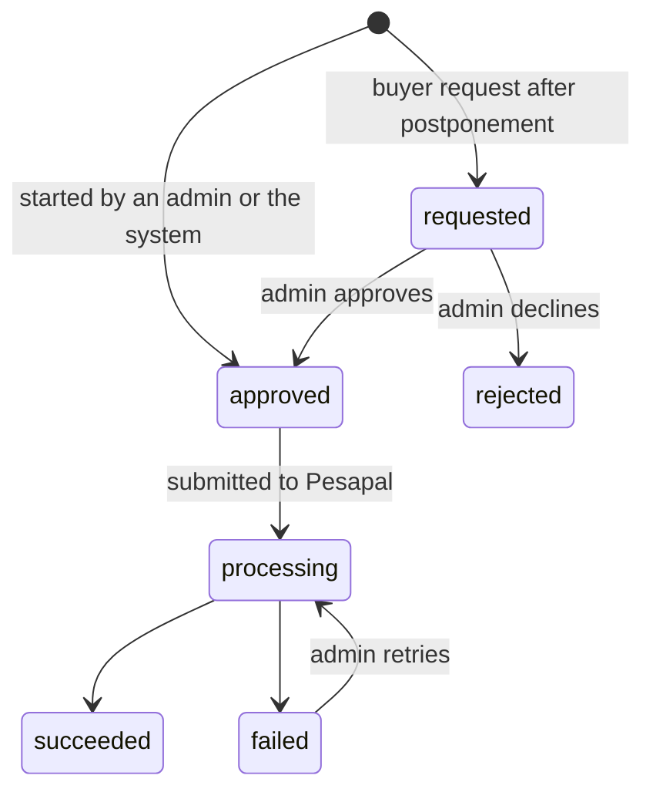
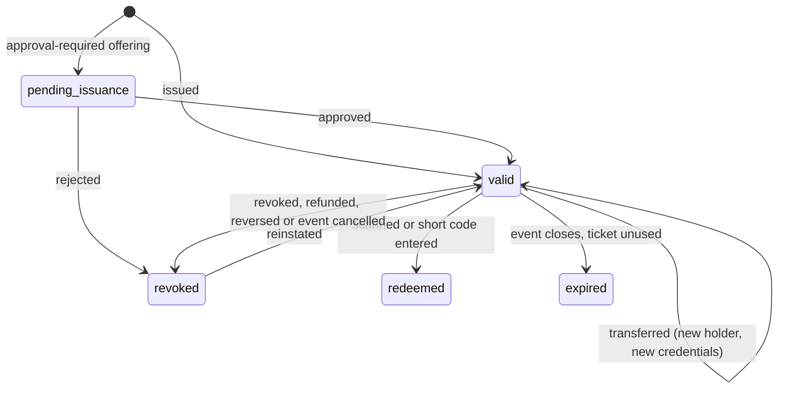
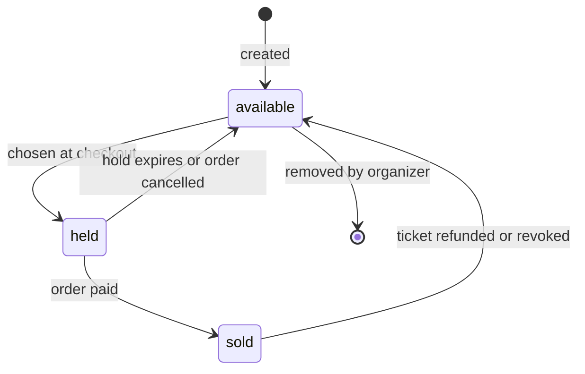
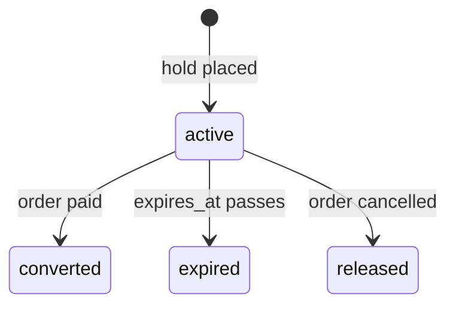

# State Machines

**Multi-Organizer Event Ticketing Platform · Version 1.3 · 20 October 2026**

**Based on:** [v1.md](../v1.md) §4.6 (version 1.8), [implementation-plan.md](../implementation-plan.md), [limitation.md](../limitation.md), [hurdles.md](../hurdles.md) and [techstack.md](../techstack.md) §5.

This document lists every state, every allowed transition, what triggers it and who may trigger it, for events, orders, payments (with refunds), tickets, seats and inventory reservations. It expands the short state models in v1.md §4.6. P1.3 turns each machine into a PHP enum and a single transition service.

The decisions behind these machines were settled on 15 October 2026 and are listed in [§8](#8-decisions).

---

## Conventions

- **Stored values** are the lowercase names shown here (for example `partially_refunded`), backed by PHP enums.
- **One way in.** Each machine has one service that changes its status. No other code writes the status column, and any transition not listed here is refused.
- **Races.** Transitions that can race (redemption, hold expiry against payment confirmation) use a conditional update, `UPDATE … WHERE status = :from`, or lock the row first. The transition counts only if a row changed.
- **Who:**
  - **Buyer:** a guest on the public website.
  - **Holder:** whoever holds a ticket's retrieval link.
  - **Staff:** organizer staff who manage the event: its creator, or staff a platform admin gave access to it (v1.md §3, rule 8). Other staff of the organizer trigger nothing.
  - **Admin:** a platform admin.
  - **Guard:** a guard password account assigned to the event, and to the gate if the assignment names one.
  - **System:** a scheduled job or the payment pipeline.
  - Event owners never trigger any transition.
- **Audit.** Every transition triggered by a person is audited. System transitions that affect money or access are audited too: event closing, hold expiry, payment results, refunds, revocations, transfers and credential revocation.

---

## 1. Event

| State       | Meaning                                                                                       |
| ----------- | --------------------------------------------------------------------------------------------- |
| `draft`     | Being set up. Not public, not purchasable. Can be deleted.                                     |
| `published` | Public. Purchasable while an offering's sales window is open and the organizer isn't suspended. Scannable during its entry window. |
| `closed`    | Entry has ended. Not purchasable, not scannable, still in everyday lists.                      |
| `cancelled` | Cancelled by staff or an admin. Not purchasable, not scannable.                                |
| `archived`  | Hidden from everyday lists. Every order, payment, ticket and scan is kept. Final.              |

**Entry window.** An event with gates admits people while a gate is open (each gate's `opens_at` to `closes_at`). An event with no gates admits people between its `starts_at` and `ends_at`; its guards are assigned to the event without a gate. In both cases an event may have several guards, and every scan records the guard who made it.

| From        | To          | Trigger                         | Who           | Conditions                                                                 | Effects |
| ----------- | ----------- | ------------------------------- | ------------- | -------------------------------------------------------------------------- | ------- |
| `draft`     | *(deleted)* | Delete draft                    | Staff, Admin  | Never published, so it has no orders, tickets or scans                     | Row and its configuration removed; audit entry kept |
| `draft`     | `published` | Publish                         | Staff, Admin  | At least one active offering; valid and consistent time windows; capacity covers all allocations; organizer active; if any offering is paid, organizer verified and its payout account entered by a platform admin (otherwise the event stays in draft) | Event appears on public endpoints |
| `published` | `closed`    | Entry ends                      | System (every-minute job) | `now ≥ max(event_gates.closes_at)`, or `now ≥ ends_at` if the event has no gates. No person can set or undo it | Sales and scans stop. Every guard password for the event is revoked and deleted, guard sessions ended and guard assignments ended. Unused `valid` tickets → `expired` |
| `published` | `cancelled` | Cancel                          | Staff, Admin  | —                                                                          | Sales and scans stop. Guard passwords revoked and assignments ended, as on closing. Pending orders → `cancelled`. Every `valid` and `pending_issuance` ticket → `revoked`. Every buyer emailed. Refunds are started by an admin, order by order |
| `closed`    | `archived`  | Archive                         | Staff, Admin  | —                                                                          | Hidden from everyday lists |
| `cancelled` | `archived`  | Archive                         | Staff, Admin  | No refund still `requested`, `approved` or `processing` for the event      | Hidden from everyday lists |

**Not allowed:**
- `published → draft` (unpublish).
- `draft → cancelled`: delete the draft instead.
- `closed → published` (reopen).
- `closed → cancelled`.
- Deleting any event that was ever published.
- Automatic archiving.

**Not states:**
- A **postponed** event stays `published` with new dates. Changing dates after publishing needs explicit confirmation and is audited (limitation.md 3.5). When confirming, staff enter the refund-request deadline, guided by the event's refund policy, and it is stored in `events.refund_requests_until` (implementation-plan.md §11, #48). Every buyer is emailed a refund-request link valid until that date. Tickets stay `valid`. The event's slug, and so its link, can't change once it is published (#47).
- A **suspended organizer**'s events stay `published` and visible, but can't be bought, and its staff, event owners and guards can't sign in (limitation.md 1.8).

---

## 2. Order

| State                | Meaning                                                                                  |
| -------------------- | ---------------------------------------------------------------------------------------- |
| `pending`            | Created with active holds; waiting for payment. The promo code can still change.          |
| `paid`               | Payment confirmed with Pesapal, or the total is zero. Holds converted to sold.            |
| `completed`          | Every ticket in the order is issued (`valid`). Normally reached in the same transaction as `paid`. |
| `expired`            | The hold ran out before a payment was confirmed. Inventory and promo use released. Final: a later payment is refunded. |
| `cancelled`          | Voided before any payment was confirmed. Inventory and promo use released. Final.         |
| `partially_refunded` | Some tickets have been refunded and revoked; the rest stay as they were.                  |
| `refunded`           | Every ticket has been refunded, or the payment was reversed. Unredeemed tickets revoked.  |

| From                         | To                   | Trigger                                   | Who     | Conditions                                                          | Effects |
| ---------------------------- | -------------------- | ----------------------------------------- | ------- | ------------------------------------------------------------------- | ------- |
| *(new)*                      | `pending`            | Create order                              | Buyer   | Event `published`; organizer active; offering active and in its sales window (a wave's dates for a wave's offering); quantity and group rules met; a delegation's offering only with its claim link or access code; submitted details match the event's setup, including the identity field it set (each ticket holder's phone or ID number, or neither), and contain no field the event didn't ask for; CAPTCHA passed if the event requires it; holds placed atomically | Reservations `active`; promo use counted against the hold; checkout token issued to the buyer |
| `pending`                    | `paid`               | Payment confirmed                         | System (payment pipeline) | Order row locked; Pesapal's status check reports completed; amount and currency match | Reservations `converted`; tickets issued; outbox records for the emails and receipt |
| `pending`                    | `paid`               | Order total is zero (complimentary or free delegation claim; promo codes cannot reduce ticket prices to zero per decision #53) | System (order service) | Same checks as a paid order; no Pesapal payment is created | As above, without a receipt |
| `paid`                       | `completed`          | All tickets issued                        | System  | Every ticket `valid`. Approval-required offerings wait for approval | — |
| `pending`                    | `expired`            | Hold expires                              | System (hold-expiry job) | Conditional update `WHERE status = 'pending'`; no payment `succeeded` | Reservations `expired`; promo use released; the order's pending payments → `expired` |
| `pending`                    | `cancelled`          | Buyer cancels checkout; event cancelled; organizer suspended | Buyer, System | —                                                     | Reservations `released`; promo use released; pending payments → `expired` |
| `paid`, `completed`          | `partially_refunded` | A refund covering some of the tickets succeeds | System (refund result) | Refund started by an admin                               | The refunded tickets are revoked |
| `paid`, `completed`, `partially_refunded` | `refunded` | Refunds now cover every ticket           | System  | Refund started by an admin                                          | All remaining unredeemed tickets revoked |
| `paid`, `completed`, `partially_refunded` | `refunded` | Pesapal reports the payment reversed     | System  | —                                                                   | All unredeemed tickets revoked; admin alerted |

**Rules:**
- The buyer's return from Pesapal never changes the order. Only the payment pipeline does.
- Payment confirmation and hold expiry race. The payment pipeline locks the order row, and the expiry job updates only `WHERE status = 'pending'`, so exactly one wins. If expiry wins, the payment is `rejected` and refunded automatically (decision #11).
- A confirmation for an order that is no longer `pending` changes nothing on the order. If it is a second payment for the same order, that payment is refunded automatically.
- Buyer calls about an order (apply promotion, start payment, check status) need the order's checkout token. Knowing the order ID is never enough (hurdles.md H11).

---

## 3. Payment

One row per payment attempt. A buyer who retries after a failure starts a new attempt on the same order; the attempt's ID is Pesapal's merchant reference (P4.3).

| State       | Meaning                                                                                     |
| ----------- | ------------------------------------------------------------------------------------------- |
| `pending`   | Sent to Pesapal; waiting for a confirmed result.                                             |
| `succeeded` | Pesapal confirmed it, with the right amount and currency, while the order was still `pending`. |
| `rejected`  | Pesapal confirmed it, but it can't be accepted: wrong amount or currency, the order had expired or been cancelled, the order was already paid, or the event was no longer on sale. Refunded automatically. |
| `failed`    | Pesapal reports the payment failed. Final for this attempt; the buyer can start another while the hold lasts. |
| `cancelled` | Pesapal reports the buyer cancelled the checkout. Final for this attempt.                    |
| `expired`   | The order expired or was cancelled while this attempt was still pending. Reconciliation keeps checking it, because the buyer may still complete it. |
| `refunded`  | Refunds now total the full amount.                                                           |
| `reversed`  | Pesapal reports that a completed payment was reversed. Final.                                |

| From        | To          | Trigger                                              | Who                     | Conditions                                         | Effects |
| ----------- | ----------- | ---------------------------------------------------- | ----------------------- | -------------------------------------------------- | ------- |
| *(new)*     | `pending`   | Start payment                                        | Buyer                   | Checkout token valid; order `pending`, hold active; idempotency key unused (a repeated key returns the same payment) | Order submitted to Pesapal; tracking ID saved as `provider_reference` |
| `pending`   | `succeeded` | Status check reports completed                       | System (IPN handler or reconciliation) | Pesapal's status check is the only source; amount and currency match; order still `pending` and not already paid | Order → `paid` |
| `pending`   | `rejected`  | Status check reports completed                       | System                  | Amount or currency differs, or the order is no longer `pending`, or it is already paid, or the event is no longer `published` | Refund created and submitted automatically (no approval step); admin notified |
| `pending`   | `failed`    | Status check reports failed                          | System                  | Exact Pesapal status mapping confirmed in P4.3     | Buyer may retry while the hold is active |
| `pending`   | `cancelled` | Pesapal reports the buyer cancelled                  | System                  | Mapping confirmed in P4.3                          | Buyer may retry while the hold is active |
| `pending`   | `expired`   | The order expires or is cancelled                    | System (hold-expiry job or order service) | —                                    | — |
| `expired`   | `rejected`  | Late confirmation from the status check              | System (IPN or reconciliation) | —                                           | Refunded automatically (decision #11) |
| `rejected`  | `refunded`  | The automatic refund succeeds                        | System                  | —                                                  | — |
| `succeeded` | `refunded`  | Refunds reach the full amount                        | System                  | —                                                  | Order → `refunded` |
| `succeeded` | `reversed`  | Status check reports reversed                        | System                  | —                                                  | Order → `refunded`; unredeemed tickets revoked; admin alerted |

**Rules:**
- Pesapal's status check is authoritative. If it reports a change that isn't in this table (for example `failed` → completed), log it, alert an admin and change nothing automatically.
- A partial refund doesn't change the payment's state; its `refunds` rows record it. The order shows `partially_refunded`.

### 3.1 Refund

Only platform admins start refunds (decision #12). The system also refunds `rejected` payments automatically. Organizer staff can't create refunds.

| From         | To           | Trigger                                   | Who                 | Notes |
| ------------ | ------------ | ----------------------------------------- | ------------------- | ----- |
| *(new)*      | `requested`  | Refund-request link in a postponement email | Holder            | Only until `events.refund_requests_until`; names the tickets; lands in the admin queue |
| *(new)*      | `approved`   | Start a refund, naming the tickets it covers | Admin            | Used for cancellations, Media rejections and any other refund |
| *(new)*      | `approved`   | A payment becomes `rejected`              | System              | Covers the whole payment; no tickets exist for it |
| `requested`  | `approved`   | Approve                                   | Admin               | — |
| `requested`  | `rejected`   | Decline, with a reason                    | Admin               | Final; the holder is emailed |
| `approved`   | `processing` | Submit to Pesapal's refund request        | System              | Only where Pesapal supports refunds for the payment method |
| `processing` | `succeeded`  | Pesapal confirms the refund, or an admin records a manual refund with its reference | System, Admin | Order and payment states updated; covered tickets revoked |
| `processing` | `failed`     | Pesapal rejects the refund                | System              | Admin alerted |
| `failed`     | `processing` | Retry                                     | Admin               | — |

A refund always goes back to the original payment, whoever holds the ticket now.

---

## 4. Ticket

| State              | Meaning                                                                                        |
| ------------------ | ---------------------------------------------------------------------------------------------- |
| `pending_issuance` | Created for an approval-required offering (such as Media) and waiting for the organizer's approval. Its place is counted as sold. No QR code or short code yet; can't be scanned. |
| `valid`            | Issued, with a QR token and short code. Admits once during the entry window.                    |
| `redeemed`         | Used for entry. Final: no re-entry (hurdles.md H7).                                             |
| `revoked`          | Cancelled by a person or by a refund, reversal or event cancellation. Refused at the gate.      |
| `expired`          | The event closed without the ticket being used. Final.                                          |

| From               | To                 | Trigger                                    | Who                 | Conditions                                                     | Effects |
| ------------------ | ------------------ | ------------------------------------------ | ------------------- | -------------------------------------------------------------- | ------- |
| *(new)*            | `valid`            | Order becomes `paid`                       | System              | Inside the payment (or zero-total) transaction; idempotent, so reprocessing creates no extra tickets | QR token and short code generated; email queued through the outbox |
| *(new)*            | `valid`            | Manual issue (Media, complimentary)        | Staff, Admin        | Capacity available; attendee details given                     | Audited |
| *(new)*            | `pending_issuance` | Order for an approval-required offering becomes `paid` | System  | —                                                              | Place counted as sold |
| `pending_issuance` | `valid`            | Approve                                    | Staff, Admin        | —                                                              | Credentials generated; email queued; order → `completed` when every ticket is `valid` |
| `pending_issuance` | `revoked`          | Reject, with a reason                      | Staff, Admin        | —                                                              | Place returned to sale; buyer emailed; an admin starts the refund |
| `valid`            | `valid`            | Transfer to a new name and email           | Holder              | Event `published`; before the event's `starts_at`; the event's identity field isn't `id_number`; the recipient's name, email and, for a `phone` event, phone number given | New attendee record; new QR token and short code (old ones stop working); recipient emailed their own retrieval link; the old link no longer shows the ticket; recorded in `ticket_transfers` |
| `valid`            | `redeemed`         | Scan or short code at the gate             | Guard               | Event `published`; within the entry window; guard assigned to the event (and gate); ticket belongs to the event. One atomic update `WHERE status = 'valid'` | Scan recorded in `ticket_scans` with the guard; `redeemed_at` set |
| `valid`            | `revoked`          | Revoke, with a reason                      | Staff, Admin        | —                                                              | Audited; refused at the gate |
| `valid`            | `revoked`          | Refund covering the ticket, payment reversal, or event cancellation | System | —                                                     | — |
| `revoked`          | `valid`            | Reinstate (separate action)                | Staff, Admin        | Order still `paid` or `completed`; ticket not covered by a refund; event `published`; if its place went back on sale, capacity (and the seat) can be taken again atomically | Audited |
| `valid`            | `expired`          | Event closes                               | System (event-close job) | —                                                         | — |

**Rules:**
- **Places go back on sale.** When a ticket that was never redeemed is revoked or refunded and the event is still `published`, the offering's `sold_count` drops by one and its seat becomes `available`. This doesn't happen when the event is cancelled.
- **Credentials change only on transfer.** Reinstating a ticket keeps its QR token and short code.
- **Identity field.** Staff choose `events.identity_field` when they create the event: `none`, `phone` or `id_number`. It can change only while the event is a `draft`. Buyers never choose; checkout asks for exactly the field the event set.
  - `phone` or `id_number`: details are collected for every ticket, and each ticket holder gives their name and that field. Phone numbers are stored in full; ID numbers only as their last 4 digits. The scanner shows the holder's name and the last 4 digits with a "Check" prompt.
  - `none`: no phone number or ID number is collected from anyone in the order.
  - No event collects both. Organizer-defined questions are pick-lists, checkboxes or dates only (no free text), so a phone or ID number can't be collected any other way, and any submission containing a field the event didn't ask for is refused.
  - Tickets for `id_number` events can't be transferred.
- Guards can't revoke, reinstate, transfer or issue tickets. Event owners only see a ticket's check-in status and entry time in the guest list.
- A refund doesn't change a `redeemed` ticket.

### 4.1 Scan results (not states)

Every attempt is written to `ticket_scans`, whatever the result, with the guard who made it. The guard sees four outcomes, and the API returns one of these reasons:

| Guard sees       | `ticket_scans.result` values |
| ---------------- | ---------------------------- |
| VALID            | `admitted` (with name, category, seat or delegation; for events with an identity field, the last 4 digits of the holder's phone or ID number and a "Check" prompt) |
| ALREADY USED     | `already_redeemed`, with the earlier time, gate and guard |
| INVALID          | `revoked`, `not_issued` (`pending_issuance`), `expired`, `wrong_event`, `wrong_gate`, `outside_entry_window`, `event_not_open`, `unknown_credential`, `guard_not_assigned`, `short_code_locked`, `rate_limited` |
| UNABLE TO VERIFY | No server response (shown by the scanner only; nothing is recorded) |

---

## 5. Seat

Only for events with reserved seating.

| State       | Meaning                                                                         |
| ----------- | ------------------------------------------------------------------------------- |
| `available` | Can be chosen at checkout.                                                       |
| `held`      | Held by an `active` reservation with this `seat_id`.                             |
| `sold`      | Assigned to a `pending_issuance`, `valid` or `redeemed` ticket.                  |

"Released" in v1.md FR-12 is the transition back to `available`, not a stored state. Organizers can't block seats in the first release.

| From        | To          | Trigger                          | Who          | Conditions                                                         | Effects |
| ----------- | ----------- | -------------------------------- | ------------ | ------------------------------------------------------------------ | ------- |
| *(new)*     | `available` | Create seats (single or bulk)    | Staff, Admin | Event uses reserved seating                                         | — |
| `available` | `held`      | Buyer chooses the seat           | Buyer        | Same transaction as the offering hold; conditional update `WHERE status = 'available'` | Reservation with `seat_id` |
| `held`      | `available` | Hold expires or order cancelled  | System       | Same transaction as the reservation release                        | — |
| `held`      | `sold`      | Order becomes `paid`             | System       | Same transaction as the reservation conversion                     | `tickets.seat_id` set |
| `sold`      | `available` | Its ticket is refunded or revoked | System      | Ticket never redeemed; event still `published`                      | — |
| `available` | *(deleted)* | Remove seat                      | Staff, Admin | Never sold                                                          | — |

**Rule:** the partial unique index (one active ticket per seat per event) is the final guard against double sale. The seat status is a convenience that changes only in the same transaction as its reservation or ticket.

---

## 6. Inventory reservation

A reservation holds capacity on one offering, and on one seat when `seat_id` is set. A delegation's tickets are its own offerings, so claiming them is an ordinary offering hold.

| From     | To          | Trigger                    | Who                       | Conditions                                                         | Effects |
| -------- | ----------- | -------------------------- | ------------------------- | ------------------------------------------------------------------ | ------- |
| *(new)*  | `active`    | Order created              | Buyer (through the order service) | `capacity - sold_count - reserved_count >= qty` on the offering, checked and updated in one statement; `expires_at = now + 15 minutes` (configurable, decision #10) | `reserved_count += qty` |
| `active` | `converted` | Order becomes `paid`       | System (payment pipeline or zero-total order service) | Same transaction as the order change               | `reserved_count -= qty`, `sold_count += qty`; seat → `sold` |
| `active` | `expired`   | `expires_at` passes        | System (hold-expiry job, every minute) | Conditional update `WHERE status = 'active'`, so it's released only once; safe to run twice | `reserved_count -= qty`; seat → `available`; promo use released |
| `active` | `released`  | Order cancelled            | System                    | Same                                                               | Same as `expired` |

**Rules:**
- **Delegations are set aside.** A delegation's tickets are its own offerings (`event_ticket_offerings.delegation_id`), which public checkout can't buy (hurdles.md H14). Every offering counts against the event's capacity once, so a ticket is never counted twice.
- **Moving unsold tickets.** Staff can move unsold tickets between two offerings of the same category (v1.md FR-04). One transaction lowers the first offering's capacity with a conditional update, `WHERE capacity - sold_count - reserved_count >= :n`, and raises the second's, so no hold or sale is lost. Waves themselves have no stored state (§8, Q13).
- **No re-holds.** A payment that arrives after its hold ended is refunded (decision #11); it never creates a new reservation.
- **Invariants**, checked by a reconciliation test:
  - `reserved_count` equals the sum of `quantity` over the offering's `active` reservations.
  - `0 ≤ sold_count + reserved_count ≤ capacity`.

---

## 7. Rules across machines

1. An order becomes `paid` only through a `succeeded` payment, or a zero total.
2. Tickets exist only for `paid` or `completed` orders (or manual issues), and are created only as `pending_issuance` or `valid`.
3. Event `closed`, `cancelled` or `archived`: no new orders, payments, transfers or scans. A payment confirmed afterwards is `rejected` and refunded.
4. A suspended organizer: no new orders or payments, and its staff, event owners and guards can't sign in. Existing tickets keep their state.
5. Every refund for tickets names the tickets it covers, and those tickets are revoked when it succeeds.
6. Money and access transitions run inside database transactions. External calls (Pesapal, email) happen outside them, driven by the outbox.

---

## 8. Decisions

Settled on 15 October 2026 from the P0.1 specification check.

| #   | Question | Decision |
| --- | -------- | -------- |
| Q1  | What separates `paid` and `completed`? | `paid` = payment confirmed (or zero total); `completed` = every ticket issued. |
| Q2  | What cancels an order? | Only before payment: the buyer cancels checkout, the event is cancelled, or the organizer is suspended. After payment, only refunds. |
| Q3  | When does a ticket expire? | Unused `valid` tickets expire when the event closes. |
| Q4  | Does a refunded or revoked ticket's place go back on sale? | Yes, automatically, if it was never redeemed and the event is still `published`. Not for cancelled events. |
| Q5  | How do approval-required (Media) tickets work? | Approve after payment: tickets wait in `pending_issuance`; approval issues them; rejection revokes them and an admin refunds. |
| Q6  | A confirmed payment has the wrong amount? | Payment `rejected` and refunded automatically. |
| Q7  | Pesapal reverses a completed payment? | Payment `reversed`, order `refunded`, unredeemed tickets revoked, admin alerted. |
| Q8  | How do partial refunds work? | Per ticket: each refund names the tickets it covers. |
| Q9  | Seat states? | `available`, `held`, `sold`; no blocked seats. |
| Q10 | An event with no gates? | It closes at its end time; its guards scan between its start and end times. |
| Q11 | Archiving and unpublishing? | Manual archive only (cancelled events once refunds are settled); no unpublish or reopen. |
| Q12 | Delegation capacity? | Set aside as the delegation's own offerings, outside the waves, which public checkout can't buy. (Updated 15 October 2026; it was a sub-quota of its offerings' capacity.) |
| Q13 | Do ticket waves have states? | No stored state. A wave is upcoming, on sale or ended by its dates, and sold out when all its offerings are; its offerings follow the reservation rules in §6. |

Related decisions in implementation-plan.md §11: #10 (15-minute hold), #11 (late payments always refunded), #12 (only admins start refunds), #17 (ticket transfers), #18 (identity field: none, phone or ID number), #23 (ticket waves) and #26 (delegations set aside).
