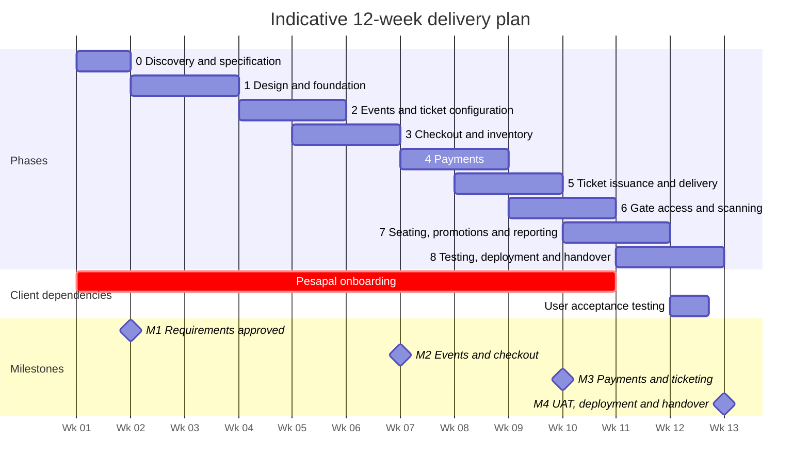

# Implementation Plan: Multi-Organizer Event Ticketing Platform

**Version 1.13 · 16 October 2026 · System design and analysis**

**Based on:** [v1.md](v1.md) (requirements specification), [sow.md](sow.md) (statement of work) and [techstack.md](techstack.md) (architecture blueprint). v2.md, an earlier requirements review, has been removed; v1.md replaced it.

This plan turns the requirements and architecture into phases that the team can carry out and the client can approve one at a time. For each phase it gives the goal, what the phase needs from the client, the steps in order, what it delivers, and the tests that must pass before later work depends on it.

---

## 1. Delivery approach

### 1.1 Principles

1. **Data integrity before screens.** The four integrity boundaries are built and tested in the backend before their screens are polished: tenant isolation, inventory holds, payment confirmation and ticket redemption.
2. **Every phase ends with something that works.** A phase is finished when its exit tests pass on staging, not when its screens exist.
3. **Backend and frontend in parallel.** The API contract is agreed in Phase 1. Frontend developers then build against it, using mock data, while the backend implements it. This is why consecutive phases overlap by a week.
4. **One deployable backend.** The backend is a single Laravel application, split into modules for identity, events, inventory, orders, payments, tickets and gate access. No microservices.
5. **Test integrity against real PostgreSQL.** Row locking, constraints and concurrent updates don't behave the same way in SQLite, so all integrity tests run against PostgreSQL.

### 1.2 Phase overview

| Phase | Name                              | Weeks | SOW phase      | Payment milestone                         |
| ----- | --------------------------------- | ----- | -------------- | ----------------------------------------- |
| 0     | Discovery and specification       | 1     | 1              | **M1 (30%):** requirements approved       |
| 1     | Design and foundation             | 2–3   | 2              | —                                         |
| 2     | Events and ticket configuration   | 4–5   | 3              | —                                         |
| 3     | Checkout, orders and inventory    | 5–6   | 4              | **M2 (30%):** events and checkout         |
| 4     | Payments through Pesapal          | 7–8   | 4              | —                                         |
| 5     | Ticket issuance and delivery      | 8–9   | 5              | **M3 (25%):** payments and ticketing      |
| 6     | Gate access and scanning          | 9–10  | 6              | —                                         |
| 7     | Seating, promotions and reporting | 10–11 | 7              | —                                         |
| 8     | Testing, deployment and handover  | 11–12 | 8              | **M4 (15%):** UAT, deployment and handover |

### 1.3 Timeline



The SOW sets a 12-week delivery window (§4.1, revised 13 October 2026). The agreed scope covers two payment methods (M-Pesa and card, both through Pesapal), four user interfaces (public, organizer, admin and guard), reserved seating, promotions and reporting, so a shorter schedule isn't realistic. If the schedule slips, reserved seating is the first item to defer (see Phase 7).

The durations assume about three to four developers plus part-time design and QA. Recalibrate them in Phase 0 once the team is confirmed. If the project starts in November, the December holidays fall inside Phases 4–7, so add one to two weeks of buffer.

The scope added on 15 October 2026 (decisions #23–#26 and the data deletion tool for decision #22) falls in Phases 2, 3 and 7. Include it when recalibrating the durations in Phase 0.

### 1.4 Critical path

These items can delay launch no matter how fast development goes:

- **Pesapal onboarding** (client). Sandbox credentials are needed by Week 7 and production keys by Week 11. The merchant application must start in Week 1.
- **Hosting go/no-go** (provider). A Week 1 check decides whether the cPanel plan can run the API at all.
- **Approval of the database design and API contract** (both), by the end of Week 2. Every later phase depends on them.
- **Milestone review windows** (client). The SOW allows five business days per review. The team carries on with the next phase while the client reviews on staging.

### 1.5 How each phase is run

- One-week sprints, each ending with a demo on staging.
- A feature counts as **done** only when:
  - another developer has reviewed the code;
  - automated tests exist, including tenant-isolation tests for any new resource;
  - the API contract and documentation are updated;
  - sensitive actions write to the audit log;
  - it is deployed to staging and has been demonstrated.

---

## 2. Phase 0 — Discovery and specification

**Week 1 · SOW phase 1 · Ends with payment milestone M1 (30%)**

**Goal:** Merge the source documents into one approved specification, settle the open decisions, and remove the external blockers that could stall later phases.

**Needed from the client:** availability of the decision-maker, the Pesapal application started, access to hosting, domains and Google Cloud, branding assets, and the platform's public name (decision #28).

### Steps

1. **Confirm the naming baseline.** v1.md is the single source of truth for table names, roles and API paths, and techstack.md has been aligned to it (15 October 2026). These decisions have been applied:

   | Topic            | Standard (v1.md)                                                        | Replaced names                                  |
   | ---------------- | ----------------------------------------------------------------------- | ----------------------------------------------- |
   | Tenant tables    | `organizers`, `organizer_members`                                       | `organizations`, `organization_members`         |
   | Guard assignment | `event_staff` (role `guard` or `event_owner`)                           | `guard_assignments`                             |
   | Scan record      | `ticket_scans` (every attempt); redemption is a ticket status           | `ticket_redemptions`                            |
   | Sellable unit    | `event_ticket_offerings` (type × category) with `inventory_reservations` | `ticket_inventory`                             |
   | Roles            | Platform admin, organizer staff, event owner, guard, attendee           | The earlier four-role and five-role lists       |
   | API paths        | `/api/v1/...`, with organizer endpoints under `/api/v1/organizer`       | `/organizer/events/:id`                         |
   | Frontend         | One Next.js app for every role, in its own repository                  | `/web` plus a React + Vite `/manage` dashboard  |

   Confirm these with the client. Make any later change in v1.md first.

2. **Settle the open business decisions** listed in [§11 Decision log](#11-decision-log). Give each one an owner and a deadline.

3. **Start Pesapal onboarding.** Pesapal is the payment gateway for both M-Pesa and card payments. The client applies for a Pesapal merchant account and completes its business verification. Ask for sandbox credentials straight away. Production keys are needed by Week 11.

4. **Check the hosting.** On the actual cPanel plan, confirm each of the following:
   - [ ] The PHP version required by the chosen Laravel release, with the `pdo_pgsql`, `mbstring`, `openssl`, `bcmath`, `intl`, `fileinfo` and `gd` extensions.
   - [ ] SSH and Composer access, or another workable way to deploy.
   - [ ] A subdomain whose document root can point at Laravel's `public` directory.
   - [ ] Cron jobs that can run every minute.
   - [ ] An outbound connection to Supabase. Supabase's direct connection may require IPv6. If the host doesn't support IPv6, test Supabase's pooled connection or its IPv4 add-on.
   - [ ] SSL certificates for the API subdomain.
   - [ ] Whether long-running processes are allowed, which decides how queued jobs are run.

   Record the result as **go** or **no-go**. If it's no-go, fall back to a small VPS running the same Laravel application. No code changes are needed.

5. **Frontend hosting (decided, #5).** The Next.js app, which serves every role with server-side rendering, runs on Vercel. It must share a parent domain with the API for Sanctum's cookie sessions to work.

6. **Set measurable performance targets.** v1.md requires these before launch. Proposed starting values for the client to confirm:
   - Scan validation: 95% of scans answered within 1 second over mobile data.
   - Checkout API, excluding the payment provider's own time: 95% of requests within 500 ms.
   - Peak load: ask the client for the largest expected event and how many buyers arrive in the first minutes of a sale. Answered 16 October 2026: 1,000 to 5,000 tickets; buyers per minute still to confirm (hurdles.md H13).

7. **Fix the baseline schedule and risk register.** Confirm the team, the dates and the milestone review windows.

8. **Prepare Google sign-in.** The client creates, or gives access to, a Google Cloud project for the platform. Set up the OAuth consent screen with the app name, support email, privacy policy link and the platform's domains, requesting only the `openid`, `email` and `profile` scopes. Create OAuth clients for local development and staging now; the production client follows in Phase 8. Also confirm that every organizer staff member and event owner has, or can create, a Google account. Guards don't need one: they sign in only with guard password accounts.

### Deliverables

- D1: Approved requirements specification, including the decision log.
- Hosting check report with the go/no-go result.
- Baseline schedule.

### Exit criteria

- [ ] Client representative has signed off the requirements and decision log.
- [ ] The Pesapal merchant application has been submitted and sandbox access requested.
- [ ] Hosting go/no-go is recorded.
- [ ] A Google Cloud project and OAuth consent screen exist, with OAuth clients for local development and staging.
- [ ] The client has confirmed the naming baseline in v1.md.

---

## 3. Phase 1 — Design and foundation

**Weeks 2–3 · SOW phase 2**

**Goal:** Agree the data model, API contract and designs, and deploy a working skeleton to staging that already has Google sign-in and tenant isolation.

**Needed from the client:** design reviews, branding assets and access to DNS for the domain.

### Design track

1. **Database design and migration plan (D3).** Turn v1.md §4 into the final database design, covering every in-scope module, including seating, so later phases don't need schema rework. v1.md already includes the items earlier drafts missed: `reserved_count` on offerings for atomic holds (see Phase 3), `qr_token_encrypted` alongside `qr_token_hash` (see Phase 5), seat holds through `inventory_reservations.seat_id`, the staff role on `organizer_members`, and the guard and event_owner roles on `event_staff`.
2. **API contract** as an OpenAPI specification: endpoints, request and response formats, one standard error format, pagination and request correlation IDs.
3. **Permission policy list.** Turn the permission matrix in v1.md into a rule for every endpoint: which role may call it, and which ownership check applies.
4. **State machines.** Finalize the allowed transitions for orders, payments and tickets.
5. **UI/UX designs (D2)** for the public website, organizer dashboard, admin dashboard and guard scanner. Define the shadcn/ui theme once: colors, corner radius and fonts.

### Backend track

6. **Repositories and environments.** Two repositories (decision #8):

   ```text
   backend repository (this one)
     /api          Laravel API
     *.md, /doc    The specification
   frontend repository
     Next.js app   Public site and the organizer, event owner, admin and guard areas, with shadcn/ui
   ```

   The frontend builds against the OpenAPI contract published from the backend repository.

   Set up three environments (local, staging and production), each with its own Supabase project, so test data never reaches production.

7. **Continuous integration.** On every push, run linting, static analysis and the test suite against PostgreSQL.
8. **Laravel foundation.** Install Laravel, connect to Supabase over SSL, and add migrations for the identity and tenancy tables. Use UUIDs for any record referenced from outside the system.
9. **Google sign-in.** Sign users in through Google OAuth with Laravel Socialite, following the rules in techstack.md §3: verified Google emails only, users matched by Google account ID, and a Sanctum cookie session started after sign-in. Add logout, the `me` endpoint, account suspension, invitation acceptance (staff, event owners and platform admins), refusal of any Google sign-in from someone who holds no role and has no pending invitation, without creating an account (decision #7), and a one-time setup command that creates the first platform admin's invitation and refuses to run once any admin exists (decision #30). Passwords exist only for guard password accounts (techstack.md §3): add guard sign-in with email and password (the only way guards sign in), the forced password change at first sign-in, rate limiting with temporary lockout, and shorter guard sessions. Use the database session driver, so a specific guard's sessions can be ended. There is no self-registration, email verification or email-based password reset. Configure stateful domains, the session cookie domain, CORS and CSRF for the `www` and `api` subdomains, including requests made by the Next.js server during server-side rendering.
10. **Tenancy and authorization.** Build organizers (created only by platform admins, each with an invitation for its first staff member; decision #7), staff membership, event access for staff (`event_staff` role `manager`; decision #31) and event owner assignments, with a Laravel policy for every resource. Organizer-level resources check membership; anything about a specific event checks that the staff member manages it, and other staff get only the event's read-only summary. Only platform admins grant or remove event access, apart from the automatic access an event's creator gets. Keep platform admin permissions separate from organizer permissions. Event owners pass only the guest-list policy (view, filter and export) and the list of managers for their assigned events. Member lists follow decision #32: only admins see every user.
11. **Audit log.** A single service call records who acted, the organizer, the event, the action, the affected resource and details, including every sign-in, sign-out, failed attempt and lockout (decision #38). Entries never hold a buyer's or attendee's personal details (decision #36). The database makes the log append-only (decision #37), and a daily retention job purges every log past its period (decision #35, v1.md §4.7).
12. **API conventions.** The `/api/v1` prefix, the standard error format, rate limits on the sign-in routes, and a correlation ID on every request.
13. **Tenant-isolation test suite.** For every resource, a test checks that a user from organizer B is refused access to organizer A's records, that a staff member of organizer A who doesn't manage an event gets only its read-only summary, and that an event owner is refused everything except the guest list and the managers of their assigned events. The suite grows with every phase.

### Frontend track

14. Create the Next.js app (TypeScript, server-side rendering, Tailwind CSS and shadcn/ui) in the frontend repository.
15. Build the "Sign in with Google" page, the guard email-and-password sign-in form with its first-sign-in password change, the invitation acceptance page and a "no access" message for refused sign-ins in the Next.js app, with routing to the organizer, event owner, admin and guard areas by role.
16. Generate a typed API client from the OpenAPI specification, plus a mock server so screens can be built before the backend is ready.

### Deployment track

17. **Working skeleton on staging.** The API runs on cPanel over HTTPS, cron runs the scheduler, queued jobs are processed, the Next.js app is deployed on Vercel, and Google sign-in works end to end across the subdomains.

### Deliverables

- D2: UI/UX designs.
- D3: Database design and migration scripts.
- Approved API contract.
- Working foundation on staging.

### Exit criteria

- [ ] Organizers cannot read or change another organizer's resources, and the automated tests prove it.
- [ ] Event owners can't change anything, and can reach guest data only for their assigned events.
- [ ] Staff can change an event, or see its sales, orders and guest data, only when they manage it; only platform admins grant that access, and only platform admins see every user.
- [ ] Every protected endpoint refuses requests that aren't logged in or aren't authorized.
- [ ] Google sign-in works on staging, and the session holds across `www` and `api`, including during server-side rendering.
- [ ] Unverified Google accounts, suspended users, and people with no role and no pending invitation can't sign in, and no account is created for them; only platform admins create organizers.
- [ ] A guard password account must change its temporary password before doing anything else, and can never reach the organizer or admin areas. Google users can't reach the scanner.
- [ ] The database design, API contract and designs are approved.

---

## 4. Phase 2 — Events and ticket configuration

**Weeks 4–5 · SOW phase 3**

**Goal:** An organizer can build, configure and publish an event with ticket offerings, ticket waves, gates and assigned guards, and share its link and QR code.

### Backend

1. **Event lifecycle.** Draft → published → closed (set automatically when the last gate closes, or at the event's end time if it has no gates) or cancelled → archived, as in v1.md §4.6, enforced by the backend. A scheduled job moves published events to closed. Unpublished drafts can be deleted; events that were ever published are only archived, never deleted. Store times in UTC alongside the event's own timezone.
2. **Event details and media.** Name, description, venue, category (from the admins' list), capacity, refund policy, the optional checkout CAPTCHA and the event image (decision #46). The backend never stores an uploaded image as sent: it decodes the file (JPEG, PNG or WebP, at most 10 MB and 25 megapixels), scales it down to at most 1,920 pixels on its longest side, strips its metadata and saves it as a JPEG under 500 KB in a public Supabase Storage bucket, under a new name for each upload (techstack.md §6). Cancelling revokes every ticket, cancels pending orders, ends guard access and emails every buyer; changing a published event's dates (postponement) emails buyers a refund-request link (v1.md FR-03).
3. **Time windows.** Store and validate each window separately: sales start and end, gate opening and closing, and event start and end.
4. **Ticket types and categories.** Seed the defaults (Early Bird, Normal, At the Gate, Group and Promoted; VVIP, VIP and Media) and let organizers add their own. Each category can be set to sell in waves (decision #23).
5. **Offerings.** Each allowed type × category combination, with a price in minor units of KES, capacity, sales window, and minimum and maximum per order. Include group quantity rules, and an approval or manual-issue flag for Media tickets.
5a. **Ticket waves** (v1.md FR-04). For a category sold in waves, staff add waves, each with a name and start and end dates. A PostgreSQL exclusion constraint stops a category's waves from overlapping. Each wave holds one or more offerings (type, number of tickets, price) whose sales window is the wave's dates. Waves open on their start dates only, with no automatic advance or rollover. A "move unsold tickets" action lowers one offering's capacity with a conditional update and raises another's in the same category, in one transaction, and is audited.
6. **Delegations** (hurdles.md H14, doc/sponsored.md). Each with its set-aside allocation: one or more offerings (type, category, number of tickets and price) that public endpoints never list, public checkout can't buy, and that sit outside the waves. Each has a private claim link and access code. Staff can return unclaimed tickets to public sale with the move action.
7. **Attendee details setup.** The collection mode (purchaser only, or details for every ticket) and the field definitions, including event-specific questions. Staff choose the event's identity field when they create it (none, phone number or ID number; v1.md FR-07) and can change it only while the event is a draft. With a phone or ID number, details are collected for every ticket and each holder gives that field; phone and ID number can't be added as questions, so no event asks for both.
8. **Gates and staff.** Create gates (optional: an event without gates admits people between its start and end times). Add guards by creating a guard password account with the guard's own email and giving the guard its temporary password; assign each guard to an event and optionally a gate, and remove assignments. An event can have several guards. A guard password account works for one event at a time. When that event closes (entry ends, or it is cancelled or archived), the password is deleted, the guard's sessions end and the assignment ends. A job runs this every minute, and every request from a password guard also checks the event is still open (techstack.md §3). Assign event owners to an event by email invitation (role `event_owner`, with the event attached), and remove them; removal ends their access to that event immediately. Only the event's managers and platform admins assign guards and event owners to it.
9. **Publishing rules.** An event can be published only if it has at least one active offering, valid time windows, capacity that covers its allocations, and, if any offering is paid, a verified organizer whose payout account a platform admin has entered (decision #33). Until then such an event stays in draft, and no paid offering can be added to a published event. Changes after publishing are audited. Changes that would affect existing orders, such as lowering capacity below tickets already sold, are blocked or need explicit confirmation.
9a. **Event link, QR code and poster** (v1.md FR-14). Each event's public link is `/events/{slug}`, so event slugs are unique across the platform. Organizer staff download its QR code as PNG or SVG, and as a printable A4 PDF poster with the event's name, date, venue, QR code and link.
10. **Admin.** List organizers, verify them before their first paid event (business or ID details and payout account), enter or change their payout account (only admins can, and staff see only whether a verified one is on file; decision #33), suspend or reactivate them, manage the event category list, and oversee events. Create an event for an organizer and give one or more of its staff access to manage it in the same step (decision #34). Invite new platform admins by email and remove admin rights, never the last admin's (decision #30); both are audited.

### Frontend

11. **Organizer dashboard:** an event list (every event of the organizer, with a read-only summary for the ones the user doesn't manage) and, for managed events, a step-by-step event editor (details → times → tickets → attendee fields → gates and staff → publish), whose details step compresses the event image in the browser before uploading it, an offerings grid with a wave editor for each category sold in waves, a "move unsold tickets" dialog, delegation management with claim links and set-aside allocations, a share panel with the event link, QR code downloads and the poster, staff and event owner invitations, and guard accounts.
12. **Admin dashboard:** organizers (a new organizer with its first staff member's invitation, and a new staff invitation link for any organizer; decision #49), every event on the platform (search by name or venue, organizer and status filters, a read-only detail view whose every opening is audited, and the event editor), every user, platform admins (invite and remove), new events for an organizer with their managers chosen from its staff, staff event access (grant and remove for each event), organizer verification, event categories and suspension controls. Each admin and organizer section has its own address (`/admin?tab=events`), so the sidebar opens it directly.
13. **Public website:** a landing page listing every public ticket option across published events (search by event name or venue, event category and date filters, sold-out options marked, upcoming waves greyed out, delegation tickets never listed), and event pages at `/events/{slug}` that show published events only (v1.md FR-14). Event images go through `next/image`, which resizes them on the fly for each screen (decision #46).

### Exit criteria

- [ ] An organizer can publish an event with valid offerings and capacity limits.
- [ ] Unpublished events never appear on public endpoints.
- [ ] A category's waves can't overlap, each wave's offerings sell only between its dates, and moving unsold tickets keeps every offering at or above what it has sold and holds.
- [ ] The landing page lists every public ticket option of published events, and never a delegation's set-aside tickets.
- [ ] Each event's QR code opens its event page, and the poster downloads.
- [ ] An uploaded event image is stored as a JPEG under 500 KB and at most 1,920 pixels on its longest side, without metadata, and event pages serve it resized for the screen.
- [ ] Guard account creation and assignment work, and guards see only the events assigned to them.
- [ ] Event owner invitation and assignment work, and event owners see only the events assigned to them.
- [ ] When an event closes, its guard passwords are deleted and those guards are signed out immediately; their past scans still show their names.
- [ ] Tenant-isolation tests cover every new resource.

---

## 5. Phase 3 — Checkout, orders and inventory

**Weeks 5–6 · SOW phase 4 (first half) · Ends with payment milestone M2 (30%)**

**Goal:** A buyer can build an order and hold tickets, and buyers acting at the same moment can never oversell.

### Backend

1. **Order creation.** Check the offering, the sales window (a wave's dates for a wave's offering), quantity limits, group rules (a quantity that is a multiple of the offering's `group_size`, priced per ticket; decision #50), delegation eligibility (a delegation's offerings only with its claim link or access code; public checkout can't buy them) and, when the event requires it, the CAPTCHA. Return a random checkout token, stored hashed, that the buyer's later calls must send.
2. **Inventory hold**, made in one transaction with an atomic conditional update:

   ```sql
   -- Hold :qty tickets only if enough remain.
   -- 1 row updated = held. 0 rows updated = sold out.
   UPDATE event_ticket_offerings
   SET    reserved_count = reserved_count + :qty
   WHERE  id = :offering_id
     AND  status = 'active'
     AND  capacity - sold_count - reserved_count >= :qty;
   ```

   In the same transaction, insert the matching `inventory_reservations` row with its expiry time. If no row was updated, return a clear "sold out" response.

3. **Hold expiry.** Holds last 15 minutes by default, configurable (decision #10). A scheduled job runs every minute, releases expired holds and expires their orders. Build the hold mechanism generically so seat holds in Phase 7 can reuse it.
4. **Attendee details.** Validate them against the event's field setup and collection mode, and store purchaser details separately from ticket-holder details.
5. **Promotions (core).** Percentage or fixed discounts, eligible offerings, start and end dates, total and per-buyer limits, and minimum quantity or order value. Count each use against the hold so that orders placed at the same moment can't exceed a limit. Codes apply only to a held order (decision #27).
6. **Pricing.** Only the backend calculates totals. Orders that total zero skip payment and issue their tickets directly (hurdles.md H3). The platform fee is deducted from the organizer, so it never changes what the buyer pays. Each order item stores a snapshot of the unit price, discount, fees and currency, so later price edits don't change past orders.
7. **Order states.** Pending → paid → completed, plus expired and cancelled (doc/state-machines.md §2).

### Frontend

8. **Public checkout:** choose an offering and quantity (from the landing page's Buy button or the event page), fill in attendee forms built from the event's setup, pass the CAPTCHA when the event requires one, enter a promo code on the held order, review the order summary, and see a countdown for the hold, with clear handling when it expires.
9. **Organizer dashboard:** the order list for each event.

### Tests

10. **Overselling:** for example, send 50 simultaneous requests for the last 10 tickets. Exactly 10 must be held and the rest refused. Run this against PostgreSQL.
11. **Expiry:** expired holds return their tickets to inventory.
12. **Pricing:** promotions, group pricing, and snapshots that stay unchanged after an organizer edits prices.

### Exit criteria

- [ ] Simultaneous buyers cannot oversell an offering.
- [ ] Expired holds release their inventory.
- [ ] Order totals are calculated only by the backend.

---

## 6. Phase 4 — Payments through Pesapal (M-Pesa and card)

**Weeks 7–8 · SOW phase 4 (second half)**

**Goal:** The server confirms every payment exactly once, however many times Pesapal retries, delays or repeats its notifications.

**Needed from the client:** Pesapal sandbox credentials and the written refund policy.

Pesapal is the single payment gateway. Buyers pay on Pesapal's hosted checkout, choosing M-Pesa or card there, so card details never touch the platform's servers.

### Backend

1. **One payment interface.** A single interface for starting a payment, checking its status, refunding it and handling notifications. A Pesapal adapter implements it, and a fake provider stands in during tests. Because orders and tickets only use the interface, another gateway can be added later without changing them.
2. **Pesapal setup.** Request access tokens with the consumer key and secret, and cache them until they expire. Register the platform's IPN (instant payment notification) URL with Pesapal once per environment, and store the IPN ID that Pesapal returns.
3. **Starting a payment.** Submit the order to Pesapal with our order reference, amount, currency, buyer details, the IPN ID and a callback URL. Pesapal returns an order tracking ID and the address of its hosted checkout, where the buyer pays.
4. **Handling Pesapal notifications**, in this order:
   1. **Confirm the result with Pesapal.** Treat an IPN only as a signal that something changed. Fetch the real result from Pesapal's transaction status endpoint using the order tracking ID, and act only on that response.
   2. **Skip duplicates.** Pesapal IPNs don't carry a unique event ID, so record every notification in `payment_webhook_events` and make processing idempotent. If the order is already paid, acknowledge and stop.
   3. **Record the result in one transaction:** lock the order, check that the amount and currency match and the order is still pending (otherwise mark the payment rejected and refund it automatically), mark the payment as succeeded, mark the order as paid, issue the tickets (built in Phase 5), and write an outbox record for the email.
   4. **Reply to the IPN** in the format Pesapal expects, so it stops retrying.

   When the buyer is sent back to the callback URL, that page only shows the status. It never marks anything as paid.
5. **Payment after the hold expired.** Refund it automatically (decision #11); the buyer can order again.
6. **Reconciliation job.** Every few minutes, ask Pesapal for the status of payments that have been pending longer than a set time, then resolve them or flag them. Record each run in `reconciliation_runs`, with its counts and flagged payments (decision #39).
7. **Refunds and reversals.** Only platform admins start refunds (decision #12), naming the tickets each covers; the system starts them only for rejected payments, and buyers can request one only through a postponement email. Request refunds through Pesapal's refund API where Pesapal supports refunds for the payment method, and track their status. Move the order to partially refunded or refunded, and decide ticket eligibility explicitly, for example by revoking tickets after a full refund. If Pesapal reports a completed payment as reversed, handle it the same way.
8. **Payment history and reconciliation screens:** staff see the events they manage, and platform admins see the whole platform in a live payment table that refreshes every few seconds, showing each payment's status with its order's and tickets' status, and flagging stuck and rejected payments (decision #45). Store the payment method and confirmation code, never the paying account Pesapal reports.

### Frontend

9. **Payment step.** The buyer confirms the order and is sent to Pesapal's hosted checkout, by redirect or in an embedded frame, to pay by M-Pesa or card. On return, a status page checks the order status from the backend every few seconds until it is final. It never trusts the redirect.

### Sandbox test matrix

Run each scenario with both an M-Pesa test payment and a card test payment where the sandbox allows it.

| Scenario                                  | Expected result                                       |
| ----------------------------------------- | ----------------------------------------------------- |
| Successful payment                        | Order paid; tickets issued once                       |
| Failed payment or insufficient funds      | Order stays pending until it expires; buyer can retry |
| Buyer cancels or abandons the checkout    | Buyer can retry; hold expires as normal               |
| No IPN arrives                            | Reconciliation resolves the payment                   |
| Duplicate IPN                             | Processed once only                                   |
| IPNs arrive out of order                  | Final state matches Pesapal's status                  |
| IPN after the hold expired                | Payment rejected and refunded automatically           |
| Amount doesn't match the order            | Payment rejected and refunded automatically           |
| Forged IPN                                | No change, because Pesapal's status check doesn't confirm it |
| Completed payment later reversed          | Order refunded; unredeemed tickets revoked; admin alerted |

### Deliverables

- D9: Payment integration, with recorded test evidence.

### Exit criteria

- [ ] Every scenario in the test matrix passes in the Pesapal sandbox, with evidence recorded.

---

## 7. Phase 5 — Ticket issuance and delivery

**Weeks 8–9 · SOW phase 5 · Ends with payment milestone M3 (25%)**

**Goal:** Every confirmed purchase produces the right number of unique tickets that the buyer can retrieve, and an email with the link.

**Needed from the client:** the cPanel host's hourly email sending limit, and DNS access for the sending domain (SPF, DKIM and DMARC records; decision #9).

### Backend

1. **Issuance**, inside the payment transaction: one ticket per unit bought, each with a unique, non-sequential ticket number, plus its attendee, offering, delegation and seat where applicable.
2. **QR credential.** Generate a random, hard-to-guess token. The QR code contains only this token and no personal details. Store it twice, as v1.md §4.3 requires: a hash (`qr_token_hash`) to find the ticket when it's scanned, and an encrypted copy (`qr_token_encrypted`) so the ticket page can show the QR code again. Never store it in plain text. The encryption uses Laravel's application key, so keep that key stable and backed up. Also generate each ticket's 6-character short code (characters that are hard to confuse, unique within the event), stored as a keyed hash plus an encrypted copy (v1.md §4.3). Guards type it in when a QR code won't scan.
3. **Retrieval links.** Each link uses a random token whose hash is stored in `ticket_access_tokens`, with an expiry date and the ability to revoke it. Buyers can request a new link by entering their email address. This request is rate-limited and doesn't reveal whether an email address has an order.
4. **Email delivery** through the queue, driven by the outbox records, with retries and logging of failures: the order confirmation with the retrieval link, a receipt for every paid order, and emails for event changes, cancellations and transfers. No SMS (hurdles.md H9, H10).
5. **Revocation.** Organizers and admins can revoke a ticket with a reason. Revocations are audited, and revoked tickets are rejected at the gate.
6. **Media tickets.** Approval after payment: tickets wait in pending issuance until staff approve them; rejected ones are revoked and an admin refunds them. Staff can also issue Media tickets manually.
6a. **Transfers.** From the retrieval link, the holder transfers a valid ticket to a new holder before the event starts, except at events whose identity field is ID number. The ticket gets a new QR code and short code, and the recipient gets their own retrieval link.

### Frontend

7. **Ticket page** on the public website: event details, category, attendee name (where collected), ticket number, seat or delegation, the QR code and the 6-character short code, with a download as PDF or image that shows the short code too, a transfer form, and a refund-request form after a postponement.
8. **Organizer dashboard:** ticket list and search, revocation, and manual issuance of Media tickets.

### Deliverables

- D10: Ticketing engine.

### Exit criteria

- [ ] Each confirmed purchase produces the expected number of tickets, each with a unique QR code and a short code that is unique within its event.
- [ ] Repeated payment notifications never produce duplicate tickets.
- [ ] Revoked or invalid retrieval links are rejected.
- [ ] The email arrives with a working link, and failed sends are retried.

---

## 8. Phase 6 — Gate access and scanning

**Weeks 9–10 · SOW phase 6**

**Goal:** Guards can admit valid ticket holders quickly, and no ticket can be used twice.

### Backend

1. **Scan checks**, in this order: a guard password account is logged in → the guard is assigned to this event (and gate) → it is within the entry window, judged by server time (the gate is open, or, for an event without gates, between its start and end times) → the ticket exists (looked up by hash) → it belongs to this event → it is paid and not revoked → redeem it. The same checks apply when a guard types a ticket's short code instead of scanning; short code entry is rate-limited per guard and locks after 5 invalid codes in a row, until organizer staff unlock it.
2. **Redemption with one atomic update:**

   ```sql
   -- 1 row updated = admit. 0 rows updated = already used or no longer valid.
   UPDATE tickets
   SET    status = 'redeemed', redeemed_at = now()
   WHERE  id = :ticket_id
     AND  event_id = :event_id
     AND  status = 'valid';
   ```

3. **Scan log.** Record every attempt in `ticket_scans`, including rejected ones, with the result, gate, guard, time and method (QR scan or short code).
4. **Minimal response.** Return only what the guard needs: the result and reason, the category, the attendee name where collected, the last 4 digits of the holder's phone or ID number when the event has an identity field, the seat or delegation, and, for a ticket already used, when and at which gate.

### Frontend (guard area in the Next.js app)

5. **Designed for phones first:** sign in with the guard email and password → see assigned events → choose a gate (skipped for events without gates) → scan with the camera. A visible "Sign out" button supports shift changes on shared phones. Browsers only allow camera access over HTTPS. If a QR code won't scan, an "Enter code" button lets the guard type the 6-character short code from the attendee's downloaded or printed ticket.
6. **Result screens** that are large and high-contrast: valid, already used, invalid (with the reason), and unable to verify.
7. **Fail closed.** A timeout or network error shows "Unable to verify — do not admit" and never a success.
7a. **My scans:** the guard's own scans at their current event (time, result, ticket category, gate and method), without attendee names, until their access ends (decision #40).
8. **Organizer dashboard:** live gate activity and attendance counts.

### Tests

9. **Simultaneous scans:** two devices scan the same ticket at the same moment, and exactly one admits. The same holds when one guard scans the QR code and another types the short code.
10. **Rejection cases:** wrong event, wrong gate, revoked, unpaid, before the gate opens, after it closes, an unknown QR code, an invalid short code or one from another event, and a password guard whose event has closed.
11. **Field rehearsal:** real phones in poor light on slow mobile data, in conditions close to a real venue. Measure scan time against the Phase 0 target.

### Deliverables

- D8: Guard interface.

### Exit criteria

- [ ] A ticket cannot be used twice, even when scanned on two devices at the same moment.
- [ ] A ticket entered by short code is admitted once, exactly like a scan, and repeated invalid codes lock short code entry for that guard.
- [ ] Every rejection case shows the correct reason.
- [ ] The scanner fails closed when it can't reach the server.
- [ ] Every scan record includes the event, gate, guard and time.

---

## 9. Phase 7 — Reserved seating, promotions and reporting

**Weeks 10–11 · SOW phase 7 (modules 8, 9 and 10)**

**Goal:** Finish the remaining in-scope modules without destabilizing the core flow from purchase to entry.

Each part of this phase is built and tested on its own, and the core flow doesn't depend on any of it. Reserved seating is built last because it is the first item to defer if the schedule slips. SOW §4.1 allows it to move to a release after launch, with the client's approval through change control. Building it last means deferring it leaves no half-finished work.

### Promotions (remaining rules)

1. Complete the remaining rules from SOW §2.8, and add redemption tracking and reporting.

### Reporting

2. **Organizer reports**, only for the events the staff member manages: sales by offering, payment status, remaining capacity, promotion performance, attendance and gate activity; a sales list CSV export; and a read-only list of the event's audit records.
3. **Admin reports:** platform-wide summaries, transaction oversight, an audit log viewer, and a settlement report per organizer and event (sales, refunds, Pesapal fees, platform fee and amount owed) with a log for recording each manual payout (hurdles.md H1). Organizer staff see the settlement report only for the events they manage; organizer-wide totals are for admins.
4. **Guest list:** view the attendees of an event, filter them by ticket category, delegation, purchase date and check-in status, and export them as CSV. Available to organizer staff for the events they manage and to event owners for their assigned events only (doc/roleandprivileage.md). Event owners see only each holder's name, ticket category, delegation, check-in status and entry time (decision #29).

### Personal data

4a. **Data deletion on request** (v1.md FR-15, hurdles.md H12). A platform admin finds a person by email address or phone number across every organizer. The platform removes their name, email, phone number and ID digits from orders, attendees, ticket transfers and promotion redemptions, and keeps amounts, references, tickets and scan records. Audited; organizer staff and event owners are refused.

### Reserved seating

5. Organizers set up sections, rows and seat numbers through simple forms and bulk entry. The SOW (§9) excludes advanced visual seat-map editors.
6. Seats can be available, held, sold or released. Seat holds reuse the Phase 3 hold mechanism and its expiry, through `inventory_reservations.seat_id`.
7. A database constraint allows only one active ticket per seat per event.
8. Buyers choose seats during checkout, and the assigned seat appears on the ticket and at the gate.
9. Test that two buyers choosing the same seat at the same moment results in exactly one getting it.

### Exit criteria

- [ ] Reports show only the events the staff member manages, and their figures match the order and payment records.
- [ ] Event owners can view, filter and export the guest list of their assigned events only, and a CSV export matches the on-screen filters.
- [ ] A platform admin's data deletion removes the person's details everywhere, and the reports still match the records.
- [ ] A seat can't be sold twice, expired holds release seats, and general-admission events need no seat setup. If seating has been deferred by change control, this criterion moves with it.

---

## 10. Phase 8 — Testing, deployment and handover

**Weeks 11–12 · SOW phase 8 · Ends with payment milestone M4 (15%)**

**Goal:** Demonstrate the agreed acceptance criteria in an environment like production, go live, and hand over.

**Needed from the client:** people to run user acceptance testing (UAT), production payment credentials, Google Cloud access for the production sign-in client, DNS for the production domains, and the approved privacy notice and refund policy.

### Steps

1. **Feature freeze.** From here on, only defect fixes are made.
2. **End-to-end tests** of the full journey: publish an event → buy tickets with each payment method → receive the email → open the ticket → scan it → see the second scan rejected.
3. **Security review:** authorization tests across all endpoints, the Google sign-in flow (state check, verified emails, linking by Google account ID, no open redirects), guard password sign-in (hashing, rate limiting, lockout, forced password change, guard-only scope), checks against common web vulnerabilities (the OWASP Top 10), rate limits, no secrets in the repository, security headers, a dependency audit, and attempts to forge payment notifications.
4. **Performance test** against the Phase 0 targets: a burst of checkouts on one event, and scanning throughput.
5. **Backup and recovery.** Confirm what backups the Supabase plan includes, run a restore into staging, and document the procedure.
6. **Monitoring.** Error tracking, uptime checks on the API and the Next.js app, and alerts for failed jobs, payments stuck in pending, email failures and a retention job that has stopped. Application logs and error tracking keep 90 days and never personal data (decisions #35 and #36).
7. **Production setup.** A production Supabase project; configuration stored outside the web root; cron; the agreed way of running queued jobs; HTTPS on both subdomains; the Next.js app on Vercel; Sanctum configured for the production domains; production Pesapal keys, with the production IPN URL registered; and a production Google OAuth client, with its callback URL registered and the consent screen published.
8. **Data protection.** Publish the privacy notice and the deletion-on-request procedure (personal data is kept until someone asks for it to be deleted, and platform admins carry out requests with the Phase 7 tool; hurdles.md H12), and agree each party's role (controller or processor). Confirm any registration obligations with Kenya's Office of the Data Protection Commissioner.
9. **UAT.** The client tests on staging against the acceptance criteria in SOW §5. Defects are logged and classified, and critical and high defects are fixed before sign-off. The client has five business days to review.
10. **Go-live.** Deploy, run smoke tests, then make one real low-value payment with each method and refund it.
11. **Handover (D13, D14):** source code, migrations, environment documentation, API documentation, deployment guide, payment and email setup guide, admin and organizer guides, test results, known issues, and a secure transfer of credentials.

### Deliverables

- D11: Testing documentation.
- D12: Production deployment.
- D13: Documentation.
- D14: Handover.

### Exit criteria

- [ ] The SOW §5 acceptance criteria have been demonstrated.
- [ ] The v1.md §9 MVP acceptance checklist is complete.
- [ ] No critical or high-severity defects remain open.
- [ ] The client has signed off UAT.

The 30-day warranty period starts after this sign-off.

---

## 11. Decision log

These decisions affect the database, the integrations or the schedule. Each needs an owner and must be settled by the phase shown.

| #  | Decision                              | Options                                                     | Recommendation                                                                       | Needed by |
| -- | ------------------------------------- | ----------------------------------------------------------- | ------------------------------------------------------------------------------------ | --------- |
| 1  | Naming baseline                       | —                                                           | **Decided:** v1.md names; platform admin (full rights), organizer staff (organizer account, and the events they manage; decision #31), event owner (guest data read-only), guard, and attendee roles; `/api/v1` paths; applied to v1.md and techstack.md | Decided   |
| 2  | Booking or platform fees              | None; added to the buyer's total; deducted from the organizer | **Decided:** deducted from the organizer's settlement, never added to the buyer's total; Pesapal's fees are also deducted from the organizer. **Open:** how the platform fee is calculated (client) | Phase 7 |
| 3  | Payment gateway                       | —                                                           | **Decided: Pesapal**, for both M-Pesa and card payments through its hosted checkout  | Decided   |
| 4  | Paying organizers                     | Manual payouts outside the platform; automated payouts      | **Decided:** all buyer payments land in the platform's Pesapal merchant account; admins pay organizers manually from a settlement report per organizer and event, recording each payout in a payout log (hurdles.md H1). Automated payouts are out of scope (SOW §9). Since 16 October 2026 the platform is the legal seller of every ticket, because Pesapal declined to collect on behalf of other businesses (decision #42) | Decided |
| 5  | Frontend hosting                      | Vercel, cPanel Node.js support, or static files             | **Decided:** one Next.js app for every role, server-rendered, on Vercel           | Decided   |
| 6  | Attendee accounts at launch           | Guest checkout only, or optional accounts                   | **Decided:** guest checkout; buyers reach their order only through a checkout token and their retrieval link (hurdles.md H11) | Decided |
| 7  | Organizer onboarding                  | Self sign-up with admin approval, or created by admins      | **Decided (revised 16 October 2026):** created by platform admins only. An admin creates each organizer and invites its first staff member, who then invites further staff and event owners and creates guard accounts. There are no organizer applications, and a Google sign-in from someone who holds no role and has no pending invitation is refused without creating an account. Verification (business or ID details and payout account) before the first paid event is unchanged (hurdles.md H2, v1.md FR-01, FR-02) | Decided |
| 8  | Repository structure                  | One repository or several                                   | **Decided:** two repositories: the backend (Laravel and the specification, this repository) and the frontend (the Next.js app) | Decided |
| 9  | Email provider                        | Client's choice; the cPanel host's mail server            | **Decided (16 October 2026):** the cPanel host's own mail server, through SMTP. Before Phase 8: get the host's hourly sending limit, set up SPF and DKIM in cPanel and add a DMARC record, and throttle the email queue below the limit. Emails may be delayed on big sale days, and there is no delivery tracking (limitation.md B22). Development uses a local mail catcher | Decided |
| 10 | Hold duration                         | 5–20 minutes                                                | **Decided:** 15 minutes, configurable                                            | Decided   |
| 11 | Payment that arrives after the hold expired | Honor it if tickets remain; always refund; handle manually | **Decided:** always refund automatically; the buyer orders again             | Decided   |
| 12 | Refund policy and who can approve     | Organizer only; admin only; organizer requests and admin approves | **Decided:** only platform admins start refunds, ticket by ticket; the system refunds rejected payments automatically; buyers can request a refund only after a postponement | Decided |
| 13 | Sign-in method                        | —                                                           | **Decided: Google OAuth** for admins, organizer staff and event owners; guards use guard password accounts only. Buyers still check out as guests | Decided   |
| 14 | Guard sign-in                         | —                                                           | **Decided:** guards sign in only with individual email-and-password accounts, created with the guard's own email by organizer staff or a platform admin. Each password is valid for one event and deleted as soon as that event closes. Only guard accounts scan | Decided |
| 15 | Guards change the temporary password at first sign-in | Required; optional                          | **Decided:** required, so only the guard knows their password and their scans are truly theirs. The organizer can still reset it at any time | Decided |
| 16 | Entry when a QR code won't scan       | —                                                           | **Decided:** the attendee shows their downloaded or printed ticket, and the guard types its 6-character short code | Decided   |
| 17 | Ticket transfers                      | Not allowed; in-platform transfer                           | **Decided:** the holder transfers from their retrieval link until the event starts, except at events whose identity field is ID number; new QR code and short code | Decided |
| 18 | Identity field                        | —                                                           | **Decided:** staff choose none, phone number or ID number per event; every ticket holder gives that field; no event collects both; no free-text questions | Decided |
| 19 | CSV exports                           | —                                                           | **Decided:** guest list export (staff and assigned event owners) and sales list export (staff) | Decided |
| 20 | Event categories                      | —                                                           | **Decided:** a platform list managed by admins; organizers pick one per event; the public site filters by it | Decided |
| 21 | Bot protection                        | None; CAPTCHA per event; CAPTCHA always                     | **Decided:** staff or admins can require a CAPTCHA at checkout per event; load-test against the client's largest event, up to 5,000 tickets (hurdles.md H13) | Decided |
| 22 | Personal data retention               | Fixed period; delete on request                             | **Decided:** kept until someone asks for deletion; then names, emails, phone numbers and ID digits are removed and financial and scan records kept; platform admins carry out each request (hurdles.md H12, v1.md FR-15) | Decided |
| 23 | Ticket waves                          | None; event-wide waves; per-category waves                  | **Decided:** optional for each ticket category; each wave has its own dates and one or more offerings (type, number of tickets, price); a category's waves never overlap; each opens on its start date only, even if the previous one sells out; staff move unsold tickets by hand (v1.md FR-04) | Decided |
| 24 | Landing page                          | Event cards; every ticket option                            | **Decided:** every public ticket option across published events, with search by event name or venue, event category and date filters, sold-out options kept and marked, and upcoming waves greyed out; delegation tickets never listed (v1.md FR-14) | Decided |
| 25 | Event link and gate QR code           | Event page; separate gate page                              | **Decided:** one link per event (`/events/{slug}`, slugs unique across the platform) and a QR code that opens the event page; staff download it as PNG or SVG and as a printable PDF poster (hurdles.md H4) | Decided |
| 26 | Sponsor (delegation) tickets          | Sub-quota of public offerings; set aside                    | **Decided:** set aside as each delegation's own offerings, never sold publicly and outside the waves; staff can return unclaimed tickets to public sale (hurdles.md H14) | Decided |
| 27 | When a promo code applies             | Before the hold; after the hold                             | **Decided:** to the held order, at the review step (limitation.md 6.4) | Decided |
| 28 | Platform public name                  | —                                                           | **Open:** the client chooses the name used on the landing page, in emails and on posters | Phase 1 (designs) |
| 29 | Event owner guest list columns        | The four in v1.md 1.8; add ticket type and entry time; add entry time only | **Decided (16 October 2026):** each holder's name, ticket category, delegation, check-in status and entry time; filters unchanged, including purchase date (v1.md FR-13) | Decided |
| 30 | Appointing platform admins            | System command; admin endpoint; both                        | **Decided (16 October 2026):** any platform admin invites a new admin by email, accepted through Google sign-in with the invited address; any admin can remove another admin's rights, never the last admin's; a one-time setup command creates only the first admin's invitation (v1.md FR-01) | Decided |
| 31 | Staff access to events                | Every staff member manages every event; per-event access    | **Decided (16 October 2026):** per-event access. Staff manage the organizer account and create events; they manage an event only if they created it or a platform admin gave them access (`event_staff` role `manager`), and only platform admins grant or remove it. Other events of their organizer show a read-only summary without sales, orders, guest data, reports or assignments. Staff see settlement figures only for the events they manage (v1.md FR-02, FR-13) | Decided |
| 32 | Who sees which people                 | —                                                           | **Decided (16 October 2026):** only platform admins see every user; staff see their own organizer's staff and guard accounts, and the people assigned to the events they manage; event owners see the names and emails of the staff who manage their assigned events (v1.md FR-02, §3 rule 9) | Decided |
| 33 | Who controls the payout account      | Any staff member; staff propose and admins verify; platform admins only | **Decided (16 October 2026):** only platform admins enter, change or see an organizer's payout account; staff send the details to an admin and see only whether a verified account is on file; until an admin enters it, the organizer's events with paid tickets stay in draft (free events can still be published); every change is audited (v1.md FR-02) | Decided |
| 34 | Events created by platform admins     | Staff only; admins too                                      | **Decided (16 October 2026):** a platform admin can create a draft event for any unsuspended organizer and, in the same step, give one or more of its active staff access to manage it, picked from the admin's user list; the admin doesn't become a manager; audited (v1.md FR-02) | Decided |
| 35 | Log retention                         | Tiered periods; keep everything; client decides             | **Decided (16 October 2026):** audit log, payment notifications and reconciliation runs 5 years (the usual Kenyan tax-record period, confirmed by the client's accountant before launch); scan records 12 months after the event ends; application logs, error tracking, processed outbox messages and failed jobs 90 days. A daily job purges older entries. Business records (orders, payments, refunds, tickets, payouts) aren't purged (v1.md §4.7) | Decided |
| 36 | Personal data in logs                 | Keep it out; scrub on deletion; logs exempt                 | **Decided (16 October 2026):** no log holds a buyer's or attendee's name, email, phone number or ID digits, or the text of a search; logs refer to records by ID; IP addresses and browsers only for signed-in users' actions; outbox payloads hold IDs only. A deletion request therefore needs no log changes (v1.md FR-13, FR-15) | Decided |
| 37 | Protecting the audit log              | Append-only in the database; in code only; hash chain       | **Decided (16 October 2026):** append-only in the database. The app can only insert and read audit entries; a trigger refuses updates, and deletes except by the retention job's own database role for entries past their period | Decided |
| 38 | Sign-in history                       | All sign-ins; failures only; none                           | **Decided (16 October 2026):** record successful sign-ins, sign-outs, failed attempts and lockouts for Google users and guard accounts (time, method, IP, browser) in the audit log; admins see all, and an event's managers see its guards' sign-ins (v1.md FR-01) | Decided |
| 39 | Reconciliation records                | New table; audit entries; none                              | **Decided (16 October 2026):** a `reconciliation_runs` table, one row per run with its counts and flagged payments; the `payments` table is the payment attempt history, one row per attempt (v1.md §4.4) | Decided |
| 40 | Guard activity view                   | Own scans without names; count only; own scans with names   | **Decided (16 October 2026):** guards see their own scans at their current event (time, result, ticket category, gate and method), without attendee names, until their access ends (v1.md §3, §5) | Decided |
| 41 | Whole-shilling prices                 | Whole shillings; cents allowed                              | **Decided (16 October 2026):** prices, discounts, fees and totals are whole Kenyan shillings, stored as minor units that are multiples of 100; a percentage discount rounds to the nearest shilling, halves up (v1.md FR-08; limitation.md C15) | Decided |
| 42 | Who sells the tickets                 | Collect on organizers' behalf; each organizer's own Pesapal account; platform as legal seller; split payments | **Decided (16 October 2026):** Pesapal declined to let one account collect for other businesses, so the platform is the legal seller of every ticket and pays each organizer as its supplier, from the settlement report and payout log (#4). **Open:** Pesapal's written confirmation of this arrangement, and the organizer contract, which the client's lawyer prepares (hurdles.md H2) | Phase 4 |
| 43 | What tickets and receipts show        | Platform as seller; organizer; "Presented by" name        | **Decided (16 October 2026):** the event name, the organizer's name and an optional "Presented by" name that staff set for each event (`events.presented_by`), on tickets, receipts and ticket emails. No organizer agreement or terms-of-sale checkbox is built (v1.md FR-03, FR-09) | Decided |
| 44 | An event's last manager               | Admins alerted; block removal; keep as is                   | **Decided (16 October 2026):** a published event always keeps at least one manager. Its only manager can't be removed from the organizer, or lose access to it, until a platform admin has given another staff member access (v1.md FR-02) | Decided |
| 45 | Live payment table for admins         | —                                                           | **Decided (16 October 2026):** platform admins see every payment attempt in a table that refreshes every few seconds, with its payment, order and ticket status, filters and search, and stuck or rejected payments flagged. It polls the API, because the cPanel host can't run a WebSocket server (v1.md FR-08, §5) | Decided |
| 46 | Event image size and delivery         | Store uploads as sent; compress once at upload; resize on every request | **Decided (16 October 2026; storage method revised 19 October 2026):** compress once at upload, resize when viewed. The backend stores every uploaded image (JPEG, PNG or WebP, at most 10 MB and 25 megapixels) as a new JPEG under 500 KB, at most 1,920 pixels on its longest side and without metadata, in a public Supabase Storage bucket. It writes to the bucket through Supabase Storage's own HTTP API, not its S3-compatible endpoint, so the backend doesn't need the AWS SDK. The browser compresses first to save upload time, but the backend enforces the limits. Pages resize the image on the fly with `next/image` on Vercel, as AVIF or WebP where the browser supports them. Vercel bills image transformations beyond its plan's allowance (v1.md FR-03, techstack.md §6) | Decided |
| 47 | Changing an event's link              | Editable any time; fixed once published                     | **Decided (20 October 2026):** an event's slug, which forms its link `/events/{slug}`, can change only while the event is a draft. Once published it is fixed, because the link is printed on QR posters and shared (v1.md FR-14) | Decided |
| 48 | Refund-request deadline on postponement | Set by staff; a fixed period after postponing             | **Decided (20 October 2026):** staff set it. `refund_policy` is free text, so nothing can calculate a date from it: when staff move a published event's dates they confirm the postponement and enter the deadline (`refund_requests_until`), guided by the event's refund policy (v1.md FR-03) | Decided |
| 49 | Accepting and delivering invitations  | Accept on any sign-in; accept only through the link         | **Decided (20 October 2026):** an invitation is accepted only by opening its single-use link while signed in with the invited Google address; signing in alone doesn't accept it. A signed-in user who has a pending invitation but no role is told to open their link (`GET /api/v1/auth/me` lists pending invitations, never their tokens). Platform admins can issue a new staff invitation link for any organizer, and staff for their own. Until invitation emails are built with the other emails in Phase 5 (P5.2), the inviter is shown the link once and passes it on | Decided |
| 50 | Group ticket pricing                  | Per ticket in multiples of the group size; one price per group | **Decided (20 October 2026):** per ticket. An offering's `group_size` is how many tickets must be bought together: buyers buy multiples of it, and `price` is per ticket, so a group of 4 at KES 1,000 costs KES 4,000. Each ticket is still its own ticket with its own QR code (v1.md FR-04) | Decided |

---

## 12. Testing strategy

| Layer                      | What it proves                                                | Recommended tools                                       | From phase      |
| -------------------------- | ------------------------------------------------------------- | ------------------------------------------------------- | --------------- |
| Unit                       | Pricing, state transitions, promotion rules                   | Pest or PHPUnit; Vitest                                 | 1               |
| API                        | Endpoints, validation, error format                           | Pest or PHPUnit                                         | 1               |
| Authorization and tenancy  | No access across organizers; roles stay within their limits   | Pest or PHPUnit                                         | 1, then every phase |
| Concurrency                | No overselling, no double redemption, no seat sold twice      | Simultaneous requests against PostgreSQL (k6 or scripts) | 3              |
| Payment simulation         | Every notification scenario in the Phase 4 matrix             | Provider sandboxes plus recorded test notifications     | 4               |
| End-to-end                 | Full user journeys in a real browser                          | Playwright                                              | 5               |
| Performance                | The Phase 0 targets are met                                   | k6                                                      | 8               |

---

## 13. Risk register

| Risk                                                      | Mitigation                                                                                | Owner    |
| --------------------------------------------------------- | ----------------------------------------------------------------------------------------- | -------- |
| Pesapal onboarding is delayed                             | Apply in Week 1, build on the sandbox first, review progress weekly                       | Client   |
| A Pesapal outage stops all sales                          | Monitor payment failures; the payment interface allows adding a second gateway later      | Both     |
| The cPanel plan can't support the API                     | Hosting check in Week 1; fall back to a VPS with no code changes                          | Provider |
| The host can't reach Supabase (IPv6 or connection limits) | Test during the Week 1 hosting check; use Supabase's pooled connection if needed          | Provider |
| The 12-week schedule is too tight                         | Run tracks in parallel; use Phase 7 as the scope lever                                    | Both     |
| Holidays fall inside the project window                   | Add one to two weeks of buffer when the start date is fixed                               | Both     |
| Business decisions arrive late                            | Decision log with owners and deadlines                                                    | Client   |
| Payment notifications are duplicated or late              | Duplicate checks, reconciliation job, automatic refunds                                   | Provider |
| Poor connectivity at gates                                | Scanner fails closed; field rehearsal; check venue connectivity before each event         | Both     |
| Ticket emails go to spam or fail                          | SPF, DKIM and DMARC records; retries; buyers can request a new link                       | Both     |
| Some staff or event owners can't sign in with Google      | Confirm in Phase 0; help them create a Google account with their existing email           | Client   |
| Guard passwords get shared or written down                | One account per guard; forced change at first sign-in; guard-only scope; password deleted when the event closes; organizer can issue a new password or disable the account at any time; guard sign-in rehearsed before each event | Both     |
| Scope grows during the build                              | Change control as set out in SOW §12                                                      | Both     |

---

## 14. Immediate next steps

1. Circulate this plan with the SOW for review.
2. Schedule the Phase 0 decision workshop to go through the decision log.
3. Client: start the Pesapal merchant application.
4. Provider: run the cPanel and Supabase hosting check.
