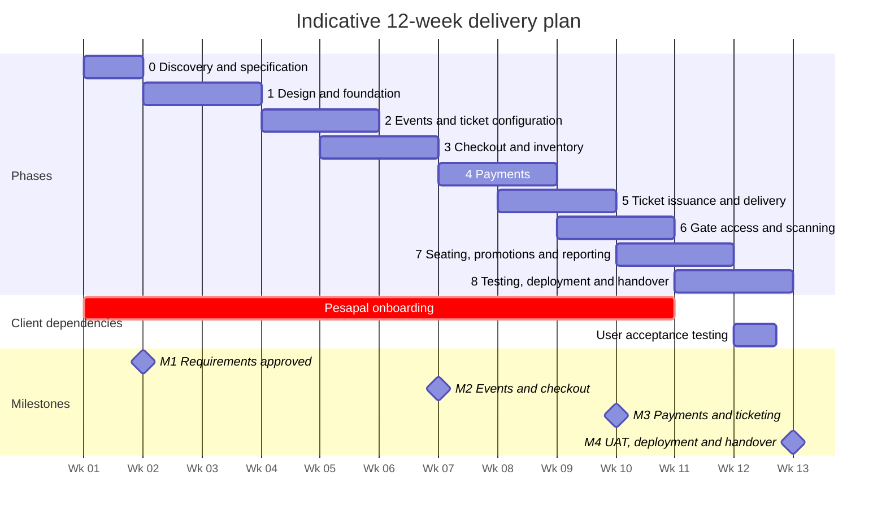

# Implementation Plan: Multi-Organizer Event Ticketing Platform

**Version 1.0 · 12 October 2026 · System design and analysis**

**Based on:** [v1.md](v1.md) (requirements specification), [sow.md](sow.md) (statement of work), [techstack.md](techstack.md) (architecture blueprint) and [v2.md](v2.md) (requirements review).

This plan turns the requirements and architecture into phases that the team can carry out and the client can approve one at a time. For each phase it gives the goal, what the phase needs from the client, the steps in order, what it delivers, and the tests that must pass before later work depends on it.

---

## 1. Delivery approach

### 1.1 Principles

1. **Data integrity before screens.** The four integrity boundaries are built and tested in the backend before their screens are polished: tenant isolation, inventory holds, payment confirmation and ticket redemption.
2. **Every phase ends with something that works.** A phase is finished when its exit tests pass on staging, not when its screens exist.
3. **Backend and frontend in parallel.** The API contract is agreed in Phase 1. Frontend developers then build against it, using mock data, while the backend implements it. This is why consecutive phases overlap by a week.
4. **One deployable backend.** The backend is a single Laravel application, split into modules for identity, events, inventory, orders, payments, tickets and gate access. No microservices.
5. **Test integrity against real PostgreSQL.** Row locking, constraints and concurrent updates don't behave the same way in SQLite, so all integrity tests run against PostgreSQL.

### 1.2 Phase overview

| Phase | Name                              | Weeks | SOW phase      | Payment milestone                         |
| ----- | --------------------------------- | ----- | -------------- | ----------------------------------------- |
| 0     | Discovery and specification       | 1     | 1              | **M1 (30%):** requirements approved       |
| 1     | Design and foundation             | 2–3   | 2              | —                                         |
| 2     | Events and ticket configuration   | 4–5   | 3              | —                                         |
| 3     | Checkout, orders and inventory    | 5–6   | 4              | **M2 (30%):** events and checkout         |
| 4     | Payments through Pesapal          | 7–8   | 4              | —                                         |
| 5     | Ticket issuance and delivery      | 8–9   | 5              | **M3 (25%):** payments and ticketing      |
| 6     | Gate access and scanning          | 9–10  | 6              | —                                         |
| 7     | Seating, promotions and reporting | 10–11 | Modules 8–10   | —                                         |
| 8     | Testing, deployment and handover  | 11–12 | 7              | **M4 (15%):** UAT, deployment and handover |

### 1.3 Timeline



The SOW estimates 8–12 weeks. This plan uses the upper bound because the agreed scope covers two payment methods (M-Pesa and card, both through Pesapal), three user interfaces, reserved seating, promotions and reporting. Eight weeks is realistic only if reserved seating and the fuller reporting move to a release after launch.

The durations assume about three to four developers plus part-time design and QA. Recalibrate them in Phase 0 once the team is confirmed. If the project starts in November, the December holidays fall inside Phases 4–7, so add one to two weeks of buffer.

### 1.4 Critical path

These items can delay launch no matter how fast development goes:

- **Pesapal onboarding** (client). Sandbox credentials are needed by Week 7 and production keys by Week 11. The merchant application must start in Week 1.
- **Hosting go/no-go** (provider). A Week 1 check decides whether the cPanel plan can run the API at all.
- **Approval of the database design and API contract** (both), by the end of Week 2. Every later phase depends on them.
- **Milestone review windows** (client). The SOW allows five business days per review. The team carries on with the next phase while the client reviews on staging.

### 1.5 How each phase is run

- One-week sprints, each ending with a demo on staging.
- A feature counts as **done** only when:
  - another developer has reviewed the code;
  - automated tests exist, including tenant-isolation tests for any new resource;
  - the API contract and documentation are updated;
  - sensitive actions write to the audit log;
  - it is deployed to staging and has been demonstrated.

---

## 2. Phase 0 — Discovery and specification

**Week 1 · SOW phase 1 · Ends with payment milestone M1 (30%)**

**Goal:** Merge the source documents into one approved specification, settle the open decisions, and remove the external blockers that could stall later phases.

**Needed from the client:** availability of the decision-maker, payment provider applications started, hosting and domain access, and branding assets.

### Steps

1. **Merge the source documents into one baseline.** v1.md and techstack.md use different names for the same things. Choose one set and record it:

   | Topic                 | v1.md                                    | techstack.md                         |
   | --------------------- | ---------------------------------------- | ------------------------------------ |
   | Tenant table          | `organizers`, `organizer_members`        | `organizations`, `organization_members` |
   | Guard assignment      | `event_staff`                            | `guard_assignments`                  |
   | Scan record           | `ticket_scans` (every attempt)           | `ticket_redemptions`                 |
   | Sellable unit         | `event_ticket_offerings` (type × category) | `ticket_inventory`                 |
   | Roles                 | 4 roles                                  | 5 roles (organizer owner and staff are separate) |
   | API paths             | `/organizer/events/:id`                  | `/api/v1/events/{id}`                |

   **Recommendation:** use v1.md's schema as the base because it is the most complete. Add techstack.md's split between organizer owner and organizer staff, use the `/api/v1` prefix, and update techstack.md to match.

2. **Settle the open business decisions** listed in [§11 Decision log](#11-decision-log). Give each one an owner and a deadline.

3. **Start Pesapal onboarding.** Pesapal is the payment gateway for both M-Pesa and card payments. The client applies for a Pesapal merchant account and completes its business verification. Ask for sandbox credentials straight away. Production keys are needed by Week 11.

4. **Check the hosting.** On the actual cPanel plan, confirm each of the following:
   - [ ] The PHP version required by the chosen Laravel release, with the `pdo_pgsql`, `mbstring`, `openssl`, `bcmath`, `intl`, `fileinfo` and `gd` extensions.
   - [ ] SSH and Composer access, or another workable way to deploy.
   - [ ] A subdomain whose document root can point at Laravel's `public` directory.
   - [ ] Cron jobs that can run every minute.
   - [ ] An outbound connection to Supabase. Supabase's direct connection may require IPv6. If the host doesn't support IPv6, test Supabase's pooled connection or its IPv4 add-on.
   - [ ] SSL certificates for the API subdomain.
   - [ ] Whether long-running processes are allowed, which decides how queued jobs are run.

   Record the result as **go** or **no-go**. If it's no-go, fall back to a small VPS running the same Laravel application. No code changes are needed.

5. **Decide where the frontends are hosted.** A Next.js site that renders on the server needs a Node runtime, for example Vercel, or cPanel's Node.js app support if the plan has it. The Vite dashboard builds to static files, which cPanel can serve. All three applications must share a parent domain for Sanctum's cookie login to work.

6. **Set measurable performance targets.** v1.md requires these before launch. Proposed starting values for the client to confirm:
   - Scan validation: 95% of scans answered within 1 second over mobile data.
   - Checkout API, excluding the payment provider's own time: 95% of requests within 500 ms.
   - Peak load: ask the client for the largest expected event and how many buyers arrive in the first minutes of a sale.

7. **Fix the baseline schedule and risk register.** Confirm the team, the dates and the milestone review windows.

### Deliverables

- D1: Approved requirements specification, including the decision log.
- Hosting check report with the go/no-go result.
- Baseline schedule.

### Exit criteria

- [ ] Client representative has signed off the requirements and decision log.
- [ ] The Pesapal merchant application has been submitted and sandbox access requested.
- [ ] Hosting go/no-go is recorded.
- [ ] The naming baseline is agreed.

---

## 3. Phase 1 — Design and foundation

**Weeks 2–3 · SOW phase 2**

**Goal:** Agree the data model, API contract and designs, and deploy a working skeleton to staging that already has login and tenant isolation.

**Needed from the client:** design reviews, branding assets and access to DNS for the domain.

### Design track

1. **Database design and migration plan (D3).** Cover every in-scope module, including seating, so later phases don't need schema rework. Fill the gaps found while reviewing v1.md:
   - A reserved count on each ticket offering, so holds can be made with one atomic update (see Phase 3).
   - Storage for the QR token that allows the ticket page to show the QR again. A hash alone can't be turned back into a QR code (see Phase 5).
   - Hold expiry for seat holds.
   - Organizer member role values for owner and staff.
2. **API contract** as an OpenAPI specification: endpoints, request and response formats, one standard error format, pagination and request correlation IDs.
3. **Permission policy list.** Turn the permission matrix in v1.md into a rule for every endpoint: which role may call it, and which ownership check applies.
4. **State machines.** Finalize the allowed transitions for orders, payments and tickets.
5. **UI/UX designs (D2)** for the public website, organizer dashboard, admin dashboard and guard scanner. Define the shadcn/ui theme once: colors, corner radius and fonts.

### Backend track

6. **Repository and environments.** Recommended layout in one repository:

   ```text
   /api            Laravel API
   /web            Next.js public website
   /manage         React + Vite dashboard (organizer, admin and guard areas)
   /packages/ui    Shared shadcn/ui components and theme
   ```

   Set up three environments (local, staging and production), each with its own Supabase project, so test data never reaches production.

7. **Continuous integration.** On every push, run linting, static analysis and the test suite against PostgreSQL.
8. **Laravel foundation.** Install Laravel, connect to Supabase over SSL, and add migrations for the identity and tenancy tables. Use UUIDs for any record referenced from outside the system.
9. **Authentication.** Set up Sanctum cookie login for the web apps: register, login, logout, email verification, password reset and account suspension. Configure stateful domains, the session cookie domain, CORS and CSRF for the `www`, `manage` and `api` subdomains.
10. **Tenancy and authorization.** Build organizers, members and roles, with a Laravel policy for every resource. Keep platform admin permissions separate from organizer permissions.
11. **Audit log.** A single service call records who acted, the organizer, the event, the action, the affected resource and details.
12. **API conventions.** The `/api/v1` prefix, the standard error format, rate limits on login and registration, and a correlation ID on every request.
13. **Tenant-isolation test suite.** For every resource, a test checks that a user from organizer B is refused access to organizer A's records. The suite grows with every phase.

### Frontend track

14. Create `/web` (Next.js and TypeScript) and `/manage` (Vite, React and TypeScript), both using Tailwind CSS and shadcn/ui with the shared theme.
15. Build the login, password reset and email verification screens in `/manage`, with routing to the organizer, admin and guard areas by role.
16. Generate a typed API client from the OpenAPI specification, plus a mock server so screens can be built before the backend is ready.

### Deployment track

17. **Working skeleton on staging.** The API runs on cPanel over HTTPS, cron runs the scheduler, queued jobs are processed, both frontends are deployed, and login works end to end across the subdomains.

### Deliverables

- D2: UI/UX designs.
- D3: Database design and migration scripts.
- Approved API contract.
- Working foundation on staging.

### Exit criteria

- [ ] Organizers cannot read or change another organizer's resources, and the automated tests prove it.
- [ ] Every protected endpoint refuses requests that aren't logged in or aren't authorized.
- [ ] Login works across `www`, `manage` and `api` on staging.
- [ ] The database design, API contract and designs are approved.

---

## 4. Phase 2 — Events and ticket configuration

**Weeks 4–5 · SOW phase 3**

**Goal:** An organizer can build, configure and publish an event with ticket offerings, gates and assigned guards.

### Backend

1. **Event lifecycle.** Draft → published → cancelled or archived, enforced by the backend. Store times in UTC alongside the event's own timezone.
2. **Event details and media.** Name, description, venue and images, with images stored in Supabase Storage.
3. **Time windows.** Store and validate each window separately: sales start and end, gate opening and closing, and event start and end.
4. **Ticket types and categories.** Seed the defaults (Early Bird, Normal, At the Gate, Group and Promoted; VVIP, VIP and Media) and let organizers add their own.
5. **Offerings.** Each allowed type × category combination, with a price in minor units of KES, capacity, sales window, and minimum and maximum per order. Include group quantity rules, and an approval or manual-issue flag for Media tickets.
6. **Delegations.** Each with its allocation, allowed categories and price rules.
7. **Attendee details setup.** The collection mode (purchaser only, or details for every ticket) and the field definitions, including event-specific questions.
8. **Gates and staff.** Create gates, invite guards by email, assign each guard to an event and optionally a gate, and remove assignments.
9. **Publishing rules.** An event can be published only if it has at least one active offering, valid time windows, and capacity that covers its allocations. Changes after publishing are audited. Changes that would affect existing orders, such as lowering capacity below tickets already sold, are blocked or need explicit confirmation.
10. **Admin.** List organizers, suspend or reactivate them, and oversee events.

### Frontend

11. **Organizer dashboard:** an event list and a step-by-step event editor (details → times → tickets → attendee fields → gates and staff → publish), an offerings grid, delegation management and staff invitations.
12. **Admin dashboard:** organizers, users, and suspension controls.
13. **Public website:** event listing and event detail pages that show published events only.

### Exit criteria

- [ ] An organizer can publish an event with valid offerings and capacity limits.
- [ ] Unpublished events never appear on public endpoints.
- [ ] Guard invitation and assignment work, and guards see only the events assigned to them.
- [ ] Tenant-isolation tests cover every new resource.

---

## 5. Phase 3 — Checkout, orders and inventory

**Weeks 5–6 · SOW phase 4 (first half) · Ends with payment milestone M2 (30%)**

**Goal:** A buyer can build an order and hold tickets, and buyers acting at the same moment can never oversell.

### Backend

1. **Order creation.** Check the offering, the sales window, quantity limits, group rules and delegation eligibility.
2. **Inventory hold**, made in one transaction with an atomic conditional update:

   ```sql
   -- Hold :qty tickets only if enough remain.
   -- 1 row updated = held. 0 rows updated = sold out.
   UPDATE event_ticket_offerings
   SET    reserved_count = reserved_count + :qty
   WHERE  id = :offering_id
     AND  status = 'active'
     AND  capacity - sold_count - reserved_count >= :qty;
   ```

   In the same transaction, insert the matching `inventory_reservations` row with its expiry time. If no row was updated, return a clear "sold out" response.

3. **Hold expiry.** Holds last for a configurable time (see the decision log). A scheduled job runs every minute, releases expired holds and expires their orders. Build the hold mechanism generically so seat holds in Phase 7 can reuse it.
4. **Attendee details.** Validate them against the event's field setup and collection mode, and store purchaser details separately from ticket-holder details.
5. **Promotions (core).** Percentage or fixed discounts, eligible offerings, start and end dates, total and per-buyer limits, and minimum quantity or order value. Count each use against the hold so that orders placed at the same moment can't exceed a limit.
6. **Pricing.** Only the backend calculates totals. Each order item stores a snapshot of the unit price, discount, fees and currency, so later price edits don't change past orders.
7. **Order states.** Pending → paid → completed, plus expired and cancelled.

### Frontend

8. **Public checkout:** choose an offering and quantity, fill in attendee forms built from the event's setup, enter a promo code, review the order summary, and see a countdown for the hold, with clear handling when it expires.
9. **Organizer dashboard:** the order list for each event.

### Tests

10. **Overselling:** for example, send 50 simultaneous requests for the last 10 tickets. Exactly 10 must be held and the rest refused. Run this against PostgreSQL.
11. **Expiry:** expired holds return their tickets to inventory.
12. **Pricing:** promotions, group pricing, and snapshots that stay unchanged after an organizer edits prices.

### Exit criteria

- [ ] Simultaneous buyers cannot oversell an offering.
- [ ] Expired holds release their inventory.
- [ ] Order totals are calculated only by the backend.

---

## 6. Phase 4 — Payments through Pesapal (M-Pesa and card)

**Weeks 7–8 · SOW phase 4 (second half)**

**Goal:** The server confirms every payment exactly once, however many times Pesapal retries, delays or repeats its notifications.

**Needed from the client:** Pesapal sandbox credentials and the written refund policy.

Pesapal is the single payment gateway. Buyers pay on Pesapal's hosted checkout, choosing M-Pesa or card there, so card details never touch the platform's servers.

### Backend

1. **One payment interface.** A single interface for starting a payment, checking its status, refunding it and handling notifications. A Pesapal adapter implements it, and a fake provider stands in during tests. Because orders and tickets only use the interface, another gateway can be added later without changing them.
2. **Pesapal setup.** Request access tokens with the consumer key and secret, and cache them until they expire. Register the platform's IPN (instant payment notification) URL with Pesapal once per environment, and store the IPN ID that Pesapal returns.
3. **Starting a payment.** Submit the order to Pesapal with our order reference, amount, currency, buyer details, the IPN ID and a callback URL. Pesapal returns an order tracking ID and the address of its hosted checkout, where the buyer pays.
4. **Handling Pesapal notifications**, in this order:
   1. **Confirm the result with Pesapal.** Treat an IPN only as a signal that something changed. Fetch the real result from Pesapal's transaction status endpoint using the order tracking ID, and act only on that response.
   2. **Skip duplicates.** Pesapal IPNs don't carry a unique event ID, so record every notification in `payment_webhook_events` and make processing idempotent. If the order is already paid, acknowledge and stop.
   3. **Record the result in one transaction:** lock the order, check that the amount and currency match, mark the payment as succeeded, mark the order as paid, issue the tickets (built in Phase 5), and write an outbox record for the email.
   4. **Reply to the IPN** in the format Pesapal expects, so it stops retrying.

   When the buyer is sent back to the callback URL, that page only shows the status. It never marks anything as paid.
5. **Payment after the hold expired.** Apply the policy chosen in the decision log, for example: hold the tickets again if they're still available, otherwise flag the order for a refund.
6. **Reconciliation job.** Every few minutes, ask Pesapal for the status of payments that have been pending longer than a set time, then resolve them or flag them. Produce a report of mismatches.
7. **Refunds and reversals.** Request refunds through Pesapal's refund API where Pesapal supports refunds for the payment method, and track their status. Move the order to partially refunded or refunded, and decide ticket eligibility explicitly, for example by revoking tickets after a full refund. If Pesapal reports a completed payment as reversed, handle it the same way.
8. **Payment history and reconciliation screens:** organizers see their own events, and platform admins see the whole platform.

### Frontend

9. **Payment step.** The buyer confirms the order and is sent to Pesapal's hosted checkout, by redirect or in an embedded frame, to pay by M-Pesa or card. On return, a status page checks the order status from the backend every few seconds until it is final. It never trusts the redirect.

### Sandbox test matrix

Run each scenario with both an M-Pesa test payment and a card test payment where the sandbox allows it.

| Scenario                                  | Expected result                                       |
| ----------------------------------------- | ----------------------------------------------------- |
| Successful payment                        | Order paid; tickets issued once                       |
| Failed payment or insufficient funds      | Order stays pending until it expires; buyer can retry |
| Buyer cancels or abandons the checkout    | Buyer can retry; hold expires as normal               |
| No IPN arrives                            | Reconciliation resolves the payment                   |
| Duplicate IPN                             | Processed once only                                   |
| IPNs arrive out of order                  | Final state matches Pesapal's status                  |
| IPN after the hold expired                | The late-payment policy is applied                    |
| Amount doesn't match the order            | Not marked paid; flagged for review                   |
| Forged IPN                                | No change, because Pesapal's status check doesn't confirm it |
| Completed payment later reversed          | Order flagged; tickets handled under the refund policy |

### Deliverables

- D9: Payment integration, with recorded test evidence.

### Exit criteria

- [ ] Every scenario in the test matrix passes in the Pesapal sandbox, with evidence recorded.

---

## 7. Phase 5 — Ticket issuance and delivery

**Weeks 8–9 · SOW phase 5 · Ends with payment milestone M3 (25%)**

**Goal:** Every confirmed purchase produces the right number of unique tickets that the buyer can retrieve, and an email with the link.

**Needed from the client:** an account with the email provider, and DNS access for the sending domain (SPF, DKIM and DMARC records).

### Backend

1. **Issuance**, inside the payment transaction: one ticket per unit bought, each with a unique, non-sequential ticket number, plus its attendee, offering, delegation and seat where applicable.
2. **QR credential.** Generate a random, hard-to-guess token. The QR code contains only this token and no personal details, and tickets are looked up by the token's hash. The ticket page must be able to show the QR again, but a hash can't be turned back into the token. So either store the token encrypted alongside its hash, or generate the QR value as a signed reference. Never store the token in plain text.
3. **Retrieval links.** Each link uses a random token whose hash is stored in `ticket_access_tokens`, with an expiry date and the ability to revoke it. Buyers can request a new link by entering their email address. This request is rate-limited and doesn't reveal whether an email address has an order.
4. **Email delivery** through the queue, driven by the outbox records, with retries and logging of failures.
5. **Revocation.** Organizers and admins can revoke a ticket with a reason. Revocations are audited, and revoked tickets are rejected at the gate.
6. **Media tickets.** An approval or manual-issue flow for organizers.

### Frontend

7. **Ticket page** on the public website: event details, category, attendee name (where collected), ticket number, seat or delegation, and the QR code, with a download as PDF or image.
8. **Organizer dashboard:** ticket list and search, revocation, and manual issuance of Media tickets.

### Deliverables

- D10: Ticketing engine.

### Exit criteria

- [ ] Each confirmed purchase produces the expected number of tickets, each with a unique QR code.
- [ ] Repeated payment notifications never produce duplicate tickets.
- [ ] Revoked or invalid retrieval links are rejected.
- [ ] The email arrives with a working link, and failed sends are retried.

---

## 8. Phase 6 — Gate access and scanning

**Weeks 9–10 · SOW phase 6**

**Goal:** Guards can admit valid ticket holders quickly, and no ticket can be used twice.

### Backend

1. **Scan checks**, in this order: the guard is logged in → the guard is assigned to this event (and gate) → the gate is open, judged by server time → the ticket exists (looked up by hash) → it belongs to this event → it is paid and not revoked → redeem it.
2. **Redemption with one atomic update:**

   ```sql
   -- 1 row updated = admit. 0 rows updated = already used or no longer valid.
   UPDATE tickets
   SET    status = 'redeemed', redeemed_at = now()
   WHERE  id = :ticket_id
     AND  event_id = :event_id
     AND  status = 'valid';
   ```

3. **Scan log.** Record every attempt in `ticket_scans`, including rejected ones, with the result, gate, guard and time.
4. **Minimal response.** Return only what the guard needs: the result and reason, the category, the attendee name where collected, the seat or delegation, and, for a ticket already used, when and at which gate.

### Frontend (guard area in `/manage`)

5. **Designed for phones first:** log in → see assigned events → choose a gate → scan with the camera. Browsers only allow camera access over HTTPS.
6. **Result screens** that are large and high-contrast: valid, already used, invalid (with the reason), and unable to verify.
7. **Fail closed.** A timeout or network error shows "Unable to verify — do not admit" and never a success.
8. **Organizer dashboard:** live gate activity and attendance counts.

### Tests

9. **Simultaneous scans:** two devices scan the same ticket at the same moment, and exactly one admits.
10. **Rejection cases:** wrong event, wrong gate, revoked, unpaid, before the gate opens, after it closes, and an unknown QR code.
11. **Field rehearsal:** real phones in poor light on slow mobile data, in conditions close to a real venue. Measure scan time against the Phase 0 target.

### Deliverables

- D8: Guard interface.

### Exit criteria

- [ ] A ticket cannot be used twice, even when scanned on two devices at the same moment.
- [ ] Every rejection case shows the correct reason.
- [ ] The scanner fails closed when it can't reach the server.
- [ ] Every scan record includes the event, gate, guard and time.

---

## 9. Phase 7 — Reserved seating, promotions and reporting

**Weeks 10–11 · SOW modules 8, 9 and 10**

**Goal:** Finish the remaining in-scope modules without destabilizing the core flow from purchase to entry.

Each part of this phase is built and tested on its own. The core flow doesn't depend on it, so if the schedule slips, this is the phase to move into a release after launch, with the client's approval through change control.

### Reserved seating

1. Organizers set up sections, rows and seat numbers through simple forms and bulk entry. The SOW (§9) excludes advanced visual seat-map editors.
2. Seats can be available, held, sold or released. Seat holds reuse the Phase 3 hold mechanism and its expiry.
3. A database constraint allows only one active ticket per seat per event.
4. Buyers choose seats during checkout, and the assigned seat appears on the ticket and at the gate.
5. Test that two buyers choosing the same seat at the same moment results in exactly one getting it.

### Promotions (remaining rules)

6. Complete the remaining rules from SOW §2.8, and add redemption tracking and reporting.

### Reporting

7. **Organizer reports**, for their own events only: sales by offering, payment status, remaining capacity, promotion performance, attendance and gate activity.
8. **Admin reports:** platform-wide summaries, transaction oversight and an audit log viewer.

### Exit criteria

- [ ] A seat can't be sold twice, expired holds release seats, and general-admission events need no seat setup.
- [ ] Reports show only the organizer's own events, and their figures match the order and payment records.

---

## 10. Phase 8 — Testing, deployment and handover

**Weeks 11–12 · SOW phase 7 · Ends with payment milestone M4 (15%)**

**Goal:** Demonstrate the agreed acceptance criteria in an environment like production, go live, and hand over.

**Needed from the client:** people to run user acceptance testing (UAT), production payment credentials, DNS for the production domains, and the approved privacy notice and refund policy.

### Steps

1. **Feature freeze.** From here on, only defect fixes are made.
2. **End-to-end tests** of the full journey: publish an event → buy tickets with each payment method → receive the email → open the ticket → scan it → see the second scan rejected.
3. **Security review:** authorization tests across all endpoints, checks against common web vulnerabilities (the OWASP Top 10), rate limits, no secrets in the repository, security headers, a dependency audit, and attempts to forge payment notifications.
4. **Performance test** against the Phase 0 targets: a burst of checkouts on one event, and scanning throughput.
5. **Backup and recovery.** Confirm what backups the Supabase plan includes, run a restore into staging, and document the procedure.
6. **Monitoring.** Error tracking, uptime checks on the API and both frontends, and alerts for failed jobs, payments stuck in pending, and email failures.
7. **Production setup.** A production Supabase project; configuration stored outside the web root; cron; the agreed way of running queued jobs; HTTPS on all three subdomains; Sanctum configured for the production domains; and production Pesapal keys, with the production IPN URL registered.
8. **Data protection.** Publish the privacy notice and retention rules, and agree each party's role (controller or processor). Confirm any registration obligations with Kenya's Office of the Data Protection Commissioner.
9. **UAT.** The client tests on staging against the acceptance criteria in SOW §5. Defects are logged and classified, and critical and high defects are fixed before sign-off. The client has five business days to review.
10. **Go-live.** Deploy, run smoke tests, then make one real low-value payment with each method and refund it.
11. **Handover (D13, D14):** source code, migrations, environment documentation, API documentation, deployment guide, payment and email setup guide, admin and organizer guides, test results, known issues, and a secure transfer of credentials.

### Deliverables

- D11: Testing documentation.
- D12: Production deployment.
- D13: Documentation.
- D14: Handover.

### Exit criteria

- [ ] The SOW §5 acceptance criteria have been demonstrated.
- [ ] The v1.md §9 MVP acceptance checklist is complete.
- [ ] No critical or high-severity defects remain open.
- [ ] The client has signed off UAT.

The 30-day warranty period starts after this sign-off.

---

## 11. Decision log

These decisions affect the database, the integrations or the schedule. Each needs an owner and must be settled by the phase shown.

| #  | Decision                              | Options                                                     | Recommendation                                                                       | Needed by |
| -- | ------------------------------------- | ----------------------------------------------------------- | ------------------------------------------------------------------------------------ | --------- |
| 1  | Naming baseline                       | v1.md names or techstack.md names                           | v1.md schema, plus the owner/staff role split                                        | Phase 0   |
| 2  | Booking or platform fees              | None; added to the buyer's total; deducted from the organizer | Business decision for the client; it changes how prices are stored on orders       | Phase 0   |
| 3  | Payment gateway                       | —                                                           | **Decided: Pesapal**, for both M-Pesa and card payments through its hosted checkout  | Decided   |
| 4  | Paying organizers                     | Manual payouts outside the platform; automated payouts      | All buyer payments land in the platform's Pesapal merchant account. Pay organizers manually from the reconciliation reports; automated payouts are out of scope (SOW §9) unless added by change request | Phase 0   |
| 5  | Frontend hosting                      | Vercel, cPanel Node.js support, or static files             | Vercel for the Next.js site; cPanel static hosting for the Vite dashboard            | Phase 0   |
| 6  | Attendee accounts at launch           | Guest checkout only, or optional accounts                   | Guest checkout with retrieval links (SOW §2.1); accounts later. techstack.md's `/me/tickets` waits until then | Phase 1   |
| 7  | Organizer onboarding                  | Self sign-up with admin approval, or created by admins      | Self sign-up with admin approval                                                     | Phase 1   |
| 8  | Repository structure                  | One repository or several                                   | One repository (see Phase 1)                                                         | Phase 1   |
| 9  | Email provider                        | Client's choice                                             | Any provider that supports domain authentication                                     | Phase 1   |
| 10 | Hold duration                         | 5–20 minutes                                                | 10–15 minutes, configurable                                                          | Phase 3   |
| 11 | Payment that arrives after the hold expired | Honor it if tickets remain; always refund; handle manually | Honor it if tickets remain, otherwise flag it for a refund                     | Phase 4   |
| 12 | Refund policy and who can approve     | Organizer only; admin only; organizer requests and admin approves | Per-event policy: the organizer requests, the platform admin approves         | Phase 4   |

---

## 12. Testing strategy

| Layer                      | What it proves                                                | Recommended tools                                       | From phase      |
| -------------------------- | ------------------------------------------------------------- | ------------------------------------------------------- | --------------- |
| Unit                       | Pricing, state transitions, promotion rules                   | Pest or PHPUnit; Vitest                                 | 1               |
| API                        | Endpoints, validation, error format                           | Pest or PHPUnit                                         | 1               |
| Authorization and tenancy  | No access across organizers; roles stay within their limits   | Pest or PHPUnit                                         | 1, then every phase |
| Concurrency                | No overselling, no double redemption, no seat sold twice      | Simultaneous requests against PostgreSQL (k6 or scripts) | 3              |
| Payment simulation         | Every notification scenario in the Phase 4 matrix             | Provider sandboxes plus recorded test notifications     | 4               |
| End-to-end                 | Full user journeys in a real browser                          | Playwright                                              | 5               |
| Performance                | The Phase 0 targets are met                                   | k6                                                      | 8               |

---

## 13. Risk register

| Risk                                                      | Mitigation                                                                                | Owner    |
| --------------------------------------------------------- | ----------------------------------------------------------------------------------------- | -------- |
| Pesapal onboarding is delayed                             | Apply in Week 1, build on the sandbox first, review progress weekly                       | Client   |
| A Pesapal outage stops all sales                          | Monitor payment failures; the payment interface allows adding a second gateway later      | Both     |
| The cPanel plan can't support the API                     | Hosting check in Week 1; fall back to a VPS with no code changes                          | Provider |
| The host can't reach Supabase (IPv6 or connection limits) | Test during the Week 1 hosting check; use Supabase's pooled connection if needed          | Provider |
| The 12-week schedule is too tight                         | Run tracks in parallel; use Phase 7 as the scope lever                                    | Both     |
| Holidays fall inside the project window                   | Add one to two weeks of buffer when the start date is fixed                               | Both     |
| Business decisions arrive late                            | Decision log with owners and deadlines                                                    | Client   |
| Payment notifications are duplicated or late              | Duplicate checks, reconciliation job, late-payment policy                                 | Provider |
| Poor connectivity at gates                                | Scanner fails closed; field rehearsal; check venue connectivity before each event         | Both     |
| Ticket emails go to spam or fail                          | SPF, DKIM and DMARC records; retries; buyers can request a new link                       | Both     |
| Scope grows during the build                              | Change control as set out in SOW §12                                                      | Both     |

---

## 14. Immediate next steps

1. Circulate this plan with the SOW for review.
2. Schedule the Phase 0 decision workshop to go through the decision log.
3. Client: start the Pesapal merchant application.
4. Provider: run the cPanel and Supabase hosting check.
