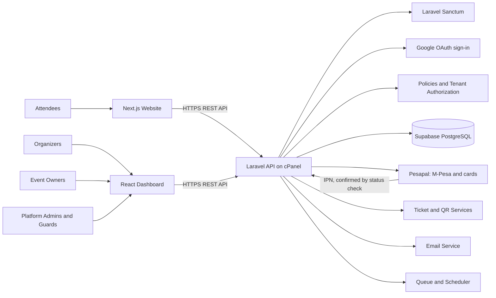
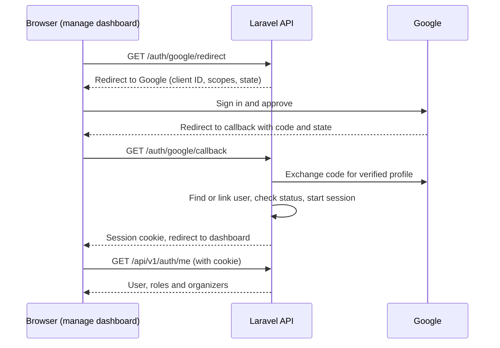
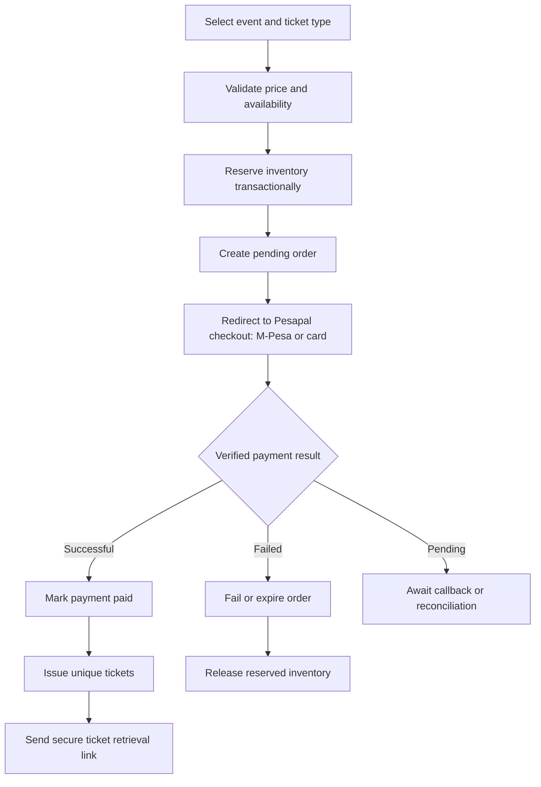
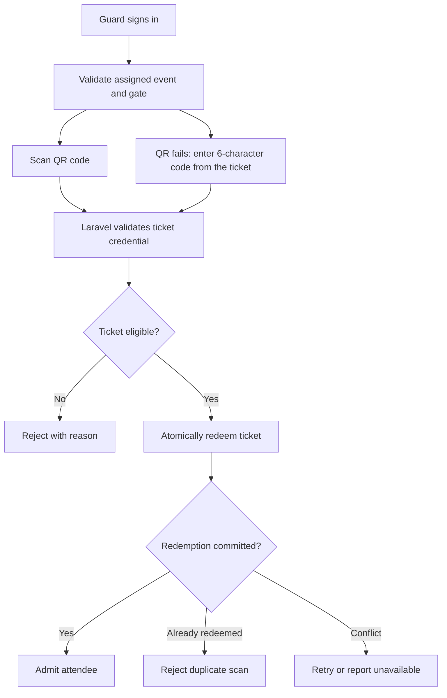

# Architecture Blueprint: Multi-Organizer Event Ticketing SaaS

We're locking in **Laravel + Sanctum + Supabase PostgreSQL**, with Laravel initially hosted on **cPanel**. This gives you a practical starting point without forcing you to build the entire infrastructure on AWS before the product is ready.

> **Key architectural principle:** Laravel owns the business rules, Supabase PostgreSQL owns the persistent data, and the frontends communicate with Laravel through a versioned API.

---

## 1. Recommended technology stack

| Layer                   | Technology                 | Responsibilities                                                                                                    |
| ----------------------- | -------------------------- | ------------------------------------------------------------------------------------------------------------------- |
| **Public frontend**     | Next.js + TypeScript       | Event discovery, event pages, guest checkout and ticket retrieval                                                   |
| **Management frontend** | React + Vite + TypeScript  | Organizer dashboard (including the event owner guest list), platform admin and guard interface                      |
| **UI and styling**      | shadcn/ui + Tailwind CSS   | Shared component library and design system for both frontends                                                       |
| **Backend**             | Laravel REST API           | Sanctum, policies, event management, orders, payments, tickets, QR validation and reporting                         |
| **Authentication**      | Google OAuth (Laravel Socialite) + Sanctum | Google sign-in for admins, organizer staff and event owners; guards use Google or an email and password created by their organizer; Sanctum cookie sessions keep everyone signed in |
| **Database**            | Supabase PostgreSQL        | Persistent records, relationships, transactions, constraints and inventory                                          |
| **Payment gateway**     | Pesapal (API 3.0)          | M-Pesa and card payments through Pesapal's hosted checkout, with IPN notifications and transaction status checks    |
| **Initial deployment**  | cPanel                     | Laravel API, provided the hosting supports the required PHP version, extensions, HTTPS, database connectivity and background tasks |

### UI and styling with shadcn/ui

Both frontends use **shadcn/ui** for components, styled with **Tailwind CSS**. shadcn/ui supports both Next.js and Vite.

- **Components live in your code.** shadcn/ui is not installed as a package. Its CLI copies each component's source into the project, where you own and can modify it.
- **One theme for both frontends.** Define the colors, radius and typography once as CSS variables, and use the same values in the Next.js website and the React dashboard so they look like one product.
- **Keep the two copies in sync.** Each frontend gets its own copy of the components. To avoid drift, either agree on one theme file that both projects copy, or move the shared components into a common package if the frontends live in one repository.
- **Accessible by default.** The components are built on accessible primitives, which supports the keyboard-accessible public forms required in the specification.
- **Design the gate scanner for the job.** Guards work fast, often outdoors, on phones. Use large, high-contrast result states (valid, already used, invalid, unavailable) rather than default component sizes.

---

## 2. System architecture

The frontends must never write directly to ticket inventory, payment records, orders or redemptions. All those operations go through Laravel, so the platform has one place to enforce authorization and transactional rules.

---

## 3. Authentication and role design

Admins, organizer staff and event owners sign in with their **Google account**. Guards can also use Google, or sign in with an **email and password** that their organizer creates for them (see [Guard password accounts](#guard-password-accounts)). Laravel Socialite handles the Google OAuth flow. Once Google confirms who the user is, Laravel starts a Sanctum **cookie-based SPA session** that keeps them signed in, rather than giving the browser long-lived bearer tokens. Buyers don't sign in at all: they check out as guests.

### Google sign-in flow

### Sign-in rules

- **Identity scopes only.** Request `openid`, `email` and `profile`. Don't store Google's access or refresh tokens; the platform only needs to know who the user is.
- **Verified emails only.** Reject Google accounts whose email address Google hasn't verified.
- **Link by Google account ID.** Store Google's stable account ID in `users.google_id` and look users up by it, not by email.
- **Invitations decide access.** Staff, event owners, and guards who use Google, are invited by email and accept by signing in with a Google account that uses that address. A new user with no invitation can apply for an organizer account, which a platform admin approves. Platform admins are designated by an existing admin or system command, never through sign-in.
- **Suspended users stay out.** A valid Google sign-in doesn't let a suspended user in.
- **Browser routes, not API routes.** The redirect and callback are browser navigations that need the session for Google's `state` check, so they live in Laravel's web routes, not under `/api/v1`.
- **No open redirects.** After sign-in, send users only to allowed frontend addresses.
- **Fresh session.** Regenerate the session ID after sign-in, and invalidate the session on logout.

See [Laravel Socialite](https://laravel.com/docs/socialite) and [Laravel Sanctum — SPA Authentication](https://laravel.com/docs/sanctum#spa-authentication).

### Guard password accounts

Guards who can't or don't want to use Google sign in with an email and password instead.

- **One account per guard.** An organizer staff member or a platform admin creates the account. Never create one account for several guards: every scan is recorded against the signed-in guard.
- **Temporary password, then the guard's own.** The platform generates a temporary password and shows it once. The organizer gives it to the guard in person or by direct message, never in a group chat. At first sign-in the guard must set their own password, so only they know it.
- **Guard-only.** A password account can never become an organizer staff member, event owner or platform admin, so a leaked password exposes at most the scanner. It is never linked to a Google sign-in, and Google sign-in with the same email is refused.
- **Owned by one organizer.** The account belongs to the organizer that created it. Only that organizer, or a platform admin, can assign it to events, issue its password or disable it. Another organizer can't assign it, because the owning organizer could issue a new password and sign in as the guard.
- **One event per password.** The account is assigned to one event at a time, and each password is issued for that event and stored in `guard_credentials`. It works only while that event is open, and only to scan that event's tickets at the gates the organizer assigned.
- **Deleted when the event closes.** An event closes when its last gate closing time passes, or when the organizer cancels or archives it. At that moment the password is revoked: the platform deletes the password hash, ends the guard's sessions and ends their assignment. A scheduled job does this every minute, and every request from a password guard also checks that their event is still open, so there is no gap in between. The account itself is kept, without a password, so scan records still show who admitted whom.
- **Organizer issues passwords, not email.** For a forgotten password, or for the guard's next event, the organizer issues a new temporary password, which revokes any earlier one and ends existing sessions. There is no email-based reset.
- **Protected sign-in.** Passwords are hashed with Laravel's default hasher. Sign-in is rate-limited by email and IP, locks temporarily after repeated failures, and returns the same error for an unknown email and a wrong password.
- **Short sessions.** Guard sessions end when the event closes and expire after a set time anyway (for example, 12 hours). Guards sign out at the end of each shift, which matters on shared scanning phones. Use Laravel's database session driver, so the platform can end a specific guard's sessions.
- **Standard Sanctum flow.** The scanner fetches Sanctum's CSRF cookie, then posts the email and password to `POST /api/v1/auth/guard/login`.

### Domains

A clean domain setup would look like this:

- `www.yourdomain.com` — public event website
- `manage.yourdomain.com` — organizer and admin dashboard
- `api.yourdomain.com` — Laravel API

These are illustrative domains. Using a common top-level domain makes Sanctum's cookie-based approach practical, provided the session cookie, CORS, CSRF and stateful-domain settings are configured correctly. Preview deployments on unrelated Vercel domains need separate consideration.

Create a Google OAuth client for each environment (local, staging and production), and register that environment's callback address, for example `https://api.yourdomain.com/auth/google/callback`, as an authorized redirect URI.

### Roles and permissions

| Role                | Access                                                                                                        |
| ------------------- | ------------------------------------------------------------------------------------------------------------- |
| **Platform admin**  | Full rights and privileges across the platform: manage platform users, organizer accounts, event oversight, dispute intervention, global configuration, and platform-wide reports |
| **Organizer staff** | Full control of their organizer account: profile, members, events, pricing, offerings, delegations, guards, and settlement reports |
| **Event owner**     | Access restricted strictly to assigned events to view, filter, and export guest/attendee data                 |
| **Guard**           | Scan and redeem tickets only for assigned events and gates                                                    |
| **Attendee**        | Buy tickets as a guest and view their own orders and tickets through a secure retrieval link; accounts are not required for the initial release |

The full permissions matrix is in v1.md §3. Use Laravel **Policies** and **Gates** to authorize operations. A role alone should never grant access to every record of that type.

> **Example:** An organizer requesting `GET /api/v1/organizer/events/123` must not see event 123 simply because they are logged in. Laravel must verify that the event belongs to an organizer they are a member of, and that their role allows the action. An event owner passes only for the guest list of an event they are assigned to.

---

## 4. Database architecture in Supabase PostgreSQL

Start with a relational schema. PostgreSQL is a good fit because ticketing requires reliable relationships, transactions, uniqueness and concurrency controls.

### Core database modules

Table names follow v1.md §4, which lists every column.

| Module                                 | Tables                                                                                                           |
| -------------------------------------- | ---------------------------------------------------------------------------------------------------------------- |
| **Identity and tenancy**               | `users`, `organizers`, `organizer_members`                                                                       |
| **Events and access**                  | `events`, `event_gates`, `event_staff`                                                                           |
| **Ticket configuration and inventory** | `ticket_types`, `ticket_categories`, `event_ticket_offerings`, `delegations`, `inventory_reservations`, `seating_sections` and `seats` (optional) |
| **Orders and tickets**                 | `orders`, `order_items`, `attendees`, `ticket_field_definitions`, `attendee_field_values`, `tickets`, `ticket_access_tokens`, `ticket_scans` |
| **Payments and promotions**            | `payments`, `payment_webhook_events`, `refunds`, `promotions`, `promotion_redemptions`                           |
| **Audit**                              | `audit_logs`                                                                                                     |

### Key design decisions

- Use UUIDs for externally referenced records where appropriate.
- Store monetary amounts as integer minor units (for example, cents), with an explicit currency code.
- Keep orders, payments and tickets as separate entities. One order may contain multiple tickets, and each ticket must have its own QR credential. Store the QR token as a hash (to find the ticket at the gate) and as an encrypted copy (to show the QR code again), never in plain text.
- Store payment-provider references and idempotency keys with appropriate uniqueness constraints.
- Model reserved seating separately from general admission; only events that use seating need seat inventory.
- Store event-specific attendee fields in a structured format where appropriate, while keeping critical fields and reporting dimensions well defined.
- Use explicit event and ticket statuses rather than inferring availability from whether a record exists.

### Supabase connection

Configure Laravel's PostgreSQL connection using the connection details supplied by your Supabase project, enforce SSL, and test connectivity from the actual cPanel hosting environment. Supabase offers direct and pooled connection options; which one works best depends on network support, connection limits and pooling mode. See [Supabase — Connecting to Postgres](https://supabase.com/docs/guides/database/connecting-to-postgres).

> **Security:** Keep the database password out of source control. Laravel should access PostgreSQL through Eloquent and controlled SQL operations; don't expose database credentials to either frontend.

---

## 5. Critical transaction flows

### A. Ticket purchase

Use temporary inventory reservations with an expiry. Otherwise, abandoned payment sessions can block ticket availability indefinitely.

Pesapal notifies Laravel of payment changes through IPN (instant payment notification) calls. Treat each IPN only as a signal: confirm the actual result with Pesapal's transaction status endpoint before marking anything paid. Processing must also be **idempotent**: a repeated IPN must not issue duplicate tickets or process the same payment twice. A scheduled reconciliation process should ask Pesapal about payments that stay pending or look inconsistent.

Buyers choose M-Pesa or card on Pesapal's hosted checkout, so card details never reach the platform. The buyer's return to the callback URL only shows a status page; it never marks the order as paid.

### B. QR scanning at the gate

The redemption must happen in a database transaction with appropriate locking or a conditional atomic update. A frontend check followed by a separate database update is not enough: two guards could scan the same ticket almost simultaneously.

For the MVP, online-only scanning is sensible. The scanner should clearly distinguish **valid**, **already-used**, **invalid** and **unavailable** results.

If a QR code won't scan, the guard asks the attendee to show their downloaded or printed ticket and types its **6-character short code**. The short code goes through the same checks and the same one-time redemption as a scan, and the result shows the attendee's name (where collected) so the guard can compare it with the ticket. Six characters are much easier to guess than a QR token, so short code entry is rate-limited per guard and locks after repeated invalid codes. Short codes are stored as a keyed hash for lookup plus an encrypted copy for display (v1.md §4.3).

---

## 6. cPanel deployment strategy

cPanel is a reasonable initial deployment target if your hosting plan supports the requirements below. Don't assume that every shared hosting plan supports a production Laravel workload equally well.

| Component                | Initial approach                                                                            |
| ------------------------ | ------------------------------------------------------------------------------------------- |
| **Laravel API**          | Deploy the application with the public web root pointing to Laravel's `public` directory    |
| **Database**             | Supabase PostgreSQL over a secured connection                                               |
| **Scheduler**            | cPanel cron invoking Laravel's scheduler every minute                                       |
| **Queues**               | Laravel database queue initially, if supported by your plan                                 |
| **Long-running workers** | Verify whether the host permits them; otherwise use a controlled cron-based worker strategy |
| **Assets**               | Supabase Storage or another object-storage service                                          |
| **Secrets**              | Environment configuration outside public access                                             |
| **Monitoring**           | Laravel logs, payment/webhook audit records and external uptime monitoring                  |

For a shared host that does not allow persistent queue workers, a cron-triggered `queue:work --stop-when-empty` approach may work for lightweight workloads, subject to hosting limits. Time-sensitive work must not depend on a queue configuration you have not tested.

> **Warning:** Do not process lengthy payment reconciliation or email batches inside the user's checkout request. Keep the HTTP request fast and move appropriate work to queues.

---

## 7. API structure

All endpoints are versioned under `/api/v1` and follow v1.md §5, which has the full list. Public endpoints sit at the top level, organizer endpoints under `/api/v1/organizer` and platform admin endpoints under `/api/v1/admin`. The main endpoints:

| Module               | Example endpoints                                                                                          |
| -------------------- | ---------------------------------------------------------------------------------------------------------- |
| **Authentication**   | `GET /auth/google/redirect`, `GET /auth/google/callback`, `POST /api/v1/auth/guard/login`, `POST /api/v1/auth/logout`, `GET /api/v1/auth/me` |
| **Invitations**      | `POST /api/v1/organizer/invitations`, `POST /api/v1/invitations/{token}/accept`                            |
| **Guard accounts**   | `POST /api/v1/organizer/guards`, `POST /api/v1/organizer/guards/{id}/password`                             |
| **Organizers**       | `POST /api/v1/organizers`, `GET /api/v1/organizers/me`                                                     |
| **Events**           | `GET /api/v1/events`, `POST /api/v1/organizer/events`, `PATCH /api/v1/organizer/events/{id}`               |
| **Ticket offerings** | `GET /api/v1/events/{id}/tickets`, `POST /api/v1/organizer/events/{id}/offerings`                          |
| **Orders**           | `POST /api/v1/orders`, `GET /api/v1/orders/{id}`                                                           |
| **Payments**         | `POST /api/v1/orders/{id}/payments`, `POST /api/v1/webhooks/payments/{provider}`                           |
| **Ticket retrieval** | `GET /api/v1/ticket-access/{token}`, `POST /api/v1/ticket-access/resend`                                   |
| **Gate scanning**    | `POST /api/v1/events/{id}/scans/validate`                                                                  |
| **Attendees**        | `GET /api/v1/organizer/events/{id}/attendees`, `GET /api/v1/organizer/events/{id}/attendees/export` (staff and assigned event owners) |
| **Reports**          | `GET /api/v1/organizer/events/{id}/reports/sales`                                                          |

Public event discovery and guest checkout are accessible without signing in. Ticket retrieval must use secure, expiring links or authenticated access, and must not expose sequential IDs as the sole authorization mechanism.

---

## 8. Implementation phases

The phase plan, with steps, exit criteria and the 12-week timeline, is in [implementation-plan.md](implementation-plan.md).

Avoid microservices for the first version. A modular Laravel application is simpler to deploy, test and maintain on cPanel. Keep payments, ticket inventory and redemption isolated into clear service classes so you can scale or extract them later if the product requires it.

---

## 9. Recommendation

Start with the **database and tenancy foundation**, not the dashboard UI. If the organizer boundaries, inventory transactions and redemption rules are sound, the frontend can evolve without compromising the ticketing engine.

The first implementation deliverable should be a **reviewed ERD and Laravel migration plan**, followed by feature tests for:

- Tenant isolation
- Overselling prevention
- Payment idempotency
- Duplicate QR redemption
