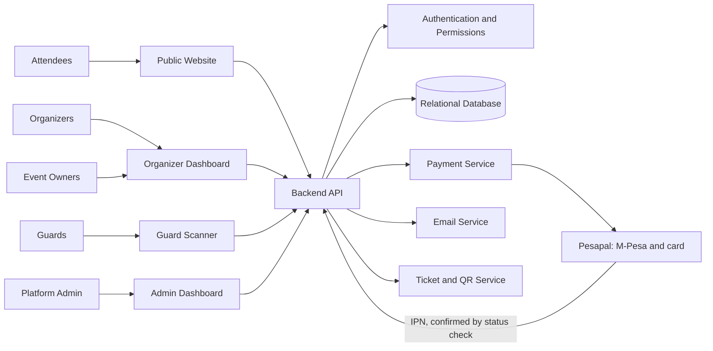
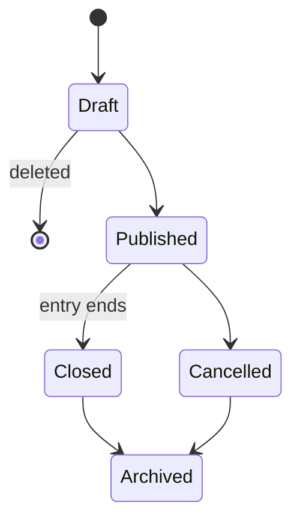
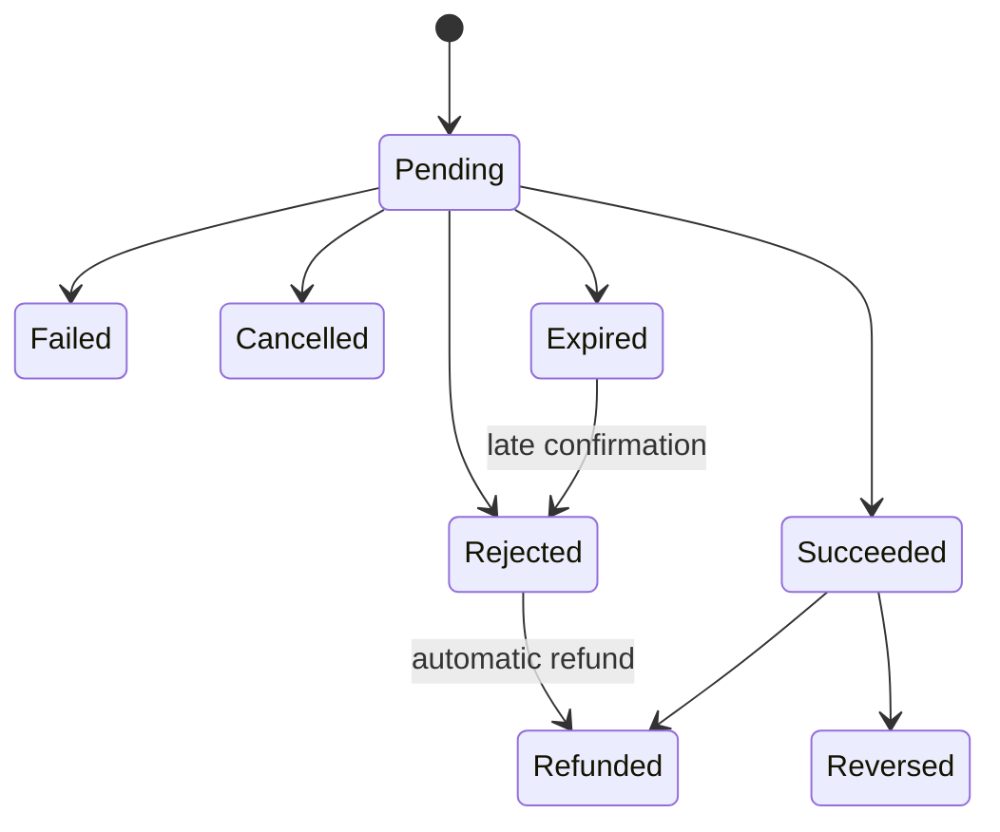
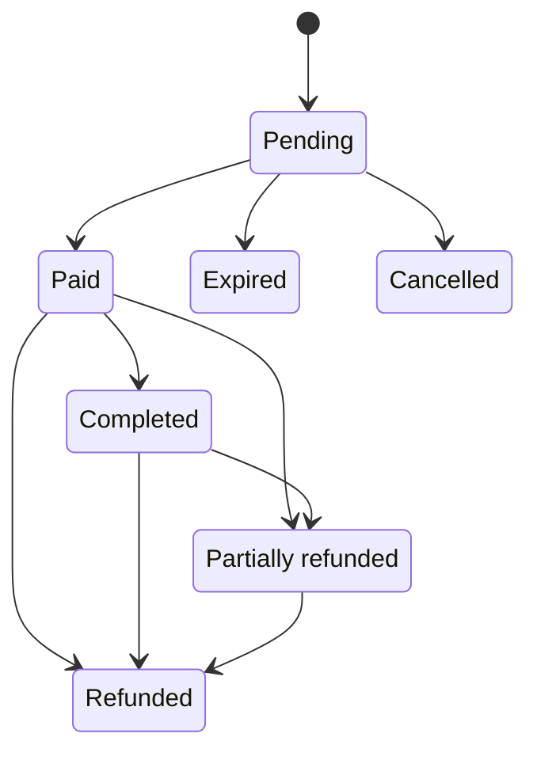
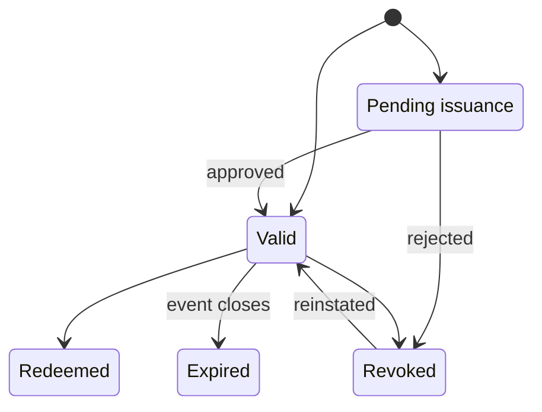
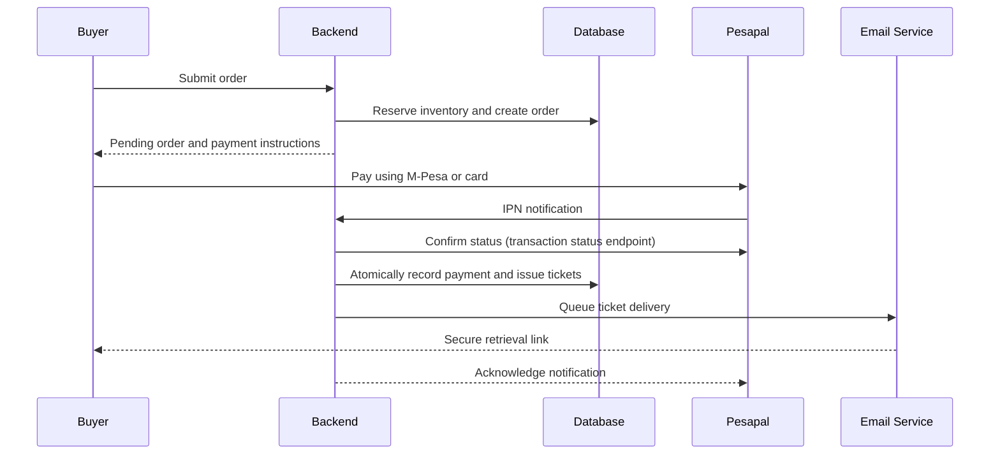

# Event Ticketing Platform — Refined Software Requirements Specification

**Version 1.8 · 15 October 2026 · Multi-organizer SaaS platform**

> **Revision 1.8:** Applies the client decisions of 15 October 2026 on the public site and ticket setup (implementation-plan.md §11, #23–#28). A landing page lists every public ticket option across published events, with search and filters (FR-14). Each event has its own link and QR code, with a printable poster, for sharing and for selling at the gate. Staff can sell any ticket category in waves, each wave with its own dates and its own ticket types, numbers of tickets and prices (FR-04). Delegation tickets are set aside from public sale as each delegation's own offerings (FR-05, hurdles.md H14). Promo codes apply to the held order (FR-06), and platform admins carry out personal data deletion requests (FR-15). Event slugs are unique across the platform, because they form the event's link. §4.5 now links to the complete ERD in doc/diagrams/erd/.
>
> **Revision 1.7:** Applies the Phase 0 decisions of 15 October 2026 (implementation-plan.md §11, hurdles.md). Pesapal handles M-Pesa and card payments, and the platform never stores the paying account it reports. Guards sign in only with organizer-created email and password accounts, and only guards scan. One server-rendered Next.js app serves every role. Only platform admins start refunds. Adds free tickets and delegation claim links, ticket transfers, event categories, an optional checkout CAPTCHA, receipts, settlement reports, organizer verification, and an identity field (none, phone number or ID number) that staff set per event. Closes the schema gaps found in the P0.1 check. The full state machines are in doc/state-machines.md.
>
> **Revision 1.6:** Platform admin has full rights and privileges across the platform. The organizer owner role is removed and its privileges transferred to organizer staff, who now have full control of their organizer account. A new event owner role is assigned per event, with access strictly limited to viewing, filtering and exporting that event's guest data. See doc/roleandprivileage.md.
>
> **Revision 1.5:** The event lifecycle has a "closed" state, which a published event enters automatically when its last gate closes. Unpublished drafts can be deleted; events that were ever published are archived, never deleted.
>
> **Revision 1.4:** Every ticket carries a 6-character short code that guards can type in when its QR code can't be scanned.
>
> **Revision 1.3:** Guards can sign in with an email and password account created by their organizer, as an alternative to Google. Each guard password is valid for one event only and is deleted as soon as that event closes.
>
> **Revision 1.2:** Platform users sign in with Google OAuth; invitations are now part of the schema.
>
> **Revision 1.1:** This document is the single source of truth for table names, roles and API paths; techstack.md follows it. Revision 1.1 added encrypted QR token storage, reserved counts and seat holds for inventory, and full `/api/v1` paths. The authoritative phase plan is in implementation-plan.md.

The platform will operate as a shared event ticketing service where multiple organizers independently manage events, sell tickets through M-Pesa and card payments, and delegate access control to authorized guards. Attendees purchase and retrieve digital tickets, while the platform administrator oversees the overall service with full operational authority.

The initial release will support:

- Online-only gate scanning
- Configurable attendee details
- Optional reserved seating
- Customizable ticket types and categories
- Event-specific access policies

---

## 1. Product scope and architecture

| Component                   | Responsibilities                                                                       |
| --------------------------- | -------------------------------------------------------------------------------------- |
| **Public ticketing website** | A landing page listing every public ticket option across published events; event pages; purchasing, discounts and ticket retrieval. |
| **Organizer dashboard**     | Manage events, ticket waves, sales, inventory, staff, seating, promotions and reports, and share each event's link and QR code. Event owners see only the guest list of their assigned events. |
| **Guard interface**         | Sign in, select an assigned event and gate, scan QR codes and validate entry online.   |
| **Platform administration** | Manage organizers, platform users, event oversight, payment configuration and audit records. |

### Recommended high-level architecture

The four interfaces are areas of one server-rendered Next.js application, and the backend is a Laravel API (techstack.md).

The backend is the source of truth for permissions, payment confirmation, inventory, ticket issuance and redemption. Frontend validation improves usability but never replaces backend authorization.

For the MVP, a **modular monolith** is a sensible starting point: one backend application with distinct event, ticketing, payment and access-control modules. This avoids premature microservice complexity while keeping modules separable as the platform grows.

---

## 2. Functional requirements

### FR-01 — Accounts and authentication

- Platform administrators, organizer staff and event owners sign in with their Google account (Google OAuth). Guards sign in only with a guard password account: their own email address and a password. Passwords exist only for guard password accounts and are stored as hashes.
- **Guard password accounts:** an organizer staff member or a platform administrator creates the account with the guard's own email address. The platform generates a temporary password, shown once, which they give to the guard. The guard must set their own password at first sign-in. If the guard forgets it, the organizer issues a new temporary password; there is no email-based reset.
- Each guard gets their own password account; one account must never be shared between guards, because scans are recorded against the signed-in guard. A password account can only ever hold the guard role, belongs to the organizer that created it, and is never linked to a Google sign-in. A Google user and a guard password account may share an email address; they stay separate users, and each sign-in path finds only its own kind of account. Only guard password accounts can scan tickets, so a staff member who works a gate uses a guard account.
- **One event per password.** A guard password account is assigned to one event at a time, and each password is issued for that event. It can be used only to scan tickets for that event, at the gates the organizer assigned. As soon as the event closes, the password is revoked and deleted, the guard's sessions end and the assignment ends. An event counts as closed for this purpose when it enters the closed state (its last gate closing time passes, or its end time if it has no gates), or when the organizer cancels or archives it, whichever comes first (see the event state model in §4.6). The account itself is kept, without a password, so scan records still show who admitted whom. For a later event, the organizer assigns the guard again and issues a new temporary password.
- Accept only Google accounts whose email address Google has verified, and link each user to their Google account ID rather than to their email alone.
- Support account suspension. A suspended user can't sign in, even with a valid Google account.
- Allow an organizer to invite staff and event owners by email. The invitee accepts by signing in with a Google account that uses the invited address.
- A signed-in user with no invitation can apply for an organizer account, which a platform administrator approves. Platform administrators are designated by an existing administrator or system command, never through sign-in.
- Require guards to authenticate before accessing scanning functionality.
- Support multiple roles where explicitly authorized, without allowing role escalation.
- Enforce authorization on every protected backend endpoint.

> **Note:** Attendees should be able to buy tickets as guests using their name and email, without signing in. An attendee account can be optional unless the business model requires one.

### FR-02 — Multi-organizer tenancy

- Multiple organizers must coexist on one platform.
- Each organizer may manage multiple events.
- Organizer members are **staff**, who have full operational and administrative control of their organizer account: profile, events, offerings, pricing, team members, delegations, guards and settlement reports. Every organizer must keep at least one active staff member.
- Organizers can assign **event owners** to specific events, whose role and privileges are strictly restricted to viewing, filtering, and exporting guest/attendee data for their assigned event(s).
- Organizer resources must be isolated from other organizers' resources.
- Before an organizer's first paid event can be published, a platform administrator verifies the organizer's business or ID details and payout account.
- Suspending an organizer stops new sales for its events and stops its staff, event owners and guards from signing in. Its published events stay visible but can't be bought.
- Event owners and guards must be assigned to specific events (through `event_staff`), with optional gate-level restrictions for guards.
- Platform administrators have full operational and administrative rights across the entire platform.
- All sensitive changes must be attributable to the user who performed them.

> **Important:** An organizer must not be able to access another organizer's ticket records, payment reports, attendee information or staff assignments by changing a URL, request ID or API parameter.

### FR-03 — Event management

Organizers must be able to create, save as draft, delete an unpublished draft, publish, update, cancel and archive events. A published event closes automatically when its last gate closes, or at its end time if it has no gates (see the event state model in §4.6). Each event should include:

- Name, description, image, location or venue, and an event category chosen from a list the platform administrators maintain.
- Start and end dates and times, with an explicit timezone.
- Ticket sales start and end times.
- Gate opening and closing times.
- Overall capacity and ticket allocation rules.
- Configurable attendee information requirements, including the identity field (FR-07).
- Ticket types, categories, delegations and pricing.
- Optional ticket waves for each ticket category (FR-04).
- Its own public link and QR code, for sharing and for selling At the Gate tickets (FR-14).
- Optional seating plan.
- Assigned guards and event owners, gates and access permissions.
- Event-specific cancellation and refund policy.
- Whether checkout requires a CAPTCHA, for high-demand events.

Only published, eligible events should be purchasable. Changes to a published event should be audited, and changes affecting existing orders or tickets may require additional safeguards.

An event without gates admits people between its start and end times, and closes at its end time.

- **Cancellation:** every ticket is revoked, pending orders are cancelled, guard access ends and every buyer is emailed. A platform administrator then refunds each order.
- **Postponement:** the event stays published with new dates, and tickets stay valid. Every buyer is emailed a link to request a refund, valid until a date set from the event's refund policy.

### FR-04 — Ticket types and categories

**Ticket types** define the sales offering. Initial types include:

- Early bird
- Normal
- At the gate
- Group
- Promoted

**Ticket categories** define the admission class or classification, initially including **VVIP**, **VIP** and **Media**.

Organizers can create additional types and categories. Each configuration should support a name, description, price, allocation, availability period and applicable restrictions.

**Important rules:**

- Early-bird pricing must end according to the configured sales window or allocation.
- Group tickets must define their required quantity and price rules.
- At-the-gate tickets must use the same inventory controls as advance tickets. Buyers buy them on their own phones through the public site, for example from a QR code poster at the gate; there are no cash sales.
- Media tickets may require approval: the order is paid first, and its tickets are issued only when staff approve them; a platform administrator refunds a rejected request. Staff can also issue Media tickets manually.
- Promoted tickets must have defined eligibility and pricing rules.
- Ticket category and type combinations must be explicitly permitted per event.
- Staff can move unsold tickets between two offerings of the same category: from an ended wave to a later one, or from a delegation's set-aside offerings back to public sale (FR-05). The move lowers one offering's capacity and raises the other's in one transaction, never below what the first has sold or holds, and is audited.

**Ticket waves.** When setting up an event, staff choose for each ticket category whether it sells in waves (Wave 1, Wave 2 and so on). Categories that don't use waves sell through ordinary offerings.

- Each wave belongs to one category and has its own start and end dates. A category's waves follow one another and never overlap.
- For each wave, staff add one or more ticket options: a ticket type, a number of tickets and a price. Each one is an offering whose sales window is the wave's dates.
- A wave goes on sale on its start date and stops at its end date. The next wave opens on its own start date only, even if the current wave sells out early.
- When a wave ends, its unsold tickets stay unsold unless staff move them to a later wave (above). Nothing moves automatically.
- Delegation tickets never belong to a wave (FR-05).
- Public pages show each category's current wave, with its upcoming waves greyed out with their dates and prices (FR-14).
- A category's waves setting can change only while nothing in that category has been sold or held.

### FR-05 — Delegations and inventory

An organizer can define delegations, such as sponsors, departments, groups or allocated guest lists. Each delegation's tickets are **set aside** from public sale (hurdles.md H14): staff give the delegation its own offerings, each with a ticket type, a category, a number of tickets and a price (often zero).

- A delegation's offerings are never listed on public pages and can't be bought through public checkout. Members claim them only through the delegation's private claim link or access code (doc/sponsored.md).
- They never belong to a wave, so members can claim them whichever wave is on sale.
- They count against the event's capacity like any other offering, so a ticket is never counted twice.
- Staff can move a delegation's unclaimed tickets back to public sale (FR-04).

A ticket may be assigned to a delegation, but ordinary tickets have none.

The system must prevent overselling through database-backed inventory reservations and transactions. Capacity must account for sold tickets, active holds and allocated inventory without counting the same ticket twice.

### FR-06 — Purchasing and orders

1. Attendee chooses a ticket option (an offering: event, ticket type and category, and wave where there is one) and a quantity, from the landing page or the event page (FR-14).
2. The system validates availability and pricing.
3. Attendee selects seats if reserved seating is enabled.
4. The system collects the attendee details required by that event.
5. A pending order is created and inventory is held for 15 minutes (configurable).
6. Attendee applies an eligible promo or coupon code to the held order (optional).
7. The backend calculates the final amount, and the attendee reviews the order.
8. The attendee chooses M-Pesa or card payment.
9. The payment gateway processes the transaction.
10. The backend verifies the outcome and issues the tickets after confirmed payment.

Public checkout can't buy a delegation's offerings; they are claimed only through the delegation's link or access code (FR-05).

Orders must support multiple tickets. The system should handle abandoned orders, expired holds, failed payments, retries and duplicate payment notifications safely.

- An order whose total is zero (complimentary tickets, a free delegation claim or a 100% discount) skips payment and issues its tickets with the same checks and audit trail.
- A payment confirmed after the order's hold expired is refunded automatically; the buyer can order again.
- Buyer calls about an order use a random checkout token issued with the order. Knowing an order ID never gives access.
- High-demand events can require a CAPTCHA at checkout.

### FR-07 — Attendee details per event

Organizers can configure which fields are required for each ticket purchase or each individual attendee. Possible fields include:

- Full name
- Email address
- Phone number or ID number, as set by the event's identity field (below)
- Ticket category or delegation
- Optional event-specific questions: pick-lists, checkboxes or dates only, with no free-text answers

**Identity field.** When staff create an event, they choose its identity field: none, phone number or ID number. Buyers can't choose; checkout asks for exactly the field the event set.

- **Phone number** or **ID number:** details are collected for every ticket (the individual attendee details mode), and each ticket holder gives their name and that field. Phone numbers are stored in full; ID numbers only as their last 4 digits. At the gate, the guard sees the holder's name and the last 4 digits and checks them with the attendee.
- **None:** no phone number or ID number is collected from anyone in the order.
- No event collects both. Phone number and ID number are never available as event-specific questions, and the backend rejects any checkout or transfer submission that contains a field the event didn't ask for.
- The setting can change only while the event is a draft. Once it is published, every buyer of the event gives the same field.

Two collection modes must be supported:

- **Purchaser details only:** the buyer's information is recorded for the order, and individual ticket-holder details are not required.
- **Individual attendee details:** each ticket has its own attendee information.

An organizer may configure the required fields and collection mode. For group orders, the system must clearly distinguish purchaser information from the information attached to each ticket.

### FR-08 — Payments

M-Pesa and card payments are required at launch. Both go through Pesapal (API 3.0): buyers pay on Pesapal's hosted checkout. The payment module must provide:

- Gateway selection and payment initiation.
- Unique merchant and gateway transaction references.
- Pending, succeeded, rejected, failed, cancelled, expired, refunded and reversed payment states (doc/state-machines.md §3).
- IPN notification handling, with every result confirmed through Pesapal's transaction status endpoint before anything changes.
- Idempotency to prevent duplicate processing.
- Reconciliation reports and a searchable payment history.
- Refunds started only by platform administrators, ticket by ticket, with status tracking. A confirmed payment that can't be accepted (wrong amount or currency, or an order that is no longer pending) is refunded automatically.
- An emailed receipt for every paid order.
- A platform fee deducted from the organizer's settlement, never added to the buyer's total. Pesapal's fees are also deducted from the organizer. How the platform fee is calculated is still to be decided.
- Clear separation between payment status, order status and ticket status.

> **Security:** Card information should be handled by the payment provider's secure hosted checkout or approved tokenization flow. Do not store raw card numbers or CVV values in the platform database. Also don't store the paying account that Pesapal's status response reports (the M-Pesa phone number or masked card number): keep only the payment method and confirmation code.

### FR-09 — Digital tickets and QR codes

After successful payment:

- Create a unique record for every ticket.
- Generate a unique, non-guessable ticket reference.
- Generate a QR code associated with that reference.
- Generate a 6-character short code for every ticket, unique within its event, as a fallback for when the QR code can't be scanned.
- Email a secure ticket retrieval URL to the purchaser.
- Allow tickets to be displayed and downloaded.
- Display event details, ticket category, attendee name where collected, ticket reference, the short code and seating details where applicable, on both the ticket page and the downloaded ticket.
- Allow organizer staff and platform administrators to revoke a ticket, with a reason, and to reinstate it through a separate audited action.
- Allow the ticket holder to transfer a ticket from their retrieval link before the event starts, unless the event's identity field is ID number. The new holder gets a new QR code and short code and their own retrieval link, and the old ones stop working.
- Email buyers an order confirmation with the retrieval link, and email ticket holders about event changes and cancellations. No SMS in the first release.

The QR payload must not expose attendee personal information. A secure ticket retrieval link and a ticket QR code are separate credentials with separate access rules.

### FR-10 — Online gate access control

Guards must be able to:

- Sign in with their guard password account. Only guard accounts can scan.
- View only assigned events and permitted gates.
- Scan only tickets that belong to events the event organizer assigned to them.
- Scan a ticket QR code using a supported mobile browser or scanner.
- If the QR code can't be scanned, ask the attendee to show their downloaded or printed ticket and enter its 6-character short code instead. The short code goes through the same checks and the same one-time redemption as a scan, and the result shows the attendee name (where collected) so the guard can compare it with the ticket shown. When the event has an identity field, the result also shows the last 4 digits of the holder's phone or ID number for the guard to check.
- See a clear result: valid, already used, revoked, unpaid, wrong event, not yet valid or outside the entry window.
- View only the attendee information necessary to verify entry.
- Record successful admission, timestamp, gate and guard identity, and whether the ticket was scanned or entered by short code.
- Have short code entry locked after 5 invalid codes in a row, until organizer staff unlock it; QR scanning keeps working.
- Work alongside other guards: an event can have several, and every scan records the guard who made it. For an event without gates, guards are assigned to the event and can scan between its start and end times.

Ticket redemption must be atomic at the backend. If two guards scan the same ticket simultaneously, only one can redeem it successfully. Each ticket admits once: re-entry is not supported.

> **MVP constraint:** Gate validation requires internet connectivity. When the backend cannot be reached, the scanner must display a connection error and must not claim that the ticket was verified.

### FR-11 — Promotions

The promotion engine should support:

- Percentage or fixed-value discounts
- Eligible ticket types
- Minimum quantities or order values
- Start/end dates
- Usage limits
- Per-buyer limits
- Event-specific restrictions

Promo codes and coupon codes can use the same underlying engine initially. Their distinction can be introduced through configurable campaign rules if required.

### FR-12 — Optional reserved seating

For events with reserved seating, organizers can configure sections, rows and seat numbers.

- Seats must be uniquely identified within the event.
- Seats can be available, held or sold. A released seat returns to available; organizers can't block seats in the first release.
- Seat holds must expire after a configurable period.
- A seat cannot be sold to multiple orders.
- A cancelled or expired order must release eligible seats.
- The ticket should display the assigned seat.

Events without reserved seating should use general admission inventory and should not require seat configuration.

### FR-13 — Reporting and auditability

Organizers should be able to view ticket sales, payment status, remaining capacity, ticket categories, promotion performance, attendance and gate activity for their own events, export sales lists as CSV, and view the audit records of their own events (read-only). Platform administrators can access platform-wide reporting.

Platform administrators also see a settlement report per organizer and event (sales, refunds, Pesapal fees, platform fee and amount owed) and record each manual payout in a payout log. Organizer staff see their own organizer's settlement report. Automated payouts stay out of scope.

Organizer staff and event owners can view the guest list for an event, filter it by ticket category, delegation, purchase date and check-in status, and export it as CSV. Event owners can do this only for the events they are assigned to, and see only each ticket holder's name, ticket category, delegation and check-in status: no contact details, identity numbers, sales, payment or settlement figures.

Audit records should capture security-relevant changes, such as role assignments, event cancellation, ticket revocation, refunds and manual payment adjustments.

### FR-14 — Landing page and event links

The public website's landing page lists every public ticket option across all published events, from every organizer:

- Each row shows the event (name, date, venue and image), the ticket type, category, wave where there is one, and the price, with a Buy button that opens checkout for that option.
- Buyers can search by event name or venue, and filter by event category and event date.
- Options stay listed while they are on sale or upcoming. Sold-out options stay listed, marked "Sold out", and upcoming waves are shown greyed out with their start date and price. Options whose sales have ended, and events that aren't published, are hidden.
- Delegation tickets are never listed (FR-05).

Each event has its own link, `/events/{slug}`, so event slugs are unique across the platform. The link opens the event page, which shows the event's public ticket options grouped by category, with the same states as the landing page.

- Organizer staff can copy the link and download a QR code that encodes it, as a PNG or SVG image, or as a printable A4 PDF poster with the event's name, date and venue, the QR code and the link.
- Buyers at the gate scan the poster and buy At the Gate tickets on their own phones (hurdles.md H4). There are no cash sales.
- The QR code holds only the link, never personal information.
- The platform's public name, used on the landing page, in emails and on posters, isn't decided yet (implementation-plan.md §11, #28).

### FR-15 — Personal data deletion

A person can ask for their personal data to be deleted (hurdles.md H12). A platform admin carries out each request:

- The admin finds the person by email address or phone number, across every organizer.
- The platform removes their name, email, phone number and ID digits from orders, attendees, ticket transfers and promotion redemptions, and keeps amounts, references, tickets and scan records.
- The deletion is audited. Organizer staff and event owners can't delete personal data.

---

## 3. Permissions matrix

Use role-based access control (RBAC) combined with resource-level authorization. A role determines **what** a user can do; resource scope determines **which** organizer, event or gate they can act on.

The platform has five roles: **platform admin**, **organizer staff**, **event owner**, **guard** and **attendee**.

**Legend:** Full = permitted within scope; Limited = restricted to assigned resources or actions; No = not permitted.

| Capability                         | Platform admin | Organizer staff       | Event owner                                 | Guard                 | Attendee                             |
| ---------------------------------- | -------------- | --------------------- | ------------------------------------------- | --------------------- | ------------------------------------ |
| Manage platform users              | Full           | No                    | No                                          | No                    | No                                   |
| Manage organizer accounts          | Full           | Own profile           | No                                          | No                    | No                                   |
| Verify organizers                  | Full           | No                    | No                                          | No                    | No                                   |
| Manage event categories            | Full           | No                    | No                                          | No                    | No                                   |
| Manage organizer members and roles | Full           | Own organizer         | No                                          | No                    | No                                   |
| Create and manage events           | Full           | Own events            | No                                          | No                    | No                                   |
| Configure ticket pricing           | Full           | Own events            | No                                          | No                    | No                                   |
| Configure ticket waves             | Full           | Own events            | No                                          | No                    | No                                   |
| Manage inventory and seats         | Full           | Own events            | No                                          | No                    | No                                   |
| Configure promotions               | Full           | Own events            | No                                          | No                    | No                                   |
| Share event link, QR code and poster | Full         | Own events            | No                                          | No                    | No                                   |
| Approve or issue Media tickets     | Full           | Own events            | No                                          | No                    | No                                   |
| View and filter attendee details   | Full           | Own events            | Limited (names and status, assigned events) | Limited               | Own tickets                          |
| Export guest data (CSV)            | Full           | Own events            | Limited (names and status, assigned events) | No                    | No                                   |
| View and export sales reports      | Full           | Own events            | No                                          | No                    | Own orders                           |
| View settlement reports            | Full           | Own organizer         | No                                          | No                    | No                                   |
| Record manual payouts              | Full           | No                    | No                                          | No                    | No                                   |
| Delete a person's data on request  | Full           | No                    | No                                          | No                    | No                                   |
| Create and assign guard accounts   | Full           | Own events            | No                                          | No                    | No                                   |
| Scan and redeem tickets            | No             | No                    | No                                          | Assigned events/gates | No                                   |
| Revoke or reinstate tickets        | Full           | Own events            | No                                          | No                    | No                                   |
| Transfer a ticket                  | No             | No                    | No                                          | No                    | Own tickets, before the event starts |
| Start refunds                      | Full           | No                    | No                                          | No                    | Request after a postponement         |
| View attendance reports            | Full           | Own events            | No                                          | Gate session only     | No                                   |
| View audit records                 | Full           | Own events, read-only | No                                          | Own relevant activity | No                                   |

Organizer staff have full control over their organizer account and events, including inviting and managing other staff, assigning event owners and creating guard accounts, but they can't start refunds. Event owners are scoped to assigned events and see only each ticket holder's name, ticket category, delegation and check-in status. Only guard password accounts scan; staff and administrators who work a gate use a guard account.

A guard password account belongs to the organizer that created it: only that organizer's staff, or a platform admin, can assign it to events, issue its password or disable it.

### Authorization rules

1. Every event belongs to one organizer or tenant.
2. Every organizer-owned resource must be scoped to that tenant, directly or through its parent resource.
3. A guard's assignment must explicitly identify the event and optionally the gate. An event owner's assignment must explicitly identify the event, and allows only reading, filtering and exporting that event's guest data.
4. A ticket's event must match the event currently being scanned.
5. Platform administrator privileges should be separated from ordinary organizer permissions.
6. Any cross-tenant administrative access should be authorized, logged and restricted to legitimate operational purposes.
7. Never trust a `role`, `organizer_id`, `event_id` or `gate_id` supplied by the browser without checking it against the authenticated user's permissions.

---

## 4. Database design

PostgreSQL is a strong fit for this system because ticket inventory, payment confirmation, seat reservations and redemption require reliable transactions and uniqueness constraints. The following is the proposed logical schema. It is a design blueprint, not yet an executable migration.

### 4.1 Identity and tenancy

| Table               | Important columns                                                                              | Purpose                                    |
| ------------------- | ---------------------------------------------------------------------------------------------- | ------------------------------------------ |
| `users`             | `id`, `name`, `email`, `phone`, `sign_in_method` (`google` or `password`), `google_id`, `managed_by_organizer_id`, `platform_role`, `status` | Shared identity. Google users have `google_id`; guard password accounts belong to the organizer in `managed_by_organizer_id` and get their passwords from `guard_credentials`; `platform_role` marks platform admins, separate from organizer roles; `email` is unique per `sign_in_method`, so a Google user and a guard account can share an address |
| `organizers`        | `id`, `name`, `slug`, `status`, `contact_email`, `verification_status` (`unverified`, `pending`, `verified` or `rejected`), `business_details`, `payout_account_encrypted`, `verified_by`, `verified_at` | Tenant or organizer account; verified before its first paid event is published |
| `organizer_members` | `organizer_id`, `user_id`, `role` (`staff`), `status`                                           | Tenant membership with full operational rights             |
| `events`            | `id`, `organizer_id`, `category_id`, `name`, `slug`, `description`, `image_path`, `venue`, `timezone`, `starts_at`, `ends_at`, `capacity`, `attendee_collection_mode` (`purchaser` or `per_ticket`), `identity_field` (`none`, `phone` or `id_number`), `captcha_required`, `refund_policy`, `refund_requests_until`, `status` (`draft`, `published`, `closed`, `cancelled` or `archived`) | Event identity and ownership; `slug` is unique across the platform, because it forms the event's link (FR-14); `identity_field` is set by staff and fixed once the event is published (FR-07); `refund_requests_until` is set when the event is postponed |
| `event_categories`  | `id`, `name`, `slug`, `status`                                                                 | Platform-wide event categories, managed by platform admins |
| `event_gates`       | `id`, `event_id`, `name`, `opens_at`, `closes_at`, `status`                                    | Event-specific entry points                |
| `event_staff`       | `id`, `event_id`, `gate_id`, `user_id`, `role` (`guard` or `event_owner`), `status`, `short_code_failures`, `short_code_locked_at` | Event-scoped assignments: guards (with an optional gate) and event owners (read-only guest data); short code entry locks after 5 invalid codes in a row until staff unlock it |
| `invitations`       | `id`, `organizer_id`, `event_id`, `email`, `role` (`staff` or `event_owner`), `token_hash`, `invited_by`, `expires_at`, `accepted_at` | Single-use email invitations for staff and event owners; guards get password accounts instead |
| `guard_credentials` | `id`, `user_id`, `event_id`, `password_hash`, `password_change_required`, `issued_by`, `issued_at`, `revoked_at` | One password per guard password account and event; the hash is deleted and `revoked_at` set when the event closes |

Use foreign keys to preserve ownership relationships. Add unique constraints for identifiers such as user email (per sign-in method), Google account ID and event slug (across the platform).

An organizer may have several staff members, and a guard or event owner may be assigned to multiple events. The membership and assignment tables should model these relationships rather than storing lists of IDs in a single column.

### 4.2 Ticket configuration and inventory

| Table                    | Important columns                                                                                     | Purpose                                                |
| ------------------------ | ----------------------------------------------------------------------------------------------------- | ------------------------------------------------------ |
| `ticket_types`           | `id`, `event_id`, `name`, `type_code`                                                                  | Early bird, normal, group, gate and other sales types |
| `ticket_categories`      | `id`, `event_id`, `name`, `category_code`, `access_rules`, `sells_in_waves`                            | VIP, VVIP, Media and organizer-defined categories; `sells_in_waves` is chosen at event setup (FR-04) |
| `ticket_waves`           | `id`, `event_id`, `category_id`, `name`, `position`, `starts_at`, `ends_at`                            | Time-based waves of one category; a category's waves never overlap (FR-04) |
| `event_ticket_offerings` | `id`, `event_id`, `ticket_type_id`, `category_id`, `wave_id`, `delegation_id`, `price`, `currency`, `capacity`, `sold_count`, `reserved_count`, `sale_starts_at`, `sale_ends_at`, `min_per_order`, `max_per_order`, `group_size`, `requires_approval`, `status` | Purchasable type/category combinations, with their price, allocation, sales window and order limits; `reserved_count` tracks active holds; `wave_id` puts the offering in a wave, whose dates become its sales window; `delegation_id` sets it aside for a delegation, never sold publicly; an offering has at most one of the two |
| `delegations`            | `id`, `event_id`, `name`, `claim_token_hash`, `claim_token_encrypted`, `access_code_hash`, `access_code_encrypted`, `status` (`active` or `paused`) | Sponsor, department or guest-list groups; their tickets are their own offerings (`event_ticket_offerings.delegation_id`), claimed through a private link or access code (FR-05) |
| `seating_sections`       | `id`, `event_id`, `name`, `layout_config`                                                              | Optional seating areas                                 |
| `seats`                  | `id`, `event_id`, `section_id`, `row_label`, `seat_number`, `status`                                   | Individual reserved seats                              |
| `inventory_reservations` | `id`, `order_id`, `offering_id`, `seat_id`, `quantity`, `expires_at`, `status`                         | Temporary holds on an offering's capacity, and on a specific seat when `seat_id` is set |

An **offering** combines a ticket type and category into an explicitly purchasable configuration. This avoids ambiguous pricing when the same event has several combinations, such as Early Bird VIP and Normal VIP. With waves, the same type and category can appear in several waves, each with its own dates and price; a category's waves never overlap, so only one price is on sale at any moment. A delegation's offerings are its set-aside tickets: public endpoints never list them, and only the delegation's claim link or access code can buy them.

Unique constraints keep pricing unambiguous: one offering per type in each wave, one per type and category among an event's ordinary public offerings, and one per type and category in each delegation.

> **Concurrency:** For high-demand events, do not rely on a simple read-then-update inventory check. Use database transactions and row locking, atomic conditional updates or an equivalent concurrency-safe strategy. For example, a hold succeeds only if `capacity - sold_count - reserved_count` covers the requested quantity, checked and updated in one statement.

### 4.3 Orders, attendees and tickets

| Table                      | Important columns                                                                                                              | Purpose                                              |
| -------------------------- | ------------------------------------------------------------------------------------------------------------------------------ | ---------------------------------------------------- |
| `orders`                   | `id`, `organizer_id`, `event_id`, `purchaser_name`, `purchaser_email`, `checkout_token_hash`, `subtotal`, `discount_total`, `total`, `currency`, `receipt_number`, `status` | Purchase record; buyer calls need the checkout token |
| `order_items`              | `id`, `order_id`, `offering_id`, `quantity`, `unit_price`, `discount_amount`, `platform_fee_amount`, `line_total`, `currency`   | Items purchased, with a snapshot of prices, discount and platform fee |
| `attendees`                | `id`, `order_id`, `name`, `email`, `phone`, `id_number_last4`                                                                   | Buyer or individual attendee details, as appropriate; a CHECK constraint keeps `phone` or `id_number_last4`, never both |
| `ticket_field_definitions` | `id`, `event_id`, `field_key`, `label`, `field_type` (`select`, `checkbox` or `date`), `options`, `required`, `scope`             | Organizer-defined attendee questions; no free text   |
| `attendee_field_values`    | `id`, `attendee_id`, `field_definition_id`, `value`                                                                             | Collected event-specific information                 |
| `tickets`                  | `id`, `order_item_id`, `event_id`, `offering_id`, `attendee_id`, `seat_id`, `delegation_id`, `ticket_number`, `qr_token_hash`, `qr_token_encrypted`, `short_code_hash`, `short_code_encrypted`, `status`, `redeemed_at` | Individually redeemable tickets |
| `ticket_access_tokens`     | `id`, `ticket_id` or `order_id`, `token_hash`, `expires_at`, `revoked_at`                                                       | Secure retrieval access                              |
| `ticket_scans`             | `id`, `ticket_id`, `event_id`, `gate_id`, `guard_user_id`, `method` (`qr` or `short_code`), `result`, `scanned_at`              | Audit trail of scan and short-code attempts          |
| `ticket_transfers`         | `id`, `ticket_id`, `from_attendee_id`, `to_attendee_id`, `transferred_at`                                                      | History of ticket transfers                          |

**Key rules:**

- Every issued ticket must have a unique ticket number and a unique QR credential.
- Store each QR token twice, never in plain text: a hash (`qr_token_hash`) to find the ticket when it is scanned, and an encrypted copy (`qr_token_encrypted`) so the ticket page can show the QR code again. A hash alone can't be turned back into the token. Keep the encryption key stable and backed up; if it is lost, existing tickets need new QR tokens.
- Generate each ticket's short code at random from characters that are hard to confuse (no 0/O or 1/I/L), unique within its event. Store it like the QR token, never in plain text: a keyed hash (`short_code_hash`, using a server-side secret) for lookup and an encrypted copy (`short_code_encrypted`) for display. A plain hash wouldn't protect it, because every six-character combination can be tried quickly.
- Six characters are much easier to guess than a QR token, so short code entry is accepted only from an assigned guard at an open gate, is rate-limited per guard, and locks after repeated invalid codes.
- Store retrieval tokens (`ticket_access_tokens`) as hashes only. A buyer who loses a link is sent a new one, so the original never needs to be shown again.
- A QR scan log should record rejected attempts as well as successful ones, with appropriate privacy and retention controls.
- Use snapshots of ticket price, tax or fee, discounts and currency in order records so historical purchases do not change when an organizer edits current pricing.
- For a group order, each individual ticket must still be separately identifiable and redeemable.
- Model purchaser details separately from ticket-holder details to support both attendee collection modes.
- Enforce unique event-seat assignment for active or sold tickets, using appropriate database constraints and reservation handling.

### 4.4 Payments and promotions

| Table                    | Important columns                                                                                          | Purpose                             |
| ------------------------ | ---------------------------------------------------------------------------------------------------------- | ----------------------------------- |
| `payments`               | `id`, `order_id`, `provider`, `provider_reference`, `amount`, `currency`, `payment_method`, `confirmation_code`, `status`, `idempotency_key` | Payment attempts and outcomes; never the paying account |
| `payment_webhook_events` | `id`, `provider`, `order_tracking_id`, `notification_type`, `payload`, `received_at`, `processed_at`, `status` | Audit of every payment notification |
| `refunds`                | `id`, `payment_id`, `amount`, `provider_reference`, `source` (`admin`, `system` or `postponement_request`), `requested_by`, `approved_by`, `status`, `reason` | Refund lifecycle |
| `refund_tickets`         | `refund_id`, `ticket_id`                                                                                   | The tickets each refund covers      |
| `promotions`             | `id`, `event_id`, `code`, `discount_type`, `discount_value`, `starts_at`, `ends_at`, `usage_limit`, `per_buyer_limit`, `min_quantity`, `min_order_value`, `used_count`, `status` | Discount campaign configuration |
| `promotion_offerings`    | `promotion_id`, `offering_id`                                                                              | The offerings a promotion applies to |
| `promotion_redemptions`  | `id`, `promotion_id`, `order_id`, `purchaser_email`, `discount_amount`, `status`                           | Usage limits (per buyer, by email) and redemption history |
| `audit_logs`             | `id`, `actor_user_id`, `organizer_id`, `event_id`, `action`, `resource_type`, `resource_id`, `metadata`, `ip_address`, `user_agent`, `created_at` | Security and business audit history |
| `organizer_payouts`      | `id`, `organizer_id`, `amount`, `currency`, `reference`, `paid_at`, `recorded_by`                          | Manual payouts recorded by platform admins |
| `outbox_messages`        | `id`, `type`, `payload`, `available_at`, `processed_at`, `attempts`, `last_error`                          | Transactional outbox for emails and other follow-up work |

> **Money handling:** Store money in integer minor units or an exact decimal type, never floating-point values. Currency and rounding rules must be explicit.

A payment provider's reference should be unique within its provider scope where the provider guarantees that property. Pesapal notifications carry no unique event ID, so every one is recorded but none is deduplicated by ID; idempotency comes from the payment and order checks.

### 4.5 Core relationships

The complete entity relationship diagram is in [doc/diagrams/erd/](doc/diagrams/erd/00-overview.md): an overview of every table in §4.1–§4.4 and its foreign keys, and one diagram with the columns for each of those sections. It replaces the short diagram this section used to show, which left out most tables and had some cardinalities wrong (hurdles.md §6).

### 4.6 Important state models

Keep event, payment, order, ticket and redemption states separate. They represent different business concepts.

**Event**

- **Published → Closed** happens automatically when the event's last gate closes, or at its end time if it has no gates. No user triggers it.
- A closed event can't be bought or scanned; its guard passwords are revoked and deleted and its guard assignments end (FR-01). Cancelling or archiving has the same effect on guard access.
- **Drafts are deleted, not archived.** A draft has never been on sale, so it has no orders, tickets or scans to keep. The organizer can delete it, and the deletion is audited.
- **Archived** is only for events that were published: it hides them from everyday lists while keeping every order, payment, ticket and scan. Events that were ever published are never deleted.
- Cancelling revokes every ticket, and an administrator refunds each order. A postponed event stays published with new dates (FR-03).

**Payment**

**Order**

**Ticket**

Redemption is a one-time admission action, not a payment state. A transfer keeps a ticket valid and gives it a new holder and new credentials.

Every transition, what triggers it and who may trigger it are in doc/state-machines.md, which is authoritative for these states. Backend business logic enforces them.

---

## 5. API design

All endpoints are versioned under `/api/v1`. Public endpoints sit at the top level, organizer endpoints under `/api/v1/organizer` and platform admin endpoints under `/api/v1/admin`. The endpoint list below is a proposed contract; request schemas and response formats should be finalized before implementation. P1.6 adds any endpoint still missing, under the same prefixes, and updates this table. Platform admins use the organizer endpoints too: their policies let admins act on any organizer.

| Module           | Example endpoints                                                                                        | Access                       |
| ---------------- | -------------------------------------------------------------------------------------------------------- | ---------------------------- |
| Authentication   | `GET /auth/google/redirect`, `GET /auth/google/callback`, `POST /api/v1/auth/guard/login`, `POST /api/v1/auth/guard/password`, `POST /api/v1/auth/logout`, `GET /api/v1/auth/me` | Public / authenticated |
| Guard accounts   | `POST /api/v1/organizer/guards`, `POST /api/v1/organizer/guards/{id}/password`, `PATCH /api/v1/organizer/guards/{id}` | Organizer |
| Invitations      | `POST /api/v1/organizer/invitations` (staff and event owners), `POST /api/v1/invitations/{token}/accept` | Organizer / invited user |
| Organizers       | `POST /api/v1/organizers`, `GET /api/v1/organizers/me`, `POST /api/v1/organizer/verification`            | Authorized users / organizer |
| Event categories | `GET /api/v1/event-categories`, `POST /api/v1/admin/event-categories`                                    | Public / platform admin |
| Events           | `GET /api/v1/events`, `GET /api/v1/events/{slug}`, `POST /api/v1/organizer/events`, `PATCH /api/v1/organizer/events/{id}`, `DELETE /api/v1/organizer/events/{id}` (drafts only), `POST /api/v1/organizer/events/{id}/publish`, `/cancel` and `/archive` | Public / organizer |
| Landing page     | `GET /api/v1/tickets` (every public ticket option of published events; search, event category and date filters) | Public |
| Ticket offerings | `GET /api/v1/events/{id}/tickets`, `POST /api/v1/organizer/events/{id}/offerings` (with an optional `wave_id` or `delegation_id`), `POST /api/v1/organizer/offerings/{id}/move-unsold` | Public / organizer |
| Ticket waves     | `POST /api/v1/organizer/events/{id}/waves`, `PATCH /api/v1/organizer/waves/{id}`, `DELETE /api/v1/organizer/waves/{id}` (nothing sold or held) | Organizer |
| Event sharing    | `GET /api/v1/organizer/events/{id}/share` (the link), `GET /api/v1/organizer/events/{id}/qr-code` (PNG or SVG), `GET /api/v1/organizer/events/{id}/poster` (PDF) | Organizer |
| Delegations      | `POST /api/v1/organizer/events/{id}/delegations`, `GET /api/v1/delegation-claims/{token}`                | Organizer / claim link holder |
| Orders           | `POST /api/v1/orders`, `GET /api/v1/orders/{id}` (with the checkout token), `GET /api/v1/organizer/orders/{id}` | Buyer with checkout token / organizer |
| Payments         | `POST /api/v1/orders/{id}/payments` (with the checkout token), `POST /api/v1/webhooks/payments/{provider}` | Buyer / Pesapal IPN, confirmed by status check |
| Tickets          | `POST /api/v1/organizer/tickets/{id}/revoke`, `POST /api/v1/organizer/tickets/{id}/reinstate`, `POST /api/v1/organizer/tickets/{id}/approve` | Organizer |
| Ticket retrieval | `GET /api/v1/ticket-access/{token}`, `POST /api/v1/ticket-access/resend`, `POST /api/v1/ticket-access/{token}/tickets/{id}/transfer`, `POST /api/v1/ticket-access/{token}/refund-requests` (after a postponement) | Valid retrieval token / buyer |
| Scanning         | `POST /api/v1/events/{id}/scans/validate` (QR token or short code)                                       | Assigned guard account |
| Event staff      | `POST /api/v1/organizer/events/{id}/staff`, `DELETE /api/v1/organizer/events/{id}/staff/{staffId}` (guards and event owners), `POST /api/v1/organizer/events/{id}/staff/{staffId}/unlock-short-codes` | Organizer |
| Attendees        | `GET /api/v1/organizer/events/{id}/attendees`, `GET /api/v1/organizer/events/{id}/attendees/export`      | Organizer / assigned event owner |
| Promotions       | `POST /api/v1/organizer/events/{id}/promotions`, `POST /api/v1/orders/{id}/apply-promotion` (with the checkout token) | Organizer / buyer |
| Reports          | `GET /api/v1/organizer/events/{id}/reports/sales`, `GET /api/v1/organizer/events/{id}/reports/sales/export`, `GET /api/v1/organizer/events/{id}/audit-logs`, `GET /api/v1/organizer/settlements` | Organizer |
| Refunds          | `POST /api/v1/admin/refunds`, `POST /api/v1/admin/refunds/{id}/approve`, `POST /api/v1/admin/refunds/{id}/decline` | Platform admin |
| Administration   | `GET /api/v1/admin/organizers`, `POST /api/v1/admin/organizers/{id}/verify`, `GET /api/v1/admin/settlements`, `POST /api/v1/admin/payouts`, `GET /api/v1/admin/audit-logs`, `POST /api/v1/admin/data-deletions` | Platform admin |

Users sign in with Google, or, for guards, with a guard password account. Laravel then keeps them signed in with Sanctum's cookie session (see techstack.md §3), so there are no token refresh endpoints, no self-service registration and no email-based password reset. The two Google routes are browser redirects handled by Laravel's web routes, because they need the session for Google's `state` check; they are not JSON API endpoints.

Use pagination, input validation, rate limiting, consistent error responses and request correlation IDs.

Public event endpoints should expose only published event information. The ticket retrieval endpoint should not allow arbitrary access to an order simply because a caller knows its database ID.

---

## 6. Payment-to-ticket issuance workflow

This is one of the most important implementation areas because a payment that succeeds without tickets, or tickets issued for an unconfirmed payment, creates a real business and financial problem.

The production implementation must account for callbacks arriving more than once or out of order, payment delays, abandoned checkouts and gateway timeouts.

Use a durable event or job queue for email delivery and other retryable background work. If ticket issuance and payment updates must be coordinated, use database transactions and a transactional outbox or an equivalent reliable mechanism.

> **Warning:** Do not hold a database transaction open while waiting for a user to pay or for an external gateway response.

---

## 7. Implementation plan

> **Note:** implementation-plan.md replaces this section as the authoritative plan. It has detailed steps, exit criteria, the 12-week timeline and the payment milestones. The summary below is kept for reference.

I recommend delivering the platform in seven stages, with a working, testable milestone at the end of each stage.

### Phase 1 — Foundation and identity

Set up the repository, environments, database migrations, authentication, user roles, organizer tenancy, membership management and audit logging.

**Exit criterion:** organizers cannot access one another's resources, and protected APIs enforce permissions.

### Phase 2 — Event and ticket configuration

Build event CRUD, publishing, sales windows, ticket types, categories, pricing, delegations, inventory, and guard and event owner assignments.

**Exit criterion:** an organizer can publish an event with valid ticket offerings and capacity constraints.

### Phase 3 — Checkout and inventory

Implement the public event pages, order creation, attendee detail forms, inventory holds, order expiry and discount calculations.

**Exit criterion:** concurrent buyers cannot oversell the same ticket allocation.

### Phase 4 — M-Pesa and card payments

Integrate the selected payment providers, hosted checkout where applicable, verified callbacks, reconciliation, retries and refund workflows.

**Exit criterion:** test transactions cover success, failure, timeout, duplicate notification and delayed confirmation cases.

### Phase 5 — Ticket issuance and delivery

Implement unique ticket records, QR codes, secure retrieval URLs, ticket downloads, attendee display and email delivery.

**Exit criterion:** confirmed purchases produce retrievable tickets, with no duplicate issuance from repeated payment callbacks.

### Phase 6 — Guard scanning and access

Build the mobile scanner, guard assignment, event and gate checks, atomic redemption, rejection messages and entry logs.

**Exit criterion:** a ticket cannot be redeemed twice, including simultaneous scans from different devices.

### Phase 7 — Advanced features and launch

Add optional seating, advanced promotion rules, organizer reports, operational dashboards, security testing, backups and deployment monitoring.

**Exit criterion:** end-to-end testing passes, payment reconciliation works, and production access controls are verified.

### Delivery priority

For the first usable release, focus on **Phases 1–6**. Keep reserved seating optional and implement it as a separately testable capability. Advanced analytics and sophisticated promotion campaigns can follow after the core purchase-to-entry lifecycle works reliably.

---

## 8. Non-functional requirements

| Area                | Requirement                                                                                     |
| ------------------- | ----------------------------------------------------------------------------------------------- |
| Security            | Google OAuth sign-in; passwords only for guard password accounts, stored as hashes, with rate-limited sign-in; least privilege, HTTPS, protected secrets and verified payment webhooks |
| Tenant isolation    | Automated tests for cross-organizer access to every major resource                              |
| Data integrity      | Transactions, foreign keys, uniqueness constraints and concurrency-safe inventory               |
| Payment reliability | Idempotent processing, reconciliation and recoverable failure states                            |
| Performance         | Define measurable targets for event browsing, checkout and scan validation before launch        |
| Availability        | Monitoring, error tracking, database backups and documented recovery procedures                 |
| Privacy             | Minimize attendee data (one identity field, no free-text questions, only the last 4 ID digits, never the paying account), restrict access, and delete a person's data on request while keeping amounts, references and scan records; a platform admin carries out each request (FR-15) |
| Auditability        | Record privileged actions, payment changes, ticket revocations and entry attempts               |
| Accessibility       | Responsive layouts, readable validation messages and keyboard-accessible public forms           |
| Testing             | Unit, integration, authorization, payment simulation, concurrency and end-to-end tests          |

For Kenyan operations, review applicable data-protection obligations and payment-provider requirements before launch. Confirm the appropriate privacy notices, lawful handling of attendee information, retention policy and procedures for data-subject requests.

---

## 9. MVP acceptance checklist

Use this checklist as a launch gate rather than treating a completed interface as proof that the system works.

### Organizers and events

- [ ] An organizer can create, publish and manage multiple events.
- [ ] An organizer cannot access another organizer's private resources.
- [ ] An event owner can view, filter and export the guest list only for their assigned events, and every other organizer action refuses them.
- [ ] Ticket types, categories, pricing, allocations and sales deadlines are enforced.
- [ ] A category sold in waves opens each wave on its start date, its waves never overlap, and unsold tickets move only through the audited move action.
- [ ] Each event's link and QR code open its event page, and the printable poster downloads.

### Purchasing and payments

- [ ] The landing page lists every public ticket option of published events, with working search and filters, and never lists delegation tickets.
- [ ] Public checkout can't buy a delegation's set-aside tickets.
- [ ] An order can contain multiple independently identifiable tickets.
- [ ] M-Pesa and card payment flows are verified server-side.
- [ ] Duplicate callbacks cannot cause duplicate charges to be recorded or duplicate tickets to be issued.
- [ ] Expired holds release inventory and seats correctly.
- [ ] Payments that can't be accepted are refunded automatically, and only platform admins can start other refunds.

### Tickets and entry

- [ ] The buyer receives a secure ticket retrieval link after confirmed payment.
- [ ] Each ticket has its own unique QR credential.
- [ ] Only guard password accounts can scan, and only for their assigned events and gates.
- [ ] A transferred ticket's old QR code and short code are refused at the gate.
- [ ] Concurrent attempts to redeem one ticket result in at most one successful admission.
- [ ] Invalid, revoked, unpaid and already-redeemed tickets are rejected.

### Operations and security

- [ ] Sales, payment and attendance reports respect organizer scope.
- [ ] Sensitive actions and ticket scans have auditable records.
- [ ] A platform admin can delete a person's data on request, keeping amounts, references and scan records.
- [ ] Gate scanning clearly fails closed when online validation is unavailable.
- [ ] Backups, monitoring and incident recovery procedures have been tested.

---

## 10. Final architectural recommendations

Three decisions deserve particular attention before implementation:

1. **Multi-tenancy from day one.** Enforce organizer ownership in backend services and database queries. Do not treat hidden dashboard links as an authorization mechanism.
2. **Inventory, payments and redemption must be transactional.** These are the system's critical integrity boundaries. A beautiful checkout flow is not enough if concurrent buyers can oversell tickets or duplicate scans can admit two people on one ticket.
3. **Keep the core modular.** Separate identity, events, ticket inventory, orders, payments, ticket issuance and gate validation into well-defined modules. Start with a single deployable backend and extract services only when operational evidence justifies it.

The next implementation artifact should be the **database ERD plus executable migrations, API contracts and a role/permission policy**. Build those before splitting work across the public website, organizer dashboard and guard interface. That will keep the three interfaces aligned with one consistent source of truth.