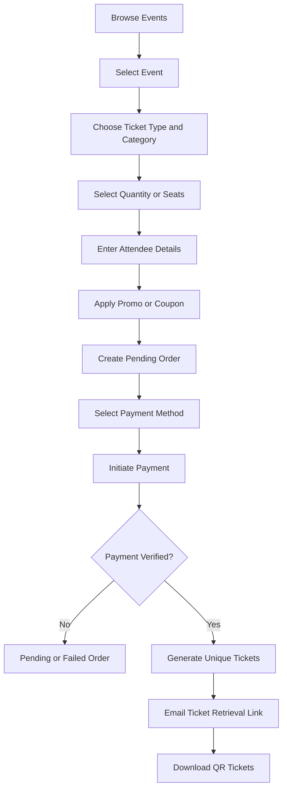
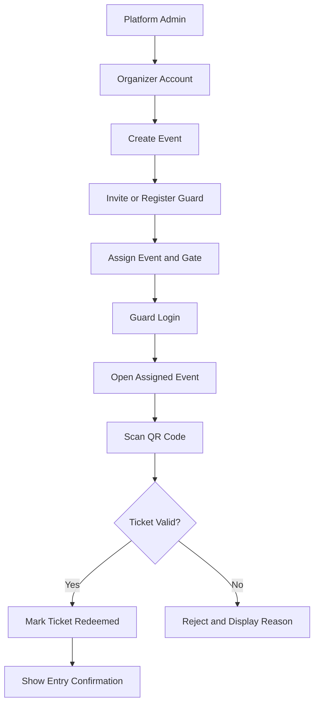
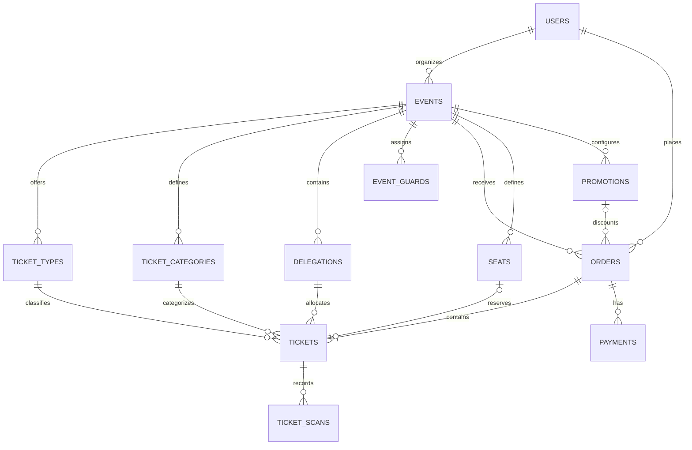

# Event Ticketing & Access Control System — Requirements Review

Your requirements describe a multi-event ticketing platform where event organizers can create events, sell tickets, manage ticket categories, receive payments, and delegate gate access to guards. Attendees purchase tickets online, receive unique QR-coded tickets, and use them for entry validation.

I'd structure this as a centralized event management platform with role-based access control, payment integration, QR ticket generation, and real-time gate validation.

---

## 1. Core system modules

### Event management

Create events, set venues and descriptions, define capacity, configure sales deadlines, and control gate opening and closing times.

### Ticket sales and pricing

Configure ticket types, categories, delegations, pricing, inventory, group purchases, promotions, and optional reserved seating.

### Payments and orders

Support payment-method selection, payment initiation, confirmation, order status, receipts, refunds where applicable, and payment reconciliation.

### Digital tickets and entry validation

Generate a unique QR code per ticket, email a retrieval link, allow ticket downloads, and prevent duplicate entry through server-side validation and redemption.

### Organizer and guard dashboards

Give organizers control over their events, sales, tickets, and assigned staff. Give guards restricted access to the events and gates to which they are assigned.

---

## 2. Recommended ticket purchasing flow

> **Important:** Generate or activate tickets only after the backend verifies successful payment. Do not rely solely on a success message from the browser or payment redirect.

For group purchases, create one order containing multiple tickets, with a distinct ticket ID and QR code for each attendee. Collect individual attendee details when required by the event organizer.

---

## 3. Ticket types versus ticket categories

These should be separate configurations because they represent different things.

| Ticket type | Purpose                                                                  |
| ----------- | ------------------------------------------------------------------------ |
| Early bird  | Discounted tickets available during an early sales period                |
| Normal      | Standard advance-purchase ticket                                         |
| At the gate | Tickets sold at the venue, subject to remaining capacity and gate policy |
| Group       | Tickets purchased together under a group pricing rule                    |
| Promoted    | Promotional allocation or campaign-specific ticket offering              |

| Ticket category | Purpose                                               |
| --------------- | ----------------------------------------------------- |
| VVIP            | Premium access level                                  |
| VIP             | Higher-tier access                                    |
| Media           | Media or press access, potentially requiring approval |

The event organizer should be able to create additional categories, rename them, set prices, assign capacity, and define access privileges.

A **ticket type** describes the sales or pricing rule; a **category** describes the access level or attendee classification. For example, an event could sell Early Bird VIP tickets or Normal VVIP tickets.

Promoted tickets should have explicit eligibility and pricing rules. If they are simply discounts, implement them as a promotion attached to a ticket type rather than a separate category.

---

## 4. Event creation and configuration

An organizer should be able to configure the following for each event.

### Event configuration checklist

**Basic details**

- [ ] Event name, description and images
- [ ] Venue, location and event date
- [ ] Organizer and contact information

**Sales and capacity**

- [ ] Total ticket inventory and sales start/end dates
- [ ] Ticket types, categories, prices and allocations
- [ ] Minimum/maximum tickets per order
- [ ] Promo codes and coupon codes

**Entry controls**

- [ ] Gate opening and closing date/time
- [ ] Permitted entry windows and gate assignments
- [ ] Guard assignments and permissions
- [ ] Cancellation, refund and late-entry policies

**Venue seating**

- [ ] Optional seating plan and seat numbers
- [ ] Seat availability and temporary reservation expiry
- [ ] Prevent duplicate seat allocation

### Delegations and ticket inventory

A delegation can represent a group, department, team, sponsor allocation, or another organizer-defined ticket allocation.

Each delegation should have:

- Delegation name and description.
- Assigned ticket category or categories.
- Ticket quantity and price rules.
- Sales availability and remaining inventory.
- Optional access permissions or assigned gate.

Inventory must be tracked consistently. The system should prevent overselling when several buyers attempt to purchase the last available tickets simultaneously.

For reserved seating, each seat must have a unique event-specific assignment and a state such as available, held, sold, or released.

---

## 5. Ticket retrieval and QR-code security

Recommended flow:

1. After payment confirmation, issue a unique ticket record for every ticket purchased.
2. Generate a QR code containing an opaque, unguessable ticket identifier or signed reference, not the attendee's personal details.
3. Email the purchaser a secure ticket retrieval URL.
4. Let the user access the page and download their ticket or QR code.
5. Display the attendee's name, ticket number, event, category and other required invitation details on the ticket.
6. Allow the ticket holder to retrieve the ticket again through the secure link.

The retrieval URL should use a sufficiently random token, support revocation or expiry where appropriate, and avoid exposing tickets to anyone who guesses an ordinary order ID. The attendee's email can be used as an additional verification factor if needed.

> **Important:** A QR code is not proof of entry by itself. The backend must validate and redeem each ticket atomically to prevent two guards from admitting the same ticket simultaneously.

---

## 6. Roles and permissions

I recommend five roles. This makes the platform easier to manage as more organizers and events join.

| Role                 | Permissions                                                                                             |
| -------------------- | ------------------------------------------------------------------------------------------------------- |
| Platform Admin       | Full rights and privileges across the platform: users, organizers, events, payments, overrides and settings |
| Organizer Staff      | Full control of organizer account: events, pricing, offerings, categories, inventory, delegations, guards, reports |
| Event Owner          | Scoped to assigned events to view, filter, and export guest/attendee data only                          |
| Guard / Gate Officer | Access only assigned events and gates, scan tickets, verify attendee details and view entry results     |
| Attendee / Buyer     | Purchase tickets, retrieve and download tickets, and view their own orders                              |

### How guard account delegation should work

The organizer should not need to give a guard unrestricted access to their dashboard.

Guard permissions should be scoped to the event and, if applicable, the gate they are assigned to. The platform should also record who scanned each ticket and when.

A guard should **not** be able to edit ticket prices, issue tickets, change event capacity, access payment credentials, or view other organizers' events.

---

## 7. Gate access and ticket validation

The guard interface should be optimized for mobile phones or tablets.

| Scan result                     | Action     | Behaviour                                                                                                                  |
| ------------------------------- | ---------- | -------------------------------------------------------------------------------------------------------------------------- |
| **Valid ticket**                | ✅ Admit   | Display attendee details, ticket category, seat or delegation if applicable, and a clear confirmation that entry has been recorded. |
| **Already redeemed**            | ❌ Reject  | Show that the ticket was already used, with the recorded entry time and gate information where authorized.                |
| **Invalid or restricted ticket** | ❌ Reject | Reject tickets that do not exist, have been revoked, are unpaid, belong to another event, or do not meet the event's access rules. |

Reference images: [QR Code Ticketing System](https://images.openai.com/static-rsc-4/cbbmRH-QP_cP98ukhtdMB1ZShQTlUmhtVFjRdP9bvnKOtTSsu8AYzUN_IrdI8rCHfhMqnqQ7V1u732f4x-DCE7y3QXVwgiVe2ETIaZstca_0GrCFD3kqOc5vpdneQ5rWUGrnXtoUlNF_npneFeyAHOYZzPjf9DiWqImDBYWx5FE?purpose=inline) · [KingdomTix - The Future of Faith-Based Ticketing](https://images.openai.com/static-rsc-4/DmCYg2mjVYpyt0Y2fpBo-VPDH1tqq8WilbSNLlMqVYy12y6dTcXzHbgAbYVDlu6wGlnt7ce3NjR8jJ0z88Ak3rVkhEPQdoyzg7ZCpzXy7v1k4TBXyVC74wqg6E9sJ99dS9BGzEbvhg7aEXdDmiGAvPcjpQ-LIIFZU2h7_a03MsQ?purpose=inline)

### Gate opening and closing rules

The event organizer should define the permitted entry window. The backend must enforce it, rather than relying on the guard's device clock.

Consider defining three separate times:

- **Ticket sales deadline:** when ticket purchases stop.
- **Gate opening time:** when ticket validation and entry can begin.
- **Gate closing time:** when new entries stop.

An event's start and end times are separate from these controls. An organizer may permit early entry or keep the gates open after the event begins.

> **Note:** If internet connectivity at the venue is unreliable, consider an offline scanning mode as a later phase. Offline validation requires special handling for synchronization and duplicate scans across multiple devices; it should not be treated as a simple extension of the online scanner.

---

## 8. Payment gateway requirements

Since this platform may serve events in Kenya, I would design the payment layer to support M-Pesa and card payments, with additional methods enabled through configurable gateways.

The system should support:

- Payment initiation and transaction references.
- Gateway callbacks or webhooks.
- Server-side payment verification.
- Pending, successful, failed, cancelled and refunded states.
- Duplicate callback protection and idempotent processing.
- Order totals, discounts, transaction fees and reconciliation.
- Refund handling and an auditable transaction history.

Keep payment processing separate from ticket issuance. A payment gateway callback should be authenticated and verified before an order is marked paid.

---

## 9. Promo codes and coupon codes

These can share the same underlying discount engine, while allowing different campaign rules.

| Configuration    | Example                                               |
| ---------------- | ----------------------------------------------------- |
| Discount type    | Percentage or fixed amount                            |
| Validity         | Start date and expiry date                            |
| Eligible tickets | VIP, Early Bird, or selected categories               |
| Usage limit      | Maximum total redemptions                             |
| Per-user limit   | One use per verified buyer                            |
| Minimum purchase | Minimum quantity or order value                       |
| Restrictions     | Event-specific, organizer-specific or invitation-only |

If promo codes and coupon codes are intended to have different business meanings, define those differences explicitly. Otherwise, a single promotion system is simpler to maintain.

---

## 10. Recommended database structure

For a relational database such as PostgreSQL or MySQL, these are the main entities I would plan for:

Additional tables will likely include event media, ticket retrieval tokens, refunds, audit logs, gate assignments and payment webhook records.

One important modeling decision: distinguish the **order** (the purchase) from individual **tickets**. A single order can contain multiple tickets, each with its own QR code, attendee details, category and redemption state.

---

## 11. Suggested implementation phases

1. **Phase 1 — Foundation:** Authentication, role-based permissions, organizer accounts, event creation and ticket configuration.
2. **Phase 2 — Sales:** Ticket inventory, orders, payment gateway integration, payment verification and ticket issuance.
3. **Phase 3 — Attendee experience:** Email delivery, secure retrieval links, QR generation and ticket downloads.
4. **Phase 4 — Gate management:** Guard assignment, scanner interface, single-use validation, entry logs and event access windows.
5. **Phase 5 — Advanced features:** Reserved seating, delegations, promotions, group ticketing, analytics, refunds and offline scanning.

---

## 12. Decisions to confirm before development

There are a few important business rules that will affect the database, payment integration and security design.

### 1. Platform ownership

- One organization managing its own events
- Multiple organizers using one platform

### 2. Payment methods

- M-Pesa first, with cards later
- M-Pesa and card payments from launch
- Other payment gateway or methods

### 3. Ticket holder details

- Each ticket has its own attendee details
- All tickets initially belong to the purchaser
- Organizer chooses per event

### 4. Seat selection

- Optional, configured per event
- Required for all events
- No reserved seating in the initial release

### 5. Internet at event gates

- Online scanning only for the initial release
- Offline scanning required from launch

My recommendation is to settle these decisions before coding. In particular, if this is a multi-organizer platform, tenant isolation and event-scoped guard permissions should be part of the architecture from day one, not added after the ticketing system is already built.